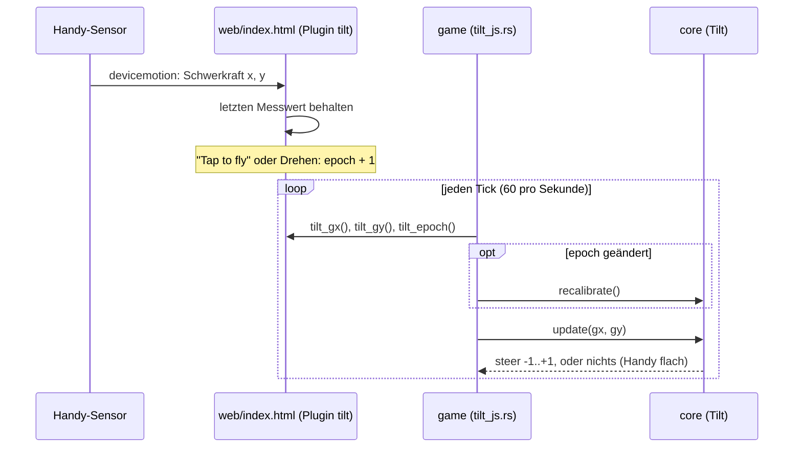
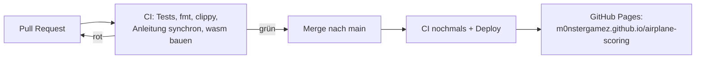

# Projektnotizen

English: [README.md](README.md). Beide Fassungen werden parallel geführt:
Ein Eintrag kommt immer in beide Dateien, im selben Pull Request.

Hier stehen Designentscheide, offene Fragen und alles, was Claude Code
wissen sollte und nicht im Code steht. Halte die Einträge kurz und datiert.

## 2026-10-28
- Gestartet mit der Vorlage airplane-scoring. macroquad fest auf 0.4.16.

## 2026-11-10
- Mobile first, nur **Querformat** (das Handy wird zum Kippen wie ein Lenkrad gehalten).
- Veröffentlicht über GitHub Actions auf GitHub Pages; die gebaute .wasm wird nicht committet.
- Geplant: Kippen über `deviceorientation` (iOS braucht eine Berechtigungsabfrage
  nach einem Tipp; HTTPS nötig), Finger und Tastatur als Ersatz, alles auf
  einen `steer`-Wert in core abgebildet.
- Eingabe: Jedes Gerät ergibt einen `steer` in [-1, 1] (core `input.rs`).
  Finger/Maus = das Flugzeug fliegt auf die Höhe des Fingers; Tasten = Up/W, Down/S.
  Der Finger gewinnt vor den Tasten. Kippen wird eine dritte Quelle.
- Eigenheit von macroquad 0.4.16: `touches()` liefert physische Pixel, Maus und
  Zeichnen logische. Das Spiel teilt Berührungen durch `dpi_scale()`.
- Kippen = das Handy ist das Flugzeug: Dreh es wie ein Lenkrad, rechte
  Seite (Nase) hoch = steigen. Verwendet den Winkel von `devicemotion`
  accelerationIncludingGravity in der x/y-Ebene des Geräts, relativ zu einer
  geraden Haltung, die bei "Tap to fly" und beim Drehen des Handys gemerkt wird. Der relative
  Winkel macht es unabhängig von Querformat links/rechts und vom umgekehrten
  Vorzeichen bei iOS. Totzone 2°, volle Geschwindigkeit ab 25°, unbrauchbar, wenn das Handy flach liegt.
- Brücke JS -> Rust: miniquad-Plugin "tilt" in web/index.html, die Imports
  sind mit #[link(wasm_import_module = "env")] in game/src/tilt_js.rs deklariert
  (wasm-ld braucht das, genau wie bei miniquads eigenen Imports).
- Vorrang: Finger > gedrückte Tasten > Kippen.

- Ton: macroquad-Feature `audio` (quad-snd 0.2.8). Die API in 0.4.16 kann nur
  laden / einmal abspielen / als Schleife / stoppen / Lautstärke setzen: keine Tonhöhe, kein Panorama, kein Ausblenden.
  Darum ist der Motor zwei Schleifen, die core überblendet (`Mix`), und
  Ausblenden heisst: core verschiebt die Lautstärken pro Tick ein wenig
  (`MIX_CHANGE_PER_SECOND`).
- core entscheidet über den Ton, game spielt ihn: `World.mix` (Lautstärken der Schleifen) und
  `World::events()` (Crash, Lightning, Thunder; gültig für einen Tick).
- Das Wetter hat einen Startwert (`World::with_seed`, SplitMix64 in core `rng.rs`); das
  Spiel nimmt ihn von der Uhr. Die ersten 10 s bleibt es trocken, dann Regenphasen von
  20–40 s; Regen >= 0.6 ist ein Gewitter. Den Donner plant core
  0.3–3 s nach seinem Blitz ein, je nach Entfernung.
- Zusammenstoss = das Flugzeug der Spielerin oder des Spielers berührt neu ein anderes Flugzeug:
  1.5 s Absturz ohne Steuerung. Flankengesteuert, also gibt es keinen zweiten
  Zusammenstoss, wenn man sich innerhalb des anderen Flugzeugs wieder fängt.
- Die Tondateien erzeugt `scripts/make-sounds.py` (nur Standardbibliothek,
  deterministisch), committet als Mono-WAV mit 16 Bit und 22050 Hz in `web/sounds/`
  (etwa 600 KB). WAV, weil quad-snd nativ nur WAV/OGG dekodiert und
  ältere iOS-Safari kein OGG können. Zur Laufzeit in einer Coroutine geladen, nicht mit
  `include_bytes!`, damit die wasm klein bleibt (+25 KB für den Ton-Code).
- quad-snd 0.2.8 fehlt `#[link(wasm_import_module = "env")]` bei seinen JS-Imports;
  `.cargo/config.toml` gibt wasm-ld `--import-undefined` mit.
- Browser starten den Ton angehalten. `mq_js_bundle.js` setzt ihn beim
  ersten touchstart/touchend/mousedown/keydown fort und hört dann auf zu horchen;
  Schleifen, die vorher gestartet wurden, beginnen dann zu spielen. Chrome meldet
  "AudioContext was not allowed to start", bis es so weit ist (in
  `scripts/shot.sh` ausgefiltert).
- Das iPhone war stumm (2026-11-10): Auf einem Handy ist das erste Ereignis
  touchstart, und Safari zählt nur touchend/click als Benutzergeste, also
  wurde das einzige resume() des Bundles endgültig abgelehnt. Chrome zählt
  touchstart, darum zeigten Tests auf dem Computer und auf Android das nie.
  Behoben in `web/index.html` (vor dem Bundle, das ungepatcht bleibt):
  jeden AudioContext merken und bei jedem touchend, click und keydown
  fortsetzen, immer (fängt auch Unterbrechungen durch iOS auf). Geprüft
  in Chrome mit nachgebildeter Safari-Regel (resume() während touchstart
  abgelehnt): Ohne den Fix bleibt der Kontext des Spiels "suspended",
  mit ihm "running". Hier nicht auf einem echten iPhone prüfbar.
- Stummschalten: Das gehört der Seite (Knopf `#mute`, localStorage
  `airplane-scoring.muted`, Plugin "sound"); die Taste M geht über Rust zum
  selben Schalter. Der Lautlos-Modus von iOS schaltet Web Audio stumm; dagegen können wir nichts tun.
- Nicht mit dem Ohr geprüft: Die Töne wurden als Spektrogramme und durch
  Aufzeichnen der Web-Audio-Aufrufe in Headless Chrome geprüft, nie angehört.

- Level-Hintergründe: Foto -> von Hand nachgezeichnetes SVG -> PNG. Die Fotos liegen in
  `art/levels/levelN/photo.*` und sind gitignored (öffentliches Repo, Handyfotos
  enthalten GPS und zeigen vielleicht Personen). Das SVG (eigene Arbeit, von unserem eigenen
  Foto nachgezeichnet) ist die Quelle; `scripts/make-backgrounds.sh` rendert es mit
  rsvg-convert in doppelter Grösse (3200x1480) nach `web/levels/levelN.png` und schlägt fehl, wenn
  linker und rechter Rand nicht zusammenpassen. Die PNGs werden wie die
  Tondateien committet; CI braucht kein rsvg.
- macroquad 0.4.16 kann kein SVG laden; resvg dazuzunehmen würde viel mehr wasm
  kosten als PNG. PNGs laden zieht den PNG-Decoder mit: wasm 489 KB -> 632 KB
  (roh, vor wasm-opt). level1.png ist etwa 530 KB und wird wie die Töne in einer
  Coroutine geladen; bis es da ist, zeigt das Spiel den alten einfarbigen Himmel.
- Scrollen: core `scroll_distance(ticks)` und `background_x(distance,
  tile_width)` (`scenery.rs`); aus der Zahl der Ticks abgeleitet, also kein neuer
  Zustand in `World`. Es gibt nur Level 1; ein Level wählen kommt später.
  Das SVG ist in Ebenen-Gruppen aufgeteilt, damit später Parallaxe möglich ist.

- Startanzeige am Computer: Auch Computer bekommen jetzt die Startanzeige
  ("Click to fly", Enter/Space) mit den Tasten und einem QR-Code zur Live-URL.
  Auch dort schaltet der Klick den Ton frei. Das QR-SVG erzeugt
  `scripts/make-qr.py`, ein kleiner Encoder nur mit der Standardbibliothek (Byte-Modus, Stufe M,
  v1-6), weil standardmässig kein QR-Werkzeug installiert ist; geprüft durch Dekodieren
  mit macOS CoreImage (CIDetector) für v1-v6 und aus dem echten Screenshot.
  Handys zeigen ihn auch, kleiner, mit der Beschriftung "Friends scan this to fly too"
  (teile das Spiel mit den Leuten um dich herum).
- Deutsch: Die Startanzeige des Spiels heisst «Startanzeige», weil
  «Startbildschirm» schon den Startbildschirm von Android bedeutet.

## 2026-11-11

- Hintergrund für Level 2: Sandstrand bei Sonnenuntergang, ruhige Bucht, dunkle Landzungen
  links und rechts, ferne Inseln dazwischen (`art/levels/level2/`, von
  unserem eigenen Foto nachgezeichnet, gerendert nach `web/levels/level2.png`). Gleiche Grösse und
  Ebenen-Regeln wie Level 1. Das Spiel verwendet ihn noch nicht: Es gibt noch keinen Weg,
  ein Level zu wählen oder zu erreichen, also wartet er nur in `web/levels/`. Im Spiel geprüft,
  indem er lokal anstelle von Level 1 gezeichnet wurde.
- Die Projektnotizen gibt es jetzt auch auf Deutsch (`docs/README.de.md`),
  parallel geführt wie die Anleitung; `scripts/check-docs.sh` vergleicht den Aufbau.

## 2026-11-12

- Levelwechsel: Alle `LEVEL_SECONDS` (60 s) beginnt das nächste Level,
  nach dem letzten wieder Level 1 (core `level.rs`, `level_view`). Die
  nächste Landschaft wird in den letzten `LEVEL_FADE_SECONDS` (3 s)
  eingeblendet, und «Level N» steht 2.5 s lang da. Gewählt statt Punkten
  (gibt es noch nicht) und statt eines Menüs (stört am Handy); kommen
  Punkte, ändert sich nur der Auslöser. Aus den Ticks und dem Start-Level
  abgeleitet, also kein neuer Zustand in `World`. Alle Level-Bilder laden
  beim Start. `?level=2` (Plugin "page", `LEVEL=2 scripts/shot.sh`)
  startet in Level 2. Headless Chrome lässt das Spiel kaum laufen, darum
  wurde die Überblendung lokal mit 1 s langen Levels geprüft.
- Das Spiel steht still bis «Tap to fly» / «Click to fly» / `?play`.
  Vorher lief die Uhr ab dem Laden der Seite: Wer lange auf der
  Startanzeige wartete, verpasste die Anzeige «Level 1», die trockenen
  ersten 10 s, sogar ganze Levels. core `Clock` (`clock.rs`) macht jetzt
  aus der Zeit pro Bild Ticks und gibt vor dem Start keine, spart auch
  keine auf; die Seite meldet den Start über das Plugin "page"
  (`page_js.rs`, ersetzt "level"). Geprüft mit lokal durchsichtig
  gemachter Startanzeige: dahinter `ticks: 0`.
- Aufgeräumter Bildschirm: Der grüne Ball (das «andere Flugzeug» aus der
  Vorlage, erzeugt in `main.rs`) und der Text «hello plane»
  (`World::greeting`, entfernt) sind weg. Darum gibt es vorerst keinen
  Zusammenstoss; die Regeln dafür bleiben mit ihren Tests in core, für
  die kommenden Hindernisse.
- Töne für Levels: eine kurze, aufsteigende Melodie (C-E-G-C,
  `new-level.wav`), wenn ein neues Level beginnt (`Event::NewLevel` aus
  `World::tick`; `World` merkt sich jetzt `start_level` und bietet
  `levels()`), und eine Strand-Schleife für Level 2 (Wellen und Möwen,
  `beach.wav`, 8 s, 344 KB), deren Lautstärke `BEACH_VOLUME` mal
  `LevelView::presence(BEACH_LEVEL)` ist, also mit der Landschaft
  ein- und ausblendet. Beide erzeugt `make-sounds.py`; als Zahlen geprüft
  (nahtlose Schleife, zwei Wellen pro Schleife) und lokal angehört: gut.
- Möwen am Strand (core `gulls.rs`): die ersten Hindernisse. Solange
  Level 2 ganz zu sehen ist, taucht alle 1.2–2.8 s eine Möwe auf (die
  erste nach 2.5 s, während «Level 2» steht): 45 % von rechts, 25 % von
  hinten (langsamer und rufen immer, damit man sie kommen hört), 30 % vom
  Sand aus nach oben. Sie wippen beim Flügelschlagen; eine berühren ist
  der übliche Zusammenstoss. Mit eigenem Zufallsstrom, damit sie das
  Wetter nicht verändern. Die Möwenrufe sind aus `beach.wav` in
  `gull-call.wav` gewandert und spielen bei `Event::GullCall`, also
  gehört jeder Ruf zu einer sichtbaren Möwe. Die Möwen wurden auf
  Screenshots geprüft, bei denen sie im Bild starteten (lokale Änderung,
  nicht committet).
- Kein Regen am Strand: `Weather::tick` bekommt `max_rain` = wie viel von
  Level 1 zu sehen ist; bei 0 gibt es kein Gewitter, und Donner unterwegs
  fällt weg. Die Phasen laufen darunter weiter, also hat Level 1 sein
  Wetter wieder. Grund: Regen passt nicht zur Sonnenuntergangsstimmung.
- Screenshots liefen viel zu kurz (Fix vom 2026-11-11, heute gemergt):
  `scripts/shot.sh out.png 5000` zeigte immer etwa 17 Ticks, egal wie
  lange, weil Chromes `--virtual-time-budget` kaum Animationsbilder
  erzeugt und die Spielschleife darum fast nicht lief.
  `scripts/cdp_shot.py` steuert Headless Chrome jetzt über das
  DevTools-Protokoll (nur Standardbibliothek, kleiner WebSocket-Client):
  Seite laden, echte Zeit warten, aufnehmen. 8000 ms ergeben jetzt etwa
  410 Ticks. Ein einfaches `--timeout` gab stattdessen eine schwarze Fläche.
- `scripts/serve.sh` überspringt `socket.getfqdn()` in
  `HTTPServer.server_bind`: Mit Homebrews Python 3.14 dauerte diese
  Rückwärtsabfrage von 127.0.0.1 auf einem Mac 35 s, und jeder Screenshot
  und jeder Start von `scripts/dev.sh` wartete darauf.
- Leben (gewünscht, jetzt wo es Hindernisse gibt): 3 pro Flug (`LIVES`),
  oben rechts als kleine Flugzeuge, links vom Lautsprecher-Knopf. Ein Zusammenstoss kostet eines; nach
  dem Erholen blinkt das Flugzeug und ist 2 s geschützt (`SAFE_SECONDS`),
  so kostet eine Möwengruppe nur ein Leben. Beim letzten Zusammenstoss
  fällt das Flugzeug, dann kommt `Event::GameOver`; die Welt steht still,
  der Ton wird ausgeblendet, und «Game over» zeigt den Score. Nach 1 s
  (`RESTART_WAIT_SECONDS`, damit ein Finger, der noch steuert, es nicht
  überspringt) startet ein Tipp, Klick oder Enter eine neue Welt. Alle
  Entscheide (3 Leben, kleine Flugzeuge, Neustart per Tipp, Schutzzeit)
  wurden so gewünscht. Geprüft mit Screenshots; den
  für «Game over» mit lokal auf 1 gesetztem `LIVES` (nicht committet).
- Score: 2 Punkte pro geflogene Sekunde (`SCORE_PER_SECOND`), berechnet
  aus den Ticks (`World::score`), darum bleibt er bei «Game over» stehen.
  Oben in der Mitte das ganze Spiel lang zu sehen und bei «Game over» als
  Ergebnis (dort ersetzt er die Flugzeit). Bereit für den Highscore, der
  als Nächstes kommt.
- Bademeistertürme in Level 1 wurden gebaut und ohne Merge verworfen
  (PR #17): Alle 2–4.5 s ein Turm hintereinander wirkte unlogisch.
- Heissluftballone (core `balloons.rs`): die Hindernisse von Level 1,
  gewählt, nachdem die Bademeistertürme verworfen wurden. Geplant sind
  etwa 50 Levels mit Level 1 als einfachstem, darum sind die Ballone
  gross, langsam und selten: alle 5–8 s einer (der erste nach 2.5 s), von
  rechts in der unteren Hälfte des Himmels, etwas schneller nach links als
  die Landschaft, steigend mit 8–25 px/s. Getroffen wird man von der Hülle
  (Radius 30 px) und vom Korb. Ein neuer Brenner-Ton
  (`balloon-burner.wav`, gefiltertes Rauschen mit Flattern) spielt, wenn
  einer auftaucht. Eigener Zufallsstrom. Geprüft mit einem Screenshot.
  Für später: Die Möwen in Level 2 (alle 1.2–2.8 s) sind für das
  zweitleichteste Level streng.
- Ballone kommen auf drei Arten (`BalloonWay`), gewünscht nach dem
  Ausprobieren: 40 % steigen aus dem unteren Himmel auf, 30 % kommen
  waagrecht auf der Höhe, auf der das Flugzeug beim Auftauchen fliegt
  (frontal), 30 % sinken aus dem oberen Himmel zum Landen. Ein Ballon auf
  Flugzeughöhe bleibt ganz im Bild.
- Auch in Level 1 kein Regen und kein Gewitter mehr: Regen passt nicht zu
  den Ballonen. `RAINY_LEVELS` (core `level.rs`) listet die Levels, in
  denen es regnen darf, im Moment leer; `LevelView::rain_room` begrenzt
  das Wetter damit und ersetzt die Begrenzung nur für den Strand. Das
  Wetter läuft weiter, bereit für ein späteres Level.
- Gleiche Proportionen auf jedem Bildschirm: Die Landschaft war auf die
  Bildschirmhöhe skaliert, Flugzeug, Hindernisse, Trefferflächen und
  Geschwindigkeiten aber in festen Pixeln. Auf einem 900 px hohen
  Computerfenster wirkte das Flugzeug winzig, und das Spiel war leichter
  als auf dem Handy. Jetzt gilt jede Pixel-Konstante für ein Handy quer
  (`DESIGN_HEIGHT` = 390), und core multipliziert sie mit `Bounds::scale`
  (Höhe / 390): Bewegung, Treffer, Auftauchen, das Abbremsen beim Finger
  (`World::steer_toward`) und die Scroll-Distanz. Das game-Crate zeichnet
  alles (Flugzeug, Möwen, Ballone, Score, Leben, Texte) im selben
  Massstab. Geprüft mit Screenshots in 844×390 und 1440×900
  nebeneinander. Ein Bildschirm ist zum Fliegen nie mehr zu klein, ausser
  er hat gar keine Höhe. Der Lautsprecher-Knopf bleibt fest 44 px (HTML).
- Mehr für Level 1, nach dem Ausprobieren: Holzhütten in der Wiese vorne
  (core `huts.rs`, 3 Arten, alle 4–7 s eine, niedrig: nur im untersten
  Viertel des Bildschirms; Trefferfläche bis zum unteren Rand wie bei
  den verworfenen Türmen). Steigende Ballone stehen jetzt auf einer
  Startrampe (`Pad`), kommen mit ihr herein und heben bei 60–85 % der
  Bildschirmbreite ab; der Brenner faucht beim Abheben. Rampen sind flach
  und harmlos; Hütten und Rampen warten aufeinander, damit sie sich nie
  überlappen. Flugzeug und Hindernisse sind 20 % kleiner
  (`OBJECT_SIZE` = 0.8 über `Bounds::size`; Geschwindigkeiten gleich),
  damit mehr Platz zum Ausweichen bleibt. Geprüft mit Screenshots.
- Level 1, dritte Runde, nach dem Ausprobieren: In eine Startrampe zu
  fliegen kostet ein Leben (Trefferfläche bis zum unteren Rand, wie bei
  Hütten). Ballone landen auch auf Rampen: Ein landender Ballon kommt
  hoch genau über seiner Rampe herein (ohne Wind) und sinkt so, dass er
  bei 30–55 % der Bildschirmbreite aufsetzt; dann zieht er mit ihr
  davon. Jetzt vier Arten (abheben, landen, auf Flugzeughöhe, vorbei
  sinken), verteilt in gemischten Vierer-Runden und nie zweimal dieselbe
  Art hintereinander: Beim Spielen kamen nach den ersten Ballonen lange
  nur Starts von der Rampe, was eine reine Zufallswahl zulässt. Flugzeug
  und Hindernisse nochmals 20 % kleiner (`OBJECT_SIZE` 0.8 → 0.64).
  Geprüft mit Screenshots.
- Flugzeug und fliegende Hindernisse nochmals 20 % kleiner
  (`OBJECT_SIZE` 0.64 → 0.512). Hütten wirklich gross gemacht und nach
  vorne gerückt, damit sie als Vordergrund wirken: 96–124 × 80–104 px,
  stehend auf 98 % der Bildschirmhöhe, skaliert nur mit `Bounds::scale`
  (sie gehören zur Landschaft, nicht zu dem, was fliegt), und vor Rampen
  und Ballonen gezeichnet.
- Nochmals 20 % kleiner (`OBJECT_SIZE` 0.512 → 0.41). Mit grossen Hütten
  vorne wirkten winzige Ballone auf den Rampen falsch, darum hat das
  Spiel jetzt Tiefe (`Bounds::depth(y)`): Flugzeug, Ballone und Möwen
  sind ab `BALLOON_FAR_HEIGHT` (55 % der Höhe) aufwärts `OBJECT_SIZE`
  gross und wachsen gleichmässig bis zur vollen Grösse eines Ballons auf
  der Rampe. Die Startrampen sind mit den Hütten in den Vordergrund
  gerückt (gleiche Bodenlinie, `Bounds::scale`). Das Flugzeug folgt wie
  gewünscht derselben Regel, samt Trefferfläche, darum ist tief fliegen
  riskanter. Screenshots: kleines Flugzeug oben, grosses am Boden, ein
  grosser Ballon auf seiner Rampe.
- Tiefe nach dem Ausprobieren angepasst: kein flacher Teil mehr. Die
  Grössen nehmen über die ganze Höhe gleichmässig ab, von voller Grösse
  bei einem Ballon auf der Rampe bis `OBJECT_SIZE` ganz oben
  (`BALLOON_FAR_HEIGHT` entfernt), so wird das Flugzeug bis ganz oben
  immer kleiner. Das Flugzeug wächst nahe am Boden stärker als die
  Ballone: bis `PLANE_NEAR_SIZE` = 1.5 (`Bounds::plane_depth`); die
  Ballone bleiben dort bei 1, wie es gefiel.
- Zusammenstoss nur noch bei echter Berührung, nachdem ein Leben haarscharf
  neben einer Hütte verloren ging. Vorher war das Flugzeug ein Kreis (der
  über und unter den schmalen Rumpf reichte), Hütten und Rampen waren
  Rechtecke bis zum unteren Rand (samt den leeren Ecken neben dem Dach),
  Ballone und Möwen Kreise. Jetzt hat core konvexe Vielecke (`shape.rs`,
  Trennachsen-Test) mit genau den Punkten, die das Spiel zeichnet:
  Flugzeug-Rumpf, Nase, Flügel, Heck, Cockpit; Hüttenwände, Dachdreieck
  und Traufe; Rampendeck und Beine; Ballonhülle (Ellipse mit 16 Ecken),
  Verjüngung, Öffnung, Seile, Korb, Rand; Möwenkörper, Kopf, Schnabel und
  die schlagenden Flügel. `PLAYER_HIT_RADIUS` und `GULL_RADIUS` sind weg.
  Tests prüfen knappe Vorbeiflüge mit 2-px-Quadraten.
- Triebwerkston: eine Turbine statt des Propeller-Tuckerns, weil das
  Flugzeug als Düsenflugzeug gezeichnet ist. `scripts/make-sounds.py`
  `turbine()`: Pfeifen des Verdichters (zwei Töne 3 Hz auseinander für
  ein Schimmern, dazu ein Oberton), ein Brummen bei 140 Hz und
  gefiltertes Rauschen für den Abgasstrahl; Vollgas hat ein höheres
  Pfeifen (1800 statt 1400 Hz), helleres Rauschen und Zischen.
  Schleifen von 2 s mit ganzen Schwingungen, darum schliessen sie
  nahtlos. Das Triebwerk wird auch mit der Entfernung leiser:
  `Mix::target` bekommt die Nähe des Flugzeugs (`Bounds::nearness`,
  dieselbe 0..1, die seine Grösse steuert), von 30 %
  (`ENGINE_FAR_VOLUME`) ganz oben bis voll nahe am Boden. Die
  Tondateien wurden mit Zahlen geprüft (Nahtstelle, Lautstärke).

## Konzepte

### Kippen: vom Sensor zur Steuerung

Die JS-Seite speichert nur Zahlen; die Rust-Hülle holt sie nur ab. Alle
Entscheide (gerade Haltung, Glättung, Totzone) stehen in `core/src/tilt.rs`
mit Tests.

### Bauen und veröffentlichen

