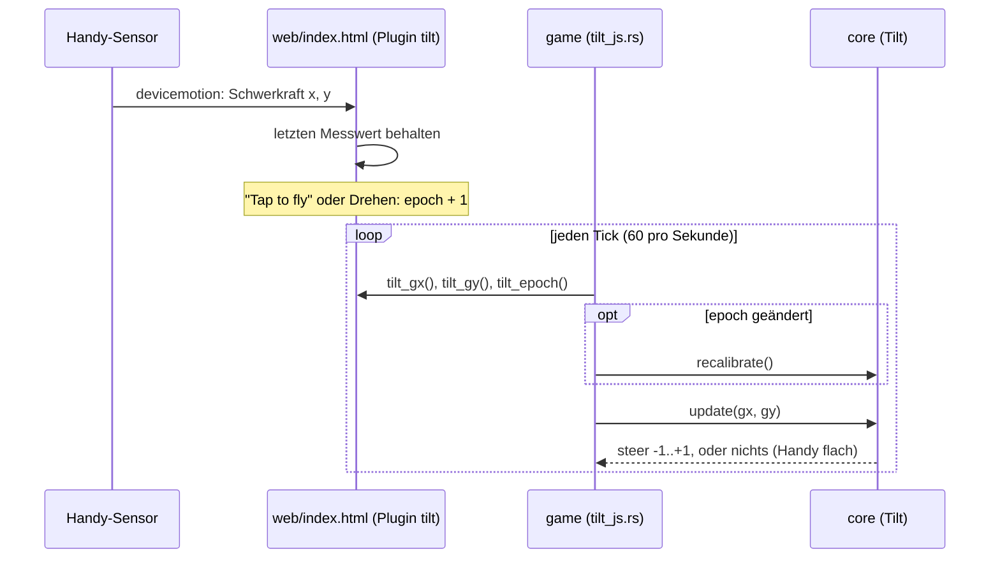
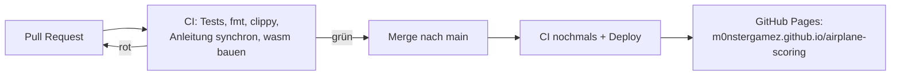

# Projektnotizen

English: [README.md](README.md). Beide Fassungen werden parallel geführt:
Ein Eintrag kommt immer in beide Dateien, im selben Pull Request.

Hier stehen Designentscheide, offene Fragen und alles, was Claude Code
wissen sollte und nicht im Code steht. Halte die Einträge kurz und datiert.

## 2026-10-28
- Gestartet mit der Vorlage airplane-scoring. macroquad fest auf 0.4.16.

## 2026-11-10
- Mobile first, nur **Querformat** (das Handy wird zum Kippen wie ein Lenkrad gehalten).
- Veröffentlicht über GitHub Actions auf GitHub Pages; die gebaute .wasm wird nicht committet.
- Geplant: Kippen über `deviceorientation` (iOS braucht eine Berechtigungsabfrage
  nach einem Tipp; HTTPS nötig), Finger und Tastatur als Ersatz, alles auf
  einen `steer`-Wert in core abgebildet.
- Eingabe: Jedes Gerät ergibt einen `steer` in [-1, 1] (core `input.rs`).
  Finger/Maus = das Flugzeug fliegt auf die Höhe des Fingers; Tasten = Up/W, Down/S.
  Der Finger gewinnt vor den Tasten. Kippen wird eine dritte Quelle.
- Eigenheit von macroquad 0.4.16: `touches()` liefert physische Pixel, Maus und
  Zeichnen logische. Das Spiel teilt Berührungen durch `dpi_scale()`.
- Kippen = das Handy ist das Flugzeug: Dreh es wie ein Lenkrad, rechte
  Seite (Nase) hoch = steigen. Verwendet den Winkel von `devicemotion`
  accelerationIncludingGravity in der x/y-Ebene des Geräts, relativ zu einer
  geraden Haltung, die bei "Tap to fly" und beim Drehen des Handys gemerkt wird. Der relative
  Winkel macht es unabhängig von Querformat links/rechts und vom umgekehrten
  Vorzeichen bei iOS. Totzone 2°, volle Geschwindigkeit ab 25°, unbrauchbar, wenn das Handy flach liegt.
- Brücke JS -> Rust: miniquad-Plugin "tilt" in web/index.html, die Imports
  sind mit #[link(wasm_import_module = "env")] in game/src/tilt_js.rs deklariert
  (wasm-ld braucht das, genau wie bei miniquads eigenen Imports).
- Vorrang: Finger > gedrückte Tasten > Kippen.

- Ton: macroquad-Feature `audio` (quad-snd 0.2.8). Die API in 0.4.16 kann nur
  laden / einmal abspielen / als Schleife / stoppen / Lautstärke setzen: keine Tonhöhe, kein Panorama, kein Ausblenden.
  Darum ist der Motor zwei Schleifen, die core überblendet (`Mix`), und
  Ausblenden heisst: core verschiebt die Lautstärken pro Tick ein wenig
  (`MIX_CHANGE_PER_SECOND`).
- core entscheidet über den Ton, game spielt ihn: `World.mix` (Lautstärken der Schleifen) und
  `World::events()` (Crash, Lightning, Thunder; gültig für einen Tick).
- Das Wetter hat einen Startwert (`World::with_seed`, SplitMix64 in core `rng.rs`); das
  Spiel nimmt ihn von der Uhr. Die ersten 10 s bleibt es trocken, dann Regenphasen von
  20–40 s; Regen >= 0.6 ist ein Gewitter. Den Donner plant core
  0.3–3 s nach seinem Blitz ein, je nach Entfernung.
- Zusammenstoss = das Flugzeug der Spielerin oder des Spielers berührt neu ein anderes Flugzeug:
  1.5 s Absturz ohne Steuerung. Flankengesteuert, also gibt es keinen zweiten
  Zusammenstoss, wenn man sich innerhalb des anderen Flugzeugs wieder fängt.
- Die Tondateien erzeugt `scripts/make-sounds.py` (nur Standardbibliothek,
  deterministisch), committet als Mono-WAV mit 16 Bit und 22050 Hz in `web/sounds/`
  (etwa 600 KB). WAV, weil quad-snd nativ nur WAV/OGG dekodiert und
  ältere iOS-Safari kein OGG können. Zur Laufzeit in einer Coroutine geladen, nicht mit
  `include_bytes!`, damit die wasm klein bleibt (+25 KB für den Ton-Code).
- quad-snd 0.2.8 fehlt `#[link(wasm_import_module = "env")]` bei seinen JS-Imports;
  `.cargo/config.toml` gibt wasm-ld `--import-undefined` mit.
- Browser starten den Ton angehalten. `mq_js_bundle.js` setzt ihn beim
  ersten touchstart/touchend/mousedown/keydown fort und hört dann auf zu horchen;
  Schleifen, die vorher gestartet wurden, beginnen dann zu spielen. Chrome meldet
  "AudioContext was not allowed to start", bis es so weit ist (in
  `scripts/shot.sh` ausgefiltert).
- Das iPhone war stumm (2026-11-10): Auf einem Handy ist das erste Ereignis
  touchstart, und Safari zählt nur touchend/click als Benutzergeste, also
  wurde das einzige resume() des Bundles endgültig abgelehnt. Chrome zählt
  touchstart, darum zeigten Tests auf dem Computer und auf Android das nie.
  Behoben in `web/index.html` (vor dem Bundle, das ungepatcht bleibt):
  jeden AudioContext merken und bei jedem touchend, click und keydown
  fortsetzen, immer (fängt auch Unterbrechungen durch iOS auf). Geprüft
  in Chrome mit nachgebildeter Safari-Regel (resume() während touchstart
  abgelehnt): Ohne den Fix bleibt der Kontext des Spiels "suspended",
  mit ihm "running". Hier nicht auf einem echten iPhone prüfbar.
- Stummschalten: Das gehört der Seite (Knopf `#mute`, localStorage
  `airplane-scoring.muted`, Plugin "sound"); die Taste M geht über Rust zum
  selben Schalter. Der Lautlos-Modus von iOS schaltet Web Audio stumm; dagegen können wir nichts tun.
- Nicht mit dem Ohr geprüft: Die Töne wurden als Spektrogramme und durch
  Aufzeichnen der Web-Audio-Aufrufe in Headless Chrome geprüft, nie angehört.

- Level-Hintergründe: Foto -> von Hand nachgezeichnetes SVG -> PNG. Die Fotos liegen in
  `art/levels/levelN/photo.*` und sind gitignored (öffentliches Repo, Handyfotos
  enthalten GPS und zeigen vielleicht Personen). Das SVG (eigene Arbeit, von unserem eigenen
  Foto nachgezeichnet) ist die Quelle; `scripts/make-backgrounds.sh` rendert es mit
  rsvg-convert in doppelter Grösse (3200x1480) nach `web/levels/levelN.png` und schlägt fehl, wenn
  linker und rechter Rand nicht zusammenpassen. Die PNGs werden wie die
  Tondateien committet; CI braucht kein rsvg.
- macroquad 0.4.16 kann kein SVG laden; resvg dazuzunehmen würde viel mehr wasm
  kosten als PNG. PNGs laden zieht den PNG-Decoder mit: wasm 489 KB -> 632 KB
  (roh, vor wasm-opt). level1.png ist etwa 530 KB und wird wie die Töne in einer
  Coroutine geladen; bis es da ist, zeigt das Spiel den alten einfarbigen Himmel.
- Scrollen: core `scroll_distance(ticks)` und `background_x(distance,
  tile_width)` (`scenery.rs`); aus der Zahl der Ticks abgeleitet, also kein neuer
  Zustand in `World`. Es gibt nur Level 1; ein Level wählen kommt später.
  Das SVG ist in Ebenen-Gruppen aufgeteilt, damit später Parallaxe möglich ist.

- Startanzeige am Computer: Auch Computer bekommen jetzt die Startanzeige
  ("Click to fly", Enter/Space) mit den Tasten und einem QR-Code zur Live-URL.
  Auch dort schaltet der Klick den Ton frei. Das QR-SVG erzeugt
  `scripts/make-qr.py`, ein kleiner Encoder nur mit der Standardbibliothek (Byte-Modus, Stufe M,
  v1-6), weil standardmässig kein QR-Werkzeug installiert ist; geprüft durch Dekodieren
  mit macOS CoreImage (CIDetector) für v1-v6 und aus dem echten Screenshot.
  Handys zeigen ihn auch, kleiner, mit der Beschriftung "Friends scan this to fly too"
  (teile das Spiel mit den Leuten um dich herum).
- Deutsch: Die Startanzeige des Spiels heisst «Startanzeige», weil
  «Startbildschirm» schon den Startbildschirm von Android bedeutet.

## 2026-11-11

- Hintergrund für Level 2: Sandstrand bei Sonnenuntergang, ruhige Bucht, dunkle Landzungen
  links und rechts, ferne Inseln dazwischen (`art/levels/level2/`, von
  unserem eigenen Foto nachgezeichnet, gerendert nach `web/levels/level2.png`). Gleiche Grösse und
  Ebenen-Regeln wie Level 1. Das Spiel verwendet ihn noch nicht: Es gibt noch keinen Weg,
  ein Level zu wählen oder zu erreichen, also wartet er nur in `web/levels/`. Im Spiel geprüft,
  indem er lokal anstelle von Level 1 gezeichnet wurde.
- Die Projektnotizen gibt es jetzt auch auf Deutsch (`docs/README.de.md`),
  parallel geführt wie die Anleitung; `scripts/check-docs.sh` vergleicht den Aufbau.

## 2026-11-12

- Levelwechsel: Alle `LEVEL_SECONDS` (60 s) beginnt das nächste Level,
  nach dem letzten wieder Level 1 (core `level.rs`, `level_view`). Die
  nächste Landschaft wird in den letzten `LEVEL_FADE_SECONDS` (3 s)
  eingeblendet, und «Level N» steht 2.5 s lang da. Gewählt statt Punkten
  (gibt es noch nicht) und statt eines Menüs (stört am Handy); kommen
  Punkte, ändert sich nur der Auslöser. Aus den Ticks und dem Start-Level
  abgeleitet, also kein neuer Zustand in `World`. Alle Level-Bilder laden
  beim Start. `?level=2` (Plugin "page", `LEVEL=2 scripts/shot.sh`)
  startet in Level 2. Headless Chrome lässt das Spiel kaum laufen, darum
  wurde die Überblendung lokal mit 1 s langen Levels geprüft.
- Das Spiel steht still bis «Tap to fly» / «Click to fly» / `?play`.
  Vorher lief die Uhr ab dem Laden der Seite: Wer lange auf der
  Startanzeige wartete, verpasste die Anzeige «Level 1», die trockenen
  ersten 10 s, sogar ganze Levels. core `Clock` (`clock.rs`) macht jetzt
  aus der Zeit pro Bild Ticks und gibt vor dem Start keine, spart auch
  keine auf; die Seite meldet den Start über das Plugin "page"
  (`page_js.rs`, ersetzt "level"). Geprüft mit lokal durchsichtig
  gemachter Startanzeige: dahinter `ticks: 0`.
- Aufgeräumter Bildschirm: Der grüne Ball (das «andere Flugzeug» aus der
  Vorlage, erzeugt in `main.rs`) und der Text «hello plane»
  (`World::greeting`, entfernt) sind weg. Darum gibt es vorerst keinen
  Zusammenstoss; die Regeln dafür bleiben mit ihren Tests in core, für
  die kommenden Hindernisse.
- Töne für Levels: eine kurze, aufsteigende Melodie (C-E-G-C,
  `new-level.wav`), wenn ein neues Level beginnt (`Event::NewLevel` aus
  `World::tick`; `World` merkt sich jetzt `start_level` und bietet
  `levels()`), und eine Strand-Schleife für Level 2 (Wellen und Möwen,
  `beach.wav`, 8 s, 344 KB), deren Lautstärke `BEACH_VOLUME` mal
  `LevelView::presence(BEACH_LEVEL)` ist, also mit der Landschaft
  ein- und ausblendet. Beide erzeugt `make-sounds.py`; als Zahlen geprüft
  (nahtlose Schleife, zwei Wellen pro Schleife) und lokal angehört: gut.
- Möwen am Strand (core `gulls.rs`): die ersten Hindernisse. Solange
  Level 2 ganz zu sehen ist, taucht alle 1.2–2.8 s eine Möwe auf (die
  erste nach 2.5 s, während «Level 2» steht): 45 % von rechts, 25 % von
  hinten (langsamer und rufen immer, damit man sie kommen hört), 30 % vom
  Sand aus nach oben. Sie wippen beim Flügelschlagen; eine berühren ist
  der übliche Zusammenstoss. Mit eigenem Zufallsstrom, damit sie das
  Wetter nicht verändern. Die Möwenrufe sind aus `beach.wav` in
  `gull-call.wav` gewandert und spielen bei `Event::GullCall`, also
  gehört jeder Ruf zu einer sichtbaren Möwe. Die Möwen wurden auf
  Screenshots geprüft, bei denen sie im Bild starteten (lokale Änderung,
  nicht committet).
- Kein Regen am Strand: `Weather::tick` bekommt `max_rain` = wie viel von
  Level 1 zu sehen ist; bei 0 gibt es kein Gewitter, und Donner unterwegs
  fällt weg. Die Phasen laufen darunter weiter, also hat Level 1 sein
  Wetter wieder. Grund: Regen passt nicht zur Sonnenuntergangsstimmung.
- Screenshots liefen viel zu kurz (Fix vom 2026-11-11, heute gemergt):
  `scripts/shot.sh out.png 5000` zeigte immer etwa 17 Ticks, egal wie
  lange, weil Chromes `--virtual-time-budget` kaum Animationsbilder
  erzeugt und die Spielschleife darum fast nicht lief.
  `scripts/cdp_shot.py` steuert Headless Chrome jetzt über das
  DevTools-Protokoll (nur Standardbibliothek, kleiner WebSocket-Client):
  Seite laden, echte Zeit warten, aufnehmen. 8000 ms ergeben jetzt etwa
  410 Ticks. Ein einfaches `--timeout` gab stattdessen eine schwarze Fläche.
- `scripts/serve.sh` überspringt `socket.getfqdn()` in
  `HTTPServer.server_bind`: Mit Homebrews Python 3.14 dauerte diese
  Rückwärtsabfrage von 127.0.0.1 auf einem Mac 35 s, und jeder Screenshot
  und jeder Start von `scripts/dev.sh` wartete darauf.
- Leben (gewünscht, jetzt wo es Hindernisse gibt): 3 pro Flug (`LIVES`),
  oben rechts als kleine Flugzeuge, links vom Lautsprecher-Knopf. Ein Zusammenstoss kostet eines; nach
  dem Erholen blinkt das Flugzeug und ist 2 s geschützt (`SAFE_SECONDS`),
  so kostet eine Möwengruppe nur ein Leben. Beim letzten Zusammenstoss
  fällt das Flugzeug, dann kommt `Event::GameOver`; die Welt steht still,
  der Ton wird ausgeblendet, und «Game over» zeigt den Score. Nach 1 s
  (`RESTART_WAIT_SECONDS`, damit ein Finger, der noch steuert, es nicht
  überspringt) startet ein Tipp, Klick oder Enter eine neue Welt. Alle
  Entscheide (3 Leben, kleine Flugzeuge, Neustart per Tipp, Schutzzeit)
  wurden so gewünscht. Geprüft mit Screenshots; den
  für «Game over» mit lokal auf 1 gesetztem `LIVES` (nicht committet).
- Score: 2 Punkte pro geflogene Sekunde (`SCORE_PER_SECOND`), berechnet
  aus den Ticks (`World::score`), darum bleibt er bei «Game over» stehen.
  Oben in der Mitte das ganze Spiel lang zu sehen und bei «Game over» als
  Ergebnis (dort ersetzt er die Flugzeit). Bereit für den Highscore, der
  als Nächstes kommt.
- Bademeistertürme in Level 1 wurden gebaut und ohne Merge verworfen
  (PR #17): Alle 2–4.5 s ein Turm hintereinander wirkte unlogisch.
- Heissluftballone (core `balloons.rs`): die Hindernisse von Level 1,
  gewählt, nachdem die Bademeistertürme verworfen wurden. Geplant sind
  etwa 50 Levels mit Level 1 als einfachstem, darum sind die Ballone
  gross, langsam und selten: alle 5–8 s einer (der erste nach 2.5 s), von
  rechts in der unteren Hälfte des Himmels, etwas schneller nach links als
  die Landschaft, steigend mit 8–25 px/s. Getroffen wird man von der Hülle
  (Radius 30 px) und vom Korb. Ein neuer Brenner-Ton
  (`balloon-burner.wav`, gefiltertes Rauschen mit Flattern) spielt, wenn
  einer auftaucht. Eigener Zufallsstrom. Geprüft mit einem Screenshot.
  Für später: Die Möwen in Level 2 (alle 1.2–2.8 s) sind für das
  zweitleichteste Level streng.
- Ballone kommen auf drei Arten (`BalloonWay`), gewünscht nach dem
  Ausprobieren: 40 % steigen aus dem unteren Himmel auf, 30 % kommen
  waagrecht auf der Höhe, auf der das Flugzeug beim Auftauchen fliegt
  (frontal), 30 % sinken aus dem oberen Himmel zum Landen. Ein Ballon auf
  Flugzeughöhe bleibt ganz im Bild.
- Auch in Level 1 kein Regen und kein Gewitter mehr: Regen passt nicht zu
  den Ballonen. `RAINY_LEVELS` (core `level.rs`) listet die Levels, in
  denen es regnen darf, im Moment leer; `LevelView::rain_room` begrenzt
  das Wetter damit und ersetzt die Begrenzung nur für den Strand. Das
  Wetter läuft weiter, bereit für ein späteres Level.
- Gleiche Proportionen auf jedem Bildschirm: Die Landschaft war auf die
  Bildschirmhöhe skaliert, Flugzeug, Hindernisse, Trefferflächen und
  Geschwindigkeiten aber in festen Pixeln. Auf einem 900 px hohen
  Computerfenster wirkte das Flugzeug winzig, und das Spiel war leichter
  als auf dem Handy. Jetzt gilt jede Pixel-Konstante für ein Handy quer
  (`DESIGN_HEIGHT` = 390), und core multipliziert sie mit `Bounds::scale`
  (Höhe / 390): Bewegung, Treffer, Auftauchen, das Abbremsen beim Finger
  (`World::steer_toward`) und die Scroll-Distanz. Das game-Crate zeichnet
  alles (Flugzeug, Möwen, Ballone, Score, Leben, Texte) im selben
  Massstab. Geprüft mit Screenshots in 844×390 und 1440×900
  nebeneinander. Ein Bildschirm ist zum Fliegen nie mehr zu klein, ausser
  er hat gar keine Höhe. Der Lautsprecher-Knopf bleibt fest 44 px (HTML).
- Mehr für Level 1, nach dem Ausprobieren: Holzhütten in der Wiese vorne
  (core `huts.rs`, 3 Arten, alle 4–7 s eine, niedrig: nur im untersten
  Viertel des Bildschirms; Trefferfläche bis zum unteren Rand wie bei
  den verworfenen Türmen). Steigende Ballone stehen jetzt auf einer
  Startrampe (`Pad`), kommen mit ihr herein und heben bei 60–85 % der
  Bildschirmbreite ab; der Brenner faucht beim Abheben. Rampen sind flach
  und harmlos; Hütten und Rampen warten aufeinander, damit sie sich nie
  überlappen. Flugzeug und Hindernisse sind 20 % kleiner
  (`OBJECT_SIZE` = 0.8 über `Bounds::size`; Geschwindigkeiten gleich),
  damit mehr Platz zum Ausweichen bleibt. Geprüft mit Screenshots.
- Level 1, dritte Runde, nach dem Ausprobieren: In eine Startrampe zu
  fliegen kostet ein Leben (Trefferfläche bis zum unteren Rand, wie bei
  Hütten). Ballone landen auch auf Rampen: Ein landender Ballon kommt
  hoch genau über seiner Rampe herein (ohne Wind) und sinkt so, dass er
  bei 30–55 % der Bildschirmbreite aufsetzt; dann zieht er mit ihr
  davon. Jetzt vier Arten (abheben, landen, auf Flugzeughöhe, vorbei
  sinken), verteilt in gemischten Vierer-Runden und nie zweimal dieselbe
  Art hintereinander: Beim Spielen kamen nach den ersten Ballonen lange
  nur Starts von der Rampe, was eine reine Zufallswahl zulässt. Flugzeug
  und Hindernisse nochmals 20 % kleiner (`OBJECT_SIZE` 0.8 → 0.64).
  Geprüft mit Screenshots.
- Flugzeug und fliegende Hindernisse nochmals 20 % kleiner
  (`OBJECT_SIZE` 0.64 → 0.512). Hütten wirklich gross gemacht und nach
  vorne gerückt, damit sie als Vordergrund wirken: 96–124 × 80–104 px,
  stehend auf 98 % der Bildschirmhöhe, skaliert nur mit `Bounds::scale`
  (sie gehören zur Landschaft, nicht zu dem, was fliegt), und vor Rampen
  und Ballonen gezeichnet.
- Nochmals 20 % kleiner (`OBJECT_SIZE` 0.512 → 0.41). Mit grossen Hütten
  vorne wirkten winzige Ballone auf den Rampen falsch, darum hat das
  Spiel jetzt Tiefe (`Bounds::depth(y)`): Flugzeug, Ballone und Möwen
  sind ab `BALLOON_FAR_HEIGHT` (55 % der Höhe) aufwärts `OBJECT_SIZE`
  gross und wachsen gleichmässig bis zur vollen Grösse eines Ballons auf
  der Rampe. Die Startrampen sind mit den Hütten in den Vordergrund
  gerückt (gleiche Bodenlinie, `Bounds::scale`). Das Flugzeug folgt wie
  gewünscht derselben Regel, samt Trefferfläche, darum ist tief fliegen
  riskanter. Screenshots: kleines Flugzeug oben, grosses am Boden, ein
  grosser Ballon auf seiner Rampe.
- Tiefe nach dem Ausprobieren angepasst: kein flacher Teil mehr. Die
  Grössen nehmen über die ganze Höhe gleichmässig ab, von voller Grösse
  bei einem Ballon auf der Rampe bis `OBJECT_SIZE` ganz oben
  (`BALLOON_FAR_HEIGHT` entfernt), so wird das Flugzeug bis ganz oben
  immer kleiner. Das Flugzeug wächst nahe am Boden stärker als die
  Ballone: bis `PLANE_NEAR_SIZE` = 1.5 (`Bounds::plane_depth`); die
  Ballone bleiben dort bei 1, wie es gefiel.
- Zusammenstoss nur noch bei echter Berührung, nachdem ein Leben haarscharf
  neben einer Hütte verloren ging. Vorher war das Flugzeug ein Kreis (der
  über und unter den schmalen Rumpf reichte), Hütten und Rampen waren
  Rechtecke bis zum unteren Rand (samt den leeren Ecken neben dem Dach),
  Ballone und Möwen Kreise. Jetzt hat core konvexe Vielecke (`shape.rs`,
  Trennachsen-Test) mit genau den Punkten, die das Spiel zeichnet:
  Flugzeug-Rumpf, Nase, Flügel, Heck, Cockpit; Hüttenwände, Dachdreieck
  und Traufe; Rampendeck und Beine; Ballonhülle (Ellipse mit 16 Ecken),
  Verjüngung, Öffnung, Seile, Korb, Rand; Möwenkörper, Kopf, Schnabel und
  die schlagenden Flügel. `PLAYER_HIT_RADIUS` und `GULL_RADIUS` sind weg.
  Tests prüfen knappe Vorbeiflüge mit 2-px-Quadraten.
- Triebwerkston: eine Turbine statt des Propeller-Tuckerns, weil das
  Flugzeug als Düsenflugzeug gezeichnet ist. `scripts/make-sounds.py`
  `turbine()`: Pfeifen des Verdichters (zwei Töne 3 Hz auseinander für
  ein Schimmern, dazu ein Oberton), ein Brummen bei 140 Hz und
  gefiltertes Rauschen für den Abgasstrahl; Vollgas hat ein höheres
  Pfeifen (1800 statt 1400 Hz), helleres Rauschen und Zischen.
  Schleifen von 2 s mit ganzen Schwingungen, darum schliessen sie
  nahtlos. Das Triebwerk wird auch mit der Entfernung leiser:
  `Mix::target` bekommt die Nähe des Flugzeugs (`Bounds::nearness`,
  dieselbe 0..1, die seine Grösse steuert), von 30 %
  (`ENGINE_FAR_VOLUME`) ganz oben bis voll nahe am Boden. Die
  Tondateien wurden mit Zahlen geprüft (Nahtstelle, Lautstärke).
- Hilfetext unten links entfernt («drag or arrow keys to fly | ticks:
  …»): Er war zum Testen gedacht und lag über den grossen Hütten. Die
  Startanzeige und die Anleitung erklären die Steuerung.
- Highscore: Die Fragen zur Gestaltung blieben unbeantwortet, darum
  wurden die empfohlenen Einstellungen gebaut: nur auf dem Gerät
  gespeichert (Page-Plugin, localStorage-Schlüssel
  `airplane-scoring.highscores`, Plugin-Version 2), die besten 5
  (`HIGHSCORE_COUNT`), «Best» unter dem Score im Flug, die Liste bei
  «Game over» mit diesem Flug markiert, «New highscore!» und eine
  erzeugte Fanfare (`new-highscore.wav`) bei einem Rekord. Regeln in core
  (`highscore.rs`): Nullen zählen nicht, Gleichstand ist kein Rekord. Die
  native Version hält die Liste nur im Speicher. Geprüft mit einem
  Screenshot («Game over» mit lokal auf ein Leben gesetztem Wert, nicht
  committet).
- Strandtürme am Strand (core `towers.rs`), gewünscht als «nicht zu
  viele, nicht zu hoch»: im Vordergrund wie die Hütten in Level 1, alle
  6–10 s einer (der erste nach 4 s), 92–112 px hoch, 46–56 px breit, 2
  Arten. Anders als die verworfenen Türme in Level 1 (hoch, alle 2–4.5 s)
  sind diese selten und niedrig. Genaue Trefferformen über
  `Tower::parts` (auch zum Zeichnen): Beine, Leiter, Plattform, Kabine,
  Dach. Geprüft mit Screenshots.
- Strandtürme stehen jetzt wie gewünscht in verschiedenen Tiefen: Jeder
  bekommt `near` 0..1; seine Bodenlinie geht von 80 % der
  Bildschirmhöhe (beim Wasser) bis 98 % (vorne), seine Grösse von 55 %
  bis 100 %. Als Vorschlag dazu Parallaxe: Hintere Türme ziehen auch
  langsamer vorbei, um denselben Faktor. Die Liste bleibt nach Tiefe
  sortiert, damit hintere zuerst gezeichnet werden.
- Sichtbarer Schaden, gewünscht: nach dem ersten verlorenen Leben eine
  dünne, helle Rauchfahne, nach dem zweiten eine dicke, dunkle mit
  flackernder Flamme am Heck (`World::smoke` aus `DAMAGE_SMOKE`), und das
  letzte Leben ist statt eines Zusammenstosses eine Explosion
  (`Event::Explosion`, Feuerball, Trümmer, Rauchwolke, roter Blitz,
  erzeugte `explosion.wav`), dann «Game over». Die Rauchwolken ergeben
  sich aus den Ticks, ohne Partikel-Zustand. Die Explosion wurde mit
  einer vorübergehenden lokalen Einstellung geprüft (ein Leben, ein
  Flugzeug direkt davor; nicht committet). Die Tiefe der Strandtürme
  (Eintrag davor) kommt in diesem PR mit, weil #24 gemergt wurde, bevor
  sie hochgeladen war.
- Wackeln beim Explodieren, wie vorgeschlagen: `World::shake` gibt einen
  Versatz von bis zu `SHAKE_PX` (10 px auf dem Handy), der mit den Ticks
  hin und her springt und mit `(1 - Fortschritt)²` ausklingt. Das Spiel
  zeichnet die Landschaft und alles darin durch eine damit verschobene
  `Camera2D`, 6 % gezoomt, damit kein Rand sichtbar wird; Blitze, Score
  und Leben bleiben ruhig. `Camera2D::from_display_rect` in macroquad
  0.4.16 dreht y nach oben (der erste Screenshot stand auf dem Kopf),
  darum dreht das Spiel `zoom.y` zurück.
- Das Spiel wird mit jedem Punkt ein bisschen schneller, gewünscht:
  `World::speed` = 1 + 0.1 % pro Punkt (`SPEED_PER_POINT`), höchstens
  `MAX_SPEED` 1.5. Die Landschaft bewegt sich jetzt um `World::distance`,
  das jeden Tick das Tempo addiert; Hütten, Rampen, Ballone, Möwen und
  Türme (hintere weniger) bekommen den zusätzlichen Weg von der Welt;
  neue Landungen werden fürs aktuelle Tempo geplant, damit sie im Bild
  aufsetzen. Das Steigen bleibt gleich.
- Weiches Steigen mit sich neigender Nase, gewünscht: Die vertikale
  Geschwindigkeit (`Player::vel_y`) folgt der Steuerung jetzt
  exponentiell (`CLIMB_RESPONSE` 8/s, volle Geschwindigkeit nach etwa
  einer Viertelsekunde) statt zu springen; ein Absturz fällt weiter
  sofort. Die Nase neigt sich mit der vertikalen Geschwindigkeit
  (`Player::pitch`, bis `MAX_PITCH_DEG` 20°, geglättet mit
  `PITCH_RESPONSE`); die Trefferform dreht sich mit (`Poly::at_turned`),
  und das Spiel zeichnet dieselben gedrehten Punkte. Der Finger zielt von
  dort, wo das Flugzeug gleich sein wird (`y + vel_y / CLIMB_RESPONSE`);
  das dämpft das Nachfahren, sodass es weiterhin nie über den Finger
  hinausschiesst (der bestehende Test dafür besteht unverändert).
  Geprüft mit einem Screenshot mit erzwungenem Steigen (vorübergehend,
  nicht committet).
- Gas, Overspeed und Pull up, gewünscht: →/D und ←/A oder das Handy
  nach vorne/hinten kippen (`Tilt::lean`, das z der Schwerkraft, das die
  Seite auf iOS und Android gleich gerichtet liefert; Tilt-Plugin
  Version 2) stellen die Fluggeschwindigkeit ein (`Player::airspeed`,
  0.5–2, ohne Eingabe zurück zu 1). Sie multipliziert das Tempo des
  Spiels. Über 1.5 «OVERSPEED» (Countdown, Klapper-Schleife, Stimme);
  3 s dort, und das Flugzeug bricht auseinander: alle Leben weg, die
  Explosion. Unter 0.75 «PULL UP» (Warnlicht, Heulton-Schleife, Stimme),
  und das Flugzeug sackt ab (gewählt statt nur einer Warnung oder eines
  Absturzes nach Zeit). Die Stimmen wiederholen sich alle 1.5 s. Die
  Stimmen (`voice-overspeed.wav`, `voice-pull-up.wav`) spricht macOS'
  `say` (Stimme «Fred») in `scripts/make-sounds.py`. Lizenzhinweis: Apple
  lizenziert seine Systemstimmen für den persönlichen Gebrauch; sie
  wurden bewusst gewählt statt espeak-ng (Open Source, frei
  verteilbar), das sich nicht installieren liess, weil der
  Homebrew-Ordner nicht beschreibbar war. Zum Ersetzen `voice()` im
  Skript ändern und es neu laufen lassen. Damit «Pull up» über dem
  Heulton zu hören ist: Der Warnton geht auf 20 % zurück, solange eine
  Stimme spricht (`VOICE_DUCK`, `VOICE_SECONDS`), und die Stimmen sind
  sanft verdichtet und spielen in voller Lautstärke. Eine Anzeige «SPEED»
  unten links zeigt die Bereiche. Nach dem Ausprobieren gewünscht:
  Sackt man bei «Pull up» bis auf den Boden ab, explodiert das Flugzeug
  ebenfalls, alle Leben weg (`break_apart`, wie bei Overspeed); im
  normalen Tempo zum Boden zu sinken bleibt harmlos. Die Stimm-Dateien
  sind zur Laufzeit freiwillig: Ohne sie spielen alle anderen Töne
  (eine fehlende Datei hatte das ganze Spiel stumm gemacht).
- Start vom Flughafen, gewünscht: Jeder neue Flug in Level 1 beginnt auf
  einer Startbahn im Vordergrund (`airport.rs`: Startbahn mit
  Pistenanfang und Mittellinie, Kontrollturm, Windsack). Das Flugzeug
  steht mit ausgefahrenem Fahrwerk darauf; die Landschaft beschleunigt
  über `ROLL_SECONDS` (2.5 s, `World::speed` mal das Rollen) aus dem
  Stand, das Flugzeug hebt ab, steigt `CLIMB_OUT_SECONDS` lang von selbst
  weg, dann steuert die Spielerin bzw. der Spieler. Freiwillig
  (`World::with_takeoff`, das das Spiel aufruft), damit bestehende Tests
  ein Flugzeug in der Luft behalten; ein Flug ab Level 2 lässt es aus.
  Solange die Startbahn noch bis an den rechten Rand reicht, kommt
  nichts Neues, damit keine Hütte und keine Rampe darauf steht (ein
  erster Versuch zeigte eine Rampe darauf). Die Anzeige SPEED ist nach
  oben links gerückt, weg von der Startbahn. Ebenfalls gewünscht: Das
  Flugzeug wird nahe am Boden etwas grösser (`PLANE_NEAR_SIZE` 1.5 →
  1.8).
- Pausenmenü, gewünscht «wie ein typisches Game-Menü»: ein Menü-Knopf
  (drei Striche) oben links, auch Esc / P, hält das Spiel an
  (`page_started` ist beim Pausieren falsch; die Uhr steht) und zeigt ein
  Menü über den ganzen Bildschirm mit dem Spiel unscharf dahinter
  (`backdrop-filter`): Continue (Countdown 3-2-1, bei 0 geht es weiter),
  Calibrate (Handys: kalibriert Kippen und Neigen neu), Options
  (Schalter Music und Sounds, Back), Menu (zurück zur Startseite;
  `page_new_flight` lässt das Spiel einen neuen Flug vorbereiten). Den
  Tab zu verlassen pausiert auch. Hintergrundmusik gibt es noch keine,
  darum schaltet «Music» die Melodien (Level-Melodie, Highscore-Fanfare)
  und «Sounds» alles andere; Lautsprecher-Knopf und M schalten beides.
  Während der Pause ist es still. Warnlicht und SPEED-Anzeige sind für
  den Knopf verschoben. `scripts/cdp_shot.py` kann vor der Aufnahme JS
  ausführen (`SHOT_EVAL`), damit wurden Menü, Optionen und Countdown auf
  Screenshots geprüft. Die Startseite selbst ist noch die alte; die
  Spielerin bzw. der Spieler beschreibt eine neue.
- Sanfterer Start, gewünscht: Das Flugzeug rollt länger
  (`ROLL_SECONDS` 2.5 → 4 s) und steigt weniger steil weg
  (`CLIMB_OUT_STEER` -0.7 → -0.4, die Nase neigt sich etwa 8° statt
  14°), dafür etwas länger (`CLIMB_OUT_SECONDS` 1.2 → 2 s), um Höhe zu
  gewinnen. Ein Test prüft, dass das Wegsteigen unter der halben vollen
  Neigung bleibt.
- Startton, gewünscht. Eine erste Version blendete nur die
  Triebwerk-Schleifen über und fügte ein tiefes Rumpeln unter 200 Hz
  hinzu; zu hören war kein Unterschied (Handy- und Laptop-Lautsprecher
  geben so Tiefes kaum wieder). Jetzt startet das Rollen
  `Event::Takeoff`, einen einzelnen Ton `takeoff.wav`: Das Pfeifen der
  Turbine steigt über die 4 s Rollen von 450 auf 1800 Hz (die Tonhöhe der
  Vollgas-Schleife), das Rauschen schwillt an und wird heller; die
  Triebwerk-Schleifen treten dabei zurück (`Mix::takeoff`) und übernehmen
  beim Abheben. Das Rollgeräusch (`runway-rumble.wav`) hat helleres
  Reifenrauschen und Klacken über die Fugen bekommen, ist lauter
  (`RUMBLE_VOLUME` 0.8) und hört beim Abheben auf. Beide Dateien lokal
  angehört.
- Fahrwerk-Geräusch, gewünscht: 0.4 s nach dem Abheben fährt das
  Fahrwerk in 1 s ein (`World::gear` 1 → 0, gezeichnet als kürzer
  werdende Streben und kleiner werdende Räder), und `Event::GearUp`
  spielt `gear-up.wav`: ein hydraulisches Surren, das leicht ansteigt,
  dann ein Klonk, wenn die Räder einrasten. Lokal angehört; das
  Einfahren auf Screenshots geprüft.
- Nach dem Ausprobieren gewünscht: ein Knopf Restart im Pausenmenü (ein
  neuer Flug vom Flughafen nach dem Countdown 3-2-1; wieder über
  `page_new_flight`), längeres Rollen (`ROLL_SECONDS` 4 → 6 s, der
  Startton passend 6.8 s lang) und ein grösseres Flugzeug nahe am Boden,
  passend zu den Hütten (`PLANE_NEAR_SIZE` 1.8 → 2.4).
  `World::with_takeoff` stellt das Flugzeug jetzt sofort auf die
  Startbahn, damit es während des Countdowns nicht in der Luft hängt
  (auf einem Screenshot gesehen).
- Levels enden mit einer Landung, gewünscht: keine Anzeige und kein
  Überblenden mehr. Nach `LEVEL_SECONDS` Flug (`level_ticks`, pro Level
  gezählt) durchläuft die Welt `Landing`: `Approach` (von rechts kommt
  eine Landebahn, `Event::GearDown`, der Autopilot steuert einen flachen
  Gleitpfad, sodass die Räder die Bahn `TOUCHDOWN_INTO` nach ihrem Anfang
  treffen; Eingaben zählen nicht), `Rollout` (Bremsen bis zum Stillstand
  über `BRAKE_SECONDS`, das Rumpeln klingt aus, `Event::LevelComplete`
  spielt die Melodie), `Complete` («Level N complete» mit Score; ein
  Tipp oder `COMPLETE_SECONDS` führt weiter) und `Countdown` (sofort die
  nächste Landschaft, ihre Nummer und 3-2-1, das Flugzeug auf seiner
  Startbahn). Score und Welt stehen bei Complete und Countdown still.
  `CLEAR_SECONDS` vor der Landung kommen keine neuen Hindernisse.
  `World::levels` folgt jetzt `completed`, nicht den Ticks. Geprüft mit
  Screenshots von Anflug, Aufsetzen, Complete und dem Countdown am
  Strand, mit lokal auf 12 gesetztem `LEVEL_SECONDS` (nicht committet).
- Hauptmenü und Level-Karte, gewünscht: Die Startseite ist jetzt ein
  Spielmenü über der Landschaft von Level 1 mit dem Flugzeug
  (`web/plane.svg`, gezeichnet aus den `PLANE_*`-Punkten von core) und
  dem Titel «AIRPLANE SCORING»: Tap/Click to fly, Levels, Options
  (dieselben Schalter Music/Sounds wie im Pausenmenü), QR-Code in einer
  Ecke, Tasten am Computer. Levels zeigt runde Bilder jeder Landschaft
  auf einem gestrichelten Weg; Level 2 ist gesperrt, bis Level 1
  gelandet ist (`page_level_complete`, gespeichert als
  `airplane-scoring.unlocked`; das Sperren war mein Vorschlag, wie in
  typischen Spielen). Ein gewähltes Level startet dort von seinem
  Flughafen (`page_level`/`page_new_flight`; jedes Level startet jetzt,
  auch mit `?level=2`). «Level complete» geht nicht mehr von selbst
  weiter: Knöpfe Next level (oder Enter) und Menu (`page_show_menu`).
  Page-Plugin Version 4. Geprüft mit Screenshots (Hauptmenü, Levels,
  Options in 844×390 und 1440×900; Complete mit lokal auf 12 gesetztem
  `LEVEL_SECONDS`, nicht committet); ein erster Versuch war auf niedrigen
  Bildschirmen zu eng, darum gibt es dort ein kompaktes Layout.
- Feinschliff am Hauptmenü, gewünscht: Der Titel sitzt tiefer, zur
  Mitte hin (11 % der Höhe nach unten, 7 % auf niedrigen Bildschirmen).
  Handys bekommen unten links eine Hinweis-Box (auf Englisch, wie aller
  Text im Spiel): wie man steuert, und dass die Kalibrierung wichtig ist
  (das Handy vor dem Tippen so halten, wie man fliegen will; Calibrate
  im Pausenmenü, wenn das Flugzeug abdriftet). Eine erste Version unter
  den Knöpfen machte es dort zu eng, darum ist sie in die Ecke gerückt.
  Geprüft mit erzwungen sichtbaren Handy-Texten auf einem Screenshot.
- Spielanleitung, gewünscht: Ein Knopf im Hauptmenü öffnet eine kurze
  Anleitung auf Englisch (Ziel, Steuerung mit Handy oder Tasten,
  Tempo-Warnungen, Pause), zweispaltig auf einer dunklen Karte, die auf
  niedrigen Bildschirmen scrollt. Solange sie offen ist, treten
  Flugzeug, QR-Code und Hinweise zur Seite, und der Titel rückt hoch
  (CSS `:has`); ein erster Versuch schnitt Back im Handyformat ab.
- Behoben: In einem Level verlorene Leben blieben im nächsten verloren
  (beim Spielen gefunden). `next_level` füllt sie jetzt wieder auf
  (`lives.max(LIVES)`, damit ein Test mit unbegrenzten Leben sie
  behält), damit ist auch der Rauch weg. Ein Test verliert in Level 1 ein
  Leben, landet und prüft, dass Level 2 mit allen 3 beginnt.
- Fehlersuche (Computer und Handy), gewünscht. Gefunden und behoben:
  - Zu schnell oder zu langsam kurz vor dem Ende eines Levels: Der
    Autopilot übernahm, aber die Overspeed-Uhr lief weiter, und das
    Durchsacken zog das Flugzeug nach unten, also explodierte es bei
    der Landung. `World::hands_off` (Start, Anflug, Ausrollen) schaltet
    jetzt die Tempo-Warnungen, ihre Töne und das Durchsacken ab. Zwei
    Tests fliegen mit Vollgas und Vollbremse in die Landung.
  - Computer: Enter auf einem mit Tab gewählten Knopf (z. B. «2 Beach»
    auf der Level-Karte) startete Level 1. Enter/Leertaste starten einen
    Flug nur noch auf der Startseite des Menüs und nicht auf einem
    gewählten Knopf. Im headless Chrome vorher und nachher geprüft
    (gewähltes Level 1 → 2).
  - Handy: Mitten im Flug hochkant gedreht, flog das Spiel hinter «turn
    your phone» weiter. Jetzt hält es an, wie beim App-Wechsel.
  - Wer einen Flug mit Menu oder Restart verliess, verlor seinen Score;
    jetzt kommt er wie bei «Game over» in die Highscores.
  - Enter/Leertaste oder ein Tipp bei offenem Pausenmenü konnten noch
    Next level drücken oder nach «Game over» neu starten; während der
    Pause wird das jetzt ignoriert.
  - Geprüft und in Ordnung: Ein Tipp auf die Spielfläche fällt nicht
    ins Hauptmenü durch (das JS-Bundle bricht Touch-Events ab), und die
    Knöpfe am Level-Ende rechnen Handy-Berührungen richtig um.
- Gewünscht: Der Highscore ist weg (`highscore.rs` in core,
  `Event::NewHighscore`, die Fanfare und ihre `.wav`, «Best» und die
  Liste bei «Game over», der Speicher im Page-Plugin; Plugin-Version 5).
  Die Seite löscht den alten Schlüssel `airplane-scoring.highscores`
  einmal. «Game over» zeigt jetzt nur noch den Score.
- Gewünscht: Eine Möwe, in die du fliegst, stürzt ab
  (`Gull::knock_down`): ein wenig hochgeworfen, dann fällt sie trudelnd
  mit schlaffen Flügeln zu Boden, kreischt (`GullCall`) und ist kein
  Hindernis mehr. Ein Leben kostet es trotzdem. Tests: Eine getroffene
  Möwe fällt, trudelt und verschwindet; eine fallende Möwe lässt das
  Flugzeug nicht abstürzen.
- Gewünscht: viel mehr Schadensrauch. `DAMAGE_SMOKE` nach einem
  verlorenen Leben 0,4 → 0,5; die Zeichnung hat etwa doppelt so viele
  Wölkchen, grösser und länger (14 + 30 × Rauch Wölkchen, eine Fahne bis
  200 px).
- Gewünscht: Die geflogene Zeit in Minuten ersetzt den Score.
  `World::seconds_flown` (ganze Sekunden, steht bei «Level complete» und
  «Game over» still) und `clock_text` («2:05») ersetzen `World::score`
  und `SCORE_PER_SECOND`; das Schnellerwerden gilt jetzt pro Sekunde
  (`SPEED_PER_SECOND` 0,002, nach einer Minute dieselben 12 % wie
  vorher). «Time 2:05» steht oben in der Mitte, bei «Level complete» und
  bei «Game over».
- Gewünscht, alles auf einmal:
  - Ein Ballon, in den du fliegst, explodiert und stürzt ab
    (`Balloon::burst`, `Event::BalloonBurst` mit dem Explosionsgeräusch
    bei `BALLOON_BURST_VOLUME`); gezeichnet als Feuerball, dann eine
    geschrumpfte, verkohlte Hülle mit Rauch, die fällt. Kein Hindernis
    mehr; ein Leben kostet es trotzdem. Ballone entstehen jetzt mit
    `Balloon::new`.
  - Bestzeiten statt Punkte: `best_times.rs` (die besten
    `BEST_TIMES_COUNT` 5 pro Level, die längste zuerst, Gleichstand ist
    kein Rekord), nach dem Level, in dem der Flug begann. Das Page-Plugin
    (Version 6) speichert sie als `airplane-scoring.best-times`. Angezeigt
    bei «Game over» mit diesem Flug markiert; ein mit Menu oder Restart
    verlassener Flug zählt auch.
  - «Tap/Click to fly» öffnet die Level-Karte («Choose a level»); der
    eigene Knopf Levels ist weg. Mit der Tastatur öffnet Enter sie mit
    Level 1 gewählt.
  - Fehlersuche: zwei neue Tests für den Anflug (das letzte Leben dort
    verloren ist «Game over», nie «Level complete»; ein Zusammenstoss
    dort landet trotzdem). Beides funktionierte schon. Im Browser
    geprüft: die Tastatur bis zur Level-Karte und die Bestzeiten-Tabelle
    bei 844×390 und 1440×900.
- Gewünscht (auf einem iPhone gesehen): Das Hauptmenü war im
  Querformat mit Safaris Leisten unten abgeschnitten, und der Knopf
  Levels soll zurückkommen (er zeigt, wie weit man ist). Levels ist
  zurück; Bildschirme bis 420 px Höhe bekommen ein kompaktes Menü
  (kleinerer Titel, flachere Knöpfe), und die Hinweis-Box fürs Handy ist
  kürzer und bleibt von den Knöpfen weg. `scripts/shot.sh` hat jetzt
  `PHONE=1` (Touch-Bildschirm nachgeahmt); geprüft: Start, Levels, How
  to play und Options bei 667×320, 844×340 und 844×390.
- Gewünscht: Der Knopf Levels zeigt nur, wie weit man ist. Ein Tipp
  auf ein Level startet dort nichts; ein Hinweis sagt «schon geschafft»,
  «noch nicht geschafft» oder «gesperrt: zuerst Level N-1 schaffen». In
  der Levelwahl («Tap to fly») sagt ein gesperrtes Level dasselbe.
  Geschaffte Levels bekommen ein grünes Häkchen; die Seite speichert sie
  jetzt als `airplane-scoring.completed` (einmal aus dem alten
  `airplane-scoring.unlocked` übernommen). Auf Screenshots geprüft bei
  667×320, 844×390 (Handy) und 1440×900.
- Auf einem iPhone gefunden: In How to play lag Back unter dem
  Bildschirmrand, und man kam nicht mehr heraus. Die Karte war in vh
  bemessen, und iOS Safari zählt vh ohne seine Leisten, also wurde sie
  höher als der Bildschirm. Jetzt nimmt die Karte nur den Platz zwischen
  Titel und Back, und ihr Text scrollt darin; Bildschirme unter 300 px
  Höhe bekommen ein kleineres Menü, und Startseite und Pausenmenü (jetzt
  mit automatischen Rändern zentriert) scrollen, statt etwas
  abzuschneiden. Geprüft bei 667×280, 667×320, 844×300, 844×390 (Handy)
  und 1440×900.
- Fehlersuche auf dem Handy, gewünscht. Gefunden und behoben:
  - Vom Benutzer gefunden: Beim Start in Level 2 kamen Möwen schon
    während des automatischen Starts, und das Flugzeug flog hinein.
    Solange der Autopilot fliegt (`World::hands_off`: Start, Anflug,
    Ausrollen), entstehen keine Hindernisse, und nichts, was noch da
    ist, kann das Flugzeug treffen. Tests: kein Hindernis beim Start in
    beiden Levels; eine Möwe am Flugzeug im Anflug kostet kein Leben.
  - Wer nur durch Kippen steuert, berührt nichts, darum sperrte sich das
    Handy mitten im Flug. Die Seite hält beim Fliegen einen Screen Wake
    Lock (iOS 16.4+, Chrome auf Android), fragt bei der Rückkehr neu
    und gibt ihn im Hauptmenü frei.
  - iOS hält den Ton einer Seite bei App-Wechsel oder Sperre an, und
    das JS-Bundle weckte ihn nur beim ersten Tipp, also blieb das Spiel
    stumm. Ein kleines Skript vor dem Bundle merkt sich seine
    AudioContexts und weckt sie bei jedem Tipp, Klick oder Tastendruck.
  - Auf Screenshots im Handyformat geprüft und in Ordnung: die Anzeigen
    im Flug, «Level complete» mit seinen Knöpfen bei 667×320 und
    844×390; der Pausen-Knopf hält Abstand zur Kerbe. Wake Lock und Ton
    auf einem echten iPhone sind hier nicht getestet.
- Fehlersuche am Computer, gewünscht. Gefunden und behoben (alles in
  `web/index.html`; das JS-Bundle hört nur auf der Spielfläche):
  - Steuern mit der Maus: Liess man die Taste über dem Pausen- oder
    Lautsprecher-Knopf los (oder ausserhalb des Fensters), hörte das
    Spiel es nie, und das Flugzeug flog weiter zum Mauszeiger. Loslassen
    (und Bewegen mit gedrückter Taste) wird jetzt von überall an die
    Spielfläche weitergereicht.
  - Tasten: ↑ halten, auf den Pausen-Knopf klicken, loslassen: Das
    Loslassen landete auf dem Knopf, und nach Continue stieg das
    Flugzeug weiter. Loslassen erreicht jetzt immer das Spiel; im Flug
    auch die Steuertasten, und die Spielfläche holt sich den Fokus
    zurück (nicht bei offenem Menü).
  - Ein Klick in ein anderes Fenster liess das Spiel weiterfliegen (die
    Seite bleibt sichtbar, also griff die Sichtbarkeitsprüfung nicht).
    Jetzt pausiert es; im Hauptmenü passiert nichts.
  - Jeder Fehler wurde zuerst im headless Chrome nachgestellt (das
    Flugzeug landete nach 0,15 s Druck am oberen Rand), dann behoben
    geprüft.
  - Geprüft und in Ordnung: macroquad lässt gehaltene Tasten los, wenn
    das Fenster den Fokus verliert, und der Lautsprecher-Knopf gibt den
    Fokus zurück.
- Version 0.2.0, gewünscht: `Cargo.toml` 0.1.0 → 0.2.0. Seit 0.1.0
  (PRs #10 bis #36): Level 2 am Strand, Leben und «Game over», Ballone,
  Hütten, Möwen und Strandtürme, Gas mit Overspeed und Pull up, Start
  und Landung, Pause und Hauptmenü mit Level-Karte, Bestzeiten pro
  Level, und viele Korrekturen für Handy und Computer. Tag `v0.2.0` und
  ein GitHub-Release folgen, sobald das gemergt ist.

## 2026-11-13

- Ballone kommen auf das Flugzeug zu, wo immer es fliegt, gewünscht: Wer
  in Level 1 ganz oben flog, wich jedem Ballon aus. Jetzt startet auch
  `Sinking` auf der Höhe des Flugzeugs (kam vorher aus dem oberen
  Himmel), so kommt die Hälfte aller Ballone auf das Flugzeug zu
  (`AtPlane`, `Sinking`), die andere Hälfte hebt weiter von Startrampen
  ab und landet darauf. `Balloon::at_plane_y` lässt sie so hoch kommen,
  wie das Flugzeug fliegen kann: Dort oben sind sie klein, darum fällt
  der alte Rand für volle Grösse oben weg. Ballone in der Luft sind
  schneller: `BALLOON_DRIFT` 15–40 px/s zusätzlich zur Landschaft (vorher
  0–20). Test: `flying_right_at_the_top_is_no_hiding_place`.
- Mehr Ballone, gewünscht nach dem Ausprobieren: `BALLOON_GAP_SECONDS`
  3–5 s (vorher 5–8). Mit mehr Ballonen könnte ein schneller einen
  langsamen vor sich einholen, darum wird der Wind eines neuen Ballons
  so begrenzt, dass er `BALLOON_APART` (4.5 Radien) hinter jedem Ballon
  bleibt, bis dieser weg ist (in 5 Minuten blieb der Wind im Schnitt bei
  26 px/s, nie unter 15).
- Die Uhr zählt pro Level, gewünscht: Nach «Next level» lief die Zeit ab
  1:10 weiter. `World::seconds_in_level` (aus `level_ticks`) ist die
  Zeit auf dem Bildschirm und in den Bestzeiten, ab 0:00 in jedem Level;
  `seconds_flown` zählt weiter den ganzen Flug, für das Schnellerwerden.
  Test: `the_clock_starts_again_with_every_level`.
- «Level complete» zeigt auch die Bestzeiten des Levels, gewünscht: Die
  Zeit wird bei `Event::LevelComplete` eingetragen (und beim Verlassen
  von dort nicht nochmals), die Tabelle zeichnet `draw_best_times` für
  beide Anzeigen, die Knöpfe sind nach unten gerückt, und die Uhr oben
  verschwindet dort (der Titel deckte sie zu). Bestzeiten gelten jetzt
  für das Level, in dem der Flug war, nicht für das Start-Level; die alte
  Tabelle (`airplane-scoring.best-times`, ganze Flüge über Levels) fällt
  weg zugunsten von `airplane-scoring.level-times`. Geprüft mit lokal
  auf 4 s gekürzten Levels bei 844×390 und 667×320.
- Fehlersuche auf allen Geräten, gewünscht. `scripts/shot.sh` hat jetzt
  `DPR=` (Pixeldichte). Geprüft: Start und Spiel auf einem Retina-MacBook
  (1440×900 @2), einem HP-Laptop (1366×768), Windows mit 125 % und 150 %,
  Full HD und Ultrawide; dazu Start, How to play, Levelkarte und
  Pausenmenü auf Handys von 568×280 bis 932×430 @3. Gefunden: Auf einem
  grossen iPhone (932×430) deckte der Kalibrierungs-Tipp den Back-Knopf
  der Levelkarte zu, solange ein Level-Hinweis stand (der Hinweis macht
  das Feld breiter); der Tipp weicht einem Hinweis jetzt auf jeder Grösse,
  nicht nur auf niedrigen Bildschirmen.

## 2026-11-14

- Hinweis «Add to Home Screen» im Hauptmenü, gewünscht: Handys im
  Browser sehen rechts auf halber Höhe «Play it like an app!» (der
  Zwilling des Kalibrierungs-Tipps links). iPhones und iPads bekommen
  die Schritte für Safari (Teilen, dann Zum Home-Bildschirm), andere
  Handys das Browser-Menü. Versteckt, sobald das Spiel vom
  Home-Bildschirm läuft (`navigator.standalone` oder `display-mode`
  standalone/fullscreen), und ausserhalb des Home-Felds. Updates kommen
  von selbst in die App auf dem Home-Bildschirm: Es gibt keinen Service
  Worker, darum lädt sie bei jedem Öffnen den neuesten Build von GitHub
  Pages (Pages speichert etwa 10 Minuten zwischen). Geprüft bei 568×280
  bis 932×430 (Text für iOS und Android) und am Computer (kein Hinweis).
- Verzerrtes Bild in der App auf dem Home-Bildschirm, gemeldet: Das
  vendorte Bundle passt die Grösse des Canvas nur bei `window.onresize`
  an, und iOS (vor allem als App auf dem Home-Bildschirm) schickt
  `resize` beim Drehen, bevor die Seite ihre neue Grösse hat, darum
  behielt der Canvas die alte Form. Ein Seiten-Skript nach dem Bundle
  prüft 50 ms bis 1.2 s nach `resize`, `orientationchange`,
  `visualViewport`-Resize, `pageshow` und `visibilitychange` nochmals,
  dazu alle 0.5 s, und ruft das Resize des Bundles auf, wenn der Canvas
  nicht zu seiner Grösse auf dem Bildschirm passt (ganze Pixel, damit
  125 % unter Windows es nicht auslöst). Geprüft mit einem absichtlich
  veralteten Canvas von 1000×1400: nach unter einer Sekunde wieder
  2532×1170 (844×390 @3). (PR #39 wurde gemergt, bevor dieser Commit
  hochgeladen war, darum kam er erst mit dem nächsten PR in `main`.)
- Die App auf dem Home-Bildschirm blieb auf einer alten Version, während
  Safari schon die neue hatte, gemeldet. GitHub Pages schickt
  `max-age=600`, aber iOS behält die Dateien einer installierten App
  länger und weckt die App oft nur auf, statt sie zu laden. Jetzt
  stempelt CI jeden Build (`scripts/stamp-build.sh` nach
  `build-web.sh`): Der Commit kommt in `<meta name="build">`, in `?v=`
  beim Bundle und beim wasm und in `web/version.txt` (gitignored). Die
  Seite holt `version.txt` mit `no-store`, wenn sie aufgeht,
  zurückkommt oder den Fokus bekommt, und jede Minute; im Hauptmenü wird
  ein neuerer Build unter `?v=<commit>` geladen, einer neuen Adresse, die
  kein Zwischenspeicher hat. Einmal pro Build und Sitzung, damit es keine
  Schleife gibt. Lokale Builds behalten `__BUILD__` und lassen es aus.
  Geprüft mit einem alten Stempel neben einer neueren `version.txt` (sie
  wechselte einmal auf `?v=`) und einer gleichen (sie blieb).
- Der Hinweis zum Home-Bildschirm war auf einem iPhone von den Knöpfen
  verdeckt, gemeldet: Sein Platz war geschätzt (halber Bildschirm minus
  170 px), und iOS Safari vergrössert Text im Querformat. Jetzt
  `text-size-adjust: 100%`, und ein Seiten-Skript misst für beide Tipps
  den freien Platz neben den Knöpfen (und beim rechten den QR-Code
  darunter), setzt ihre Breite (`border-box`) und blendet einen Tipp
  unter 120 px aus. Geprüft mit absichtlich vergrösserten Knöpfen bei
  844×390 und 667×320 und unverändert bei 568×280 und 844×390.
- Level 3, eine Stadt bei Nacht, gewünscht mit dem Foto des Nutzers
  (Nachthimmel, schwarze Hügel, die Lichter einer Stadt, ein Kran und ein
  beleuchtetes Hochhaus). Hintergrund
  `art/levels/level3/background.svg`: Himmel mit Sternen und einem
  Planeten, Hügel, niedrige Häuser mit hellen Fenstern, ein orange
  beleuchteter Hang mit Büschen; Kran und Hochhaus des Fotos wurden zu
  Hindernissen statt zu Kulisse. Die vielen kleinen Lichter setzte ein
  kurzes Skript mit Startwert (nicht behalten). Naht-Prüfung: 0 %.
- Seine Hindernisse, vom Nutzer aus vier Ideen gewählt (Kräne, Drohnen,
  Hochhäuser, Fledermäuse): Hochhäuser und Baukräne (core `city.rs`).
  Stünden beide am Boden, wäre oben wieder sicher (die Klage über
  Level 1), darum steht der Mast des Krans weit hinten (gezeichnet, nie
  getroffen), und sein Ausleger läuft oben entlang, mit einer Last am
  Seil: unter der Last durch, über die Hochhäuser. Alle 3–5 s eins, 40 %
  Kräne, nie zwei Kräne hintereinander, mindestens 140 px freier Boden
  dazwischen (der Gegenausleger reicht weit nach rechts, darum wartet
  das Nächste auf ihn). Selten und eins nach dem anderen, nach den
  abgelehnten Türmen in Level 1. `LEVEL_COUNT` 3; Tests, die zwei Levels
  annahmen, erwarten jetzt 1 → 2 → 3 → 1. Tests:
  `the_town_stands_only_in_level_3`,
  `right_at_the_top_a_crane_jib_is_in_the_way`,
  `under_a_cranes_load_is_the_way_through` und die Tests in `city.rs`.
  Der Ausleger läuft oben unter den Leben und dem Lautsprecher-Knopf
  durch; so gelassen, weil er ganz oben sein muss. Level-Karte: «3
  Town».
- Helikopter auf manchen Hochhäusern, gewünscht «als cooles Detail»:
  35 % der Hochhäuser haben einen, der abhebt (der Rotor läuft an, wenn
  sein Hochhaus 80–95 % weit im Bild ist, dann steigt er nach hinten
  oben weg) oder landet (von oberhalb des Bildschirms, aufgesetzt bis
  55–70 %). Damit es fair bleibt, ist er nur weit vor dem Flugzeug in der
  Luft: Ein Test über sechs Startwerte prüft, dass ein fliegender
  Helikopter dem x des Flugzeugs nie näher als 150 px kommt; in der Nähe
  des Flugzeugs steht er auf dem Dach (Teil der Form des Hochhauses) oder
  ist weg. Geprüft in Bildschirmfotos, lokal mit einem Helikopter auf
  jedem Hochhaus.
- Fehlersuche auf Handy und PC, gewünscht. Geprüft: die Level-Karte mit
  dem Hinweis zu Level 3 bei 568×280 bis 932×430 (@3) und an Computern
  (1280×720 @1.5, 1366×768, 1440×900 @2), und Level 3 im Flug bei
  568×280 und 1366×768. Gefunden: Mit drei Levels ist die Karte breiter,
  und an Computern ragte das Flugzeug des Menüs in den Kreis «1 Coast»;
  auf der Level-Karte tritt es jetzt zur Seite, wie bei How to play.
- Landungen mit Reifenrauch, gewünscht: Bisher setzte das Flugzeug flach
  auf, beide Räder zugleich. Jetzt setzt es mit erhobener Nase auf den
  Hinterrädern auf (`FLARE_PITCH`, -0.1 rad) und senkt die Nase über
  `NOSE_DOWN_SECONDS` (0.7 s), die Hinterräder bleiben dabei auf der
  Bahn (`runway_y_at`, nach dem gezeichneten Fahrwerk: `MAIN_WHEEL_X`,
  `NOSE_WHEEL_X`, `STRUT_REACH`, `WHEEL_RADIUS`, jetzt mit dem Spiel
  geteilt). Jedes Aufsetzen löst `Event::MainWheelsTouch` /
  `Event::NoseWheelTouch` aus und hinterlässt eine Wolke `TyreSmoke`, die
  am Boden bleibt und über 1.6 s verblasst. Noch ohne Ton. Geprüft mit
  lokal auf 4 s gekürzten Levels.
- Beleuchtete Bahnen in Level 2 und 3 (`RUNWAY_LIT_LEVELS`), gewünscht:
  in der Dämmerung und im Dunkeln schlecht zu sehen. Randlichter alle
  30 px, Mittellinien-Lichter zwischen den Strichen (leicht funkelnd),
  grüne Schwellen- und rote Endlichter, jedes mit einem Schein.
- Ein goldenes «NEW» bei Level 3 auf der Level-Karte, gewünscht: ein
  Abzeichen an seiner Station (ausserhalb des runden Bildes, damit ein
  gesperrtes, graues Level es golden behält), mit sanft pulsierendem
  Schein (ohne bei reduzierter Bewegung). Es verschwindet, sobald das
  Level auf diesem Gerät geflogen oder geschafft ist
  (`airplane-scoring.flown` im lokalen Speicher). Beim Prüfen gefunden:
  Auf der Level-Karte behielt der Kalibrierungs-Tipp die im Hauptmenü
  gemessene Breite und deckte auf Handys «1 Coast» und Back zu (seit die
  Tipps messen, PR #40); die Tipps messen jetzt am Feld, das gerade
  sichtbar ist.
- Das letzte Level endet ohne «Next level», gewünscht: Es führte nur
  zurück zu Level 1. Wo der Knopf war, steht jetzt in einem ruhigen,
  golden umrandeten Feld «No more levels yet, new ones are coming!»,
  neben «Menu» (auch Enter).
  Das entscheidet der Core (`has_next_level`), ein neues Level 4 bringt
  den Knopf also von selbst zurück.
- Level 3 überarbeitet, gewünscht nach einem Flug auf dem Handy: Durch
  den Mast der Kräne konnte man durchfliegen, ein Helikopter tat beim
  Hineinfliegen nichts Besonderes, und manchmal kam gar kein Kran.
  - Kräne stehen jetzt am Boden, und alles an ihnen zählt, auch der Mast:
    darüber fliegen (`JIB_TOP` 0.36–0.5). Ein fester Mast unter einem
    Ausleger ganz oben hätte den ganzen Bildschirm gesperrt, darum kam
    der Ausleger herunter.
  - Damit ganz oben nicht wieder ein sicherer Platz ist, kommt alle
    5–8 s ein `FlyingHeli` dem Flugzeug auf seiner Höhe entgegen (nie
    tiefer als `FLYING_HELI_LOWEST`, über der Stadt), wie die Ballone in
    Level 1.
  - Ein Helikopter, in den das Flugzeug fliegt (fliegend oder auf einem
    Dach parkiert), explodiert und stürzt als brennendes `Wreck` ab;
    `Event::HeliCrash` spielt den Explosionston. Es kostet ein Leben wie
    jeder Zusammenstoss.
  - Spätestens nach `HIGH_RISES_IN_A_ROW` (2) Hochhäusern kommt ein
    Kran; vorher konnte der Zufall lange keine Kräne bringen.
- Bestzeiten nur für geschaffte Levels, mit Millisekunden, gewünscht:
  Eine Zeit, bei der man abgestürzt ist, ergab in der Liste keinen Sinn.
  Ein Level dauerte genau `LEVEL_SECONDS` Flug, also hätte jedes
  geschaffte Level etwa dieselbe Zeit gehabt (~1:11.6). Jetzt ist ein
  Level eine Strecke (`LEVEL_DISTANCE`, `World::level_progress`): Mit mehr
  Gas landet man früher, mit dem Risiko von Overspeed und davon, dass
  alles schneller kommt. `BestTimes` speichert Millisekunden
  (`World::millis_in_level`, in Schritten von 1/60 s), die schnellste
  zuerst; «Game over» und Verlassen speichern nichts. Die Seite
  speichert sie unter einem neuen Schlüssel
  (`airplane-scoring.level-times-ms`) und verwirft die alte Liste mit
  ganzen Sekunden.
- Eine Fortschrittsanzeige unter der Uhr, gewünscht: ein dünner, sich
  golden füllender Balken mit einem kleinen Flugzeug und einer
  Zielflagge bei der Landung (`World::level_progress`), weil ein Level
  jetzt ein Rennen zu seinem Ende ist.
- Level 4, Sonnenaufgang, nach unserem eigenen Foto (ein Hochhaus vor
  der aufgehenden Sonne über einem Wald, Dampf aus dem Tal). Die
  Hindernisse waren gewünscht: Gänse in Gruppen, die schnell
  entgegenfliegen; Dampf und Blendung wurden aus Vorschlägen gewählt.
  - Die Sonne ist nicht im Hintergrundbild: Das Bild läuft mit dem
    Boden vorbei, eine Sonne darin käme alle paar Sekunden vorbei. Das
    Spiel zeichnet sie fest voraus (`SUN_AT`); von dort kommt die
    Blendung.
  - Gänse kommen in einem V, das auf das Flugzeug zielt (Spitze oder ein
    Flügel auf seiner Höhe), alle 3–5 s, und schnattern; über oder unter
    dem ganzen V durch fliegen.
  - Dampfsäulen werfen das Flugzeug nach oben (`STEAM_LIFT`, kein Leben
    weg), mit einem Zischen beim Hineinfliegen.
  - Blendung alle 10–16 s für 2.5 s taucht den Bildschirm in warmes
    Licht, gezeichnet als viele schwache Ringe, damit sie keine Ränder
    hat.
  - Das Hochhaus ist zurück, gewünscht (nur nicht bei der Bahn): vom
    Spiel als `FarHighRise` weit hinten gezeichnet, schwarz vor der
    Sonne, als Kulisse. Es kommt nur, solange keine Bahn im Bild ist,
    steht also nie bei einer (über ein ganzes Level getestet).
  - Hochhäuser und Häuser kamen ineinander (jedes hatte seinen eigenen
    Zeitgeber). Jetzt wartet das eine, bis das letzte um `SUNRISE_ROOM`
    hereingerückt ist (über fünf Minuten mit mehreren Startwerten
    getestet).
  - Gänse etwa jede Sekunde, gewünscht (vorher alle 3–5 s). Damit das
    geht: Eine Schar ist nie so schnell, dass sie die vordere einholt,
    solange diese im Bild ist, und nur alle `GOOSE_CALL_GAP_SECONDS`
    (2.5 s) ruft eine Schar, sonst wäre es ein Lärm. Jede Sekunde war
    etwas viel: jetzt etwa alle 2 Sekunden.
  - Die Hochhäuser im Tal sind jetzt fest, gewünscht: Durchfliegen tat
    nichts. `FarHighRise::shape` (Mauern, Dachplatte, Treppenhaus, Mast)
    ist, was das Spiel zeichnet und was getroffen wird; das höchste
    lässt über einen Drittel des Bildschirms darüber frei.
  - Behoben nach `/code-review` von PR #44: Das Platzieren eines V
    konnte bei einem Bildschirm ohne Höhe in `clamp` abstürzen; eine
    Blendung hörte beim Ende des Sonnenaufgangs schlagartig auf (jetzt
    blendet sie aus); das Hausdach war breiter gezeichnet als seine
    Trefferform; die Gans wird jetzt mit `GOOSE_BODY` aus dem Core
    gezeichnet; die Blendung zeichnet weniger Ringe (günstiger auf
    Handys); die Spielanleitung und das Wörterbuch nennen die Hochhäuser
    und Häuser von Level 4.
  - Neue Töne aus `scripts/make-sounds.py`: `goose-honk.wav` (Rufe mit
    starken ungeraden Obertönen, wie ein Rohrblatt) und `steam.wav`.
  - Das goldene «NEW» ist auf der Level-Karte zu Level 4 gewandert.
  - Nach dem ersten Flug gewünscht: Die Bahnen sind auch in Level 4
    beleuchtet; das Hochhaus vom Foto ist aus dem Hintergrund raus (das
    Bild wiederholt sich, also stand es bei jeder Bahn); der Dampf steigt
    jetzt aus den Kaminen kleiner Häuser (fest, kleiner als die
    Hochhäuser der Stadt); die Scharen rufen auf vier Arten
    (`GOOSE_CALLS`: Schnattern, von weiter weg, Geplapper, eine Krähe),
    nie zweimal gleich hintereinander, weil immer derselbe Ruf genervt
    hat.
- Bestenliste im Internet, aus einem Prototyp (zwei Patches und ein Plan
  von ausserhalb dieses Repos), an das heutige Spiel angepasst. Der
  Prototyp bewertete den längsten ganzen Flug; da die Bestzeiten nur
  geschaffte Levels zählen, fiel die Wahl stattdessen auf **das
  schnellste geschaffte Level**: eine Liste pro Level, jede Person einmal
  mit ihrer schnellsten Zeit, dieselbe Regel wie bei den Bestzeiten.
  - Nichts, was die Seite sagt, wird geglaubt. Der Server
    (`crates/server`, Axum und SQLite) gibt pro Flug einen Startwert aus;
    das Spiel schreibt jede Eingabe auf (`core::replay`, Steuerung und
    Gas für jeden Flug auf 1/127 gerundet, mit oder ohne Wertung) und
    schickt das Replay bei jedem «Level complete»; der Server fliegt es
    mit demselben core nach und liest `millis_in_level` jedes gelandeten
    Levels selbst ab. Ein Run zählt jedes Level einmal; ein «Game over»
    oder Verlassen schickt nichts.
  - Ein Replay darf nicht weniger echte Zeit gebraucht haben, als es
    geflogen ist (seit der Startwert ausgegeben wurde). «Next level» nach
    dem letzten Level wird abgelehnt: core allein würde wieder bei
    Level 1 beginnen.
  - Pilotinnen und Piloten sind anonym: ein zufälliges Token, im Browser
    gespeichert, auf dem Server nur als Hash. Kein Fingerprinting (braucht
    nach Schweizer und EU-Datenschutz wohl eine Einwilligung; nicht mit
    einer Juristin oder einem Juristen geprüft).
  - Im Spiel: «World rank ...» unter der Zeit bei «Level complete», dann
    «World rank 3 of 120» oder «Not counted online»; ein Knopf
    Leaderboard und eine Tafel im Hauptmenü (passt auf Handys von 568×280
    bis 844×390). Aus, solange das Meta-Tag `board-api` leer ist.
  - Replays müssen im Browser (wasm) und auf dem Server (nativ) Bit für
    Bit gleich fliegen. `sin`, `cos` und `exp` in core kommen jetzt aus
    der reinen Rust-Crate `libm` (über macroquad schon im Build) statt
    aus std, das nativ die Mathe-Bibliothek des Systems nutzt. Geprüft:
    32 Demo-Flüge (alle vier Start-Levels, vier Bildschirmgrössen) nativ
    auf Apple Silicon und in wasm (wasmtime) gleich, und wasm fliegt
    genau wie vor der Änderung. Der Flügelschlag der Gänse aus Level 4
    kam mit dem Merge von main und nutzt ebenfalls `libm`.
  - Die Tests nutzen einen Demo-Piloten, der auf einer Kopie der Welt
    vorausschaut; er landet Level 1 bei jedem getesteten Startwert. Die
    Regel zum letzten Level wird ohne ihn getestet (Level 4 mit ihm zu
    landen dauerte 2 s, die Gänse lassen ihn dauernd suchen). Die
    Server-Tests laufen in `scripts/check.sh` und im CI.
  - Noch nicht gemacht: Deployment (Fly.io, `fly.toml`), Replays
    aufbewahren, Rate-Limits, kürzere Gültigkeit der Startwerte,
    Wiederherstellungscodes, Namensfilter, eine Prüfung im CI, dass wasm
    und nativ gleich fliegen. Grundsätzlich nicht verhindert: ein Bot,
    der in Echtzeit fliegt.
- Eine Stage für die Bestenliste, gewünscht, in einer OrbStack-VM:
  `scripts/stage.sh`. Eine Maschine `stage` (amd64 Debian bookworm, wie
  die x86-Maschinen bei Fly und die Basis des Images) betreibt Docker mit
  dem echten Image aus dem `Dockerfile` und liefert eine Kopie von `web/`
  aus, deren `board-api` auf sie zeigt. Spiel unter
  http://localhost:8180, API unter :8187: OrbStack leitet die Ports der
  Maschine zum Mac weiter, und Chrome löste (anders als `curl`)
  `stage.orb.local` nicht auf; andere Ports als `dev.sh`, damit beides
  läuft. `e2e` prüft CORS, Anmeldung, Umbenennen, einen Startwert, ein zu
  frühes Replay (abgelehnt), dann ein Replay von Level 1, das core als
  wasm32-wasip1 macht (neues Beispiel `demo_replay`, mit wasmtime), nach
  der echten Zeit geschickt: Der x86-64-Server las dieselbe Zeit ab
  (60617 ms) und gab einen Rang. Erster Image-Build: etwa 2 Minuten.
  Nicht abgedeckt: https, also keine Handys (Kippen braucht eine sichere
  Seite).
- Code-Review von PR #45, Befunde 1 bis 7 behoben (8 und 9 wurden Specs
  in `docs/specs/`):
  - Ein nach «Game over» (oder aus dem Pausenmenü) neu gestarteter Flug
    zählte nie: Das Board wurde zurückgesetzt, nachdem es schon nach
    einem Startwert geschaut hatte, und das Flugzeug tickte im selben
    Frame. `Board::frame` läuft jetzt direkt vor den Ticks.
  - Das Board nimmt einen Startwert erst, wenn der Flug begonnen hat,
    nicht im Menü (jeder Levelwechsel dort verbrauchte einen Run).
  - Fünf `f32::sin_cos` in core (Form des Flugzeugs, gedrehte Polygone,
    Höhe der Bahn, Reifenrauch) waren noch aus std: jetzt
    `libm::sincosf`. Ein Test in core durchsucht die Quellen von core
    nach Mathe aus std, damit das nicht wieder hineinrutscht.
  - Seltsame Fenstergrössen (etwa kurz 1200×140) liessen den Server den
    ganzen Flug ablehnen. Die Welt nutzt jetzt `replay::playable_bounds`,
    die Grösse in das verschoben, was ein Replay annimmt; echte
    Bildschirme bleiben gleich.
  - Der Status der Seite war ein Zähler für alle Levels und Flüge: jetzt
    pro Level des Flugs. Ein Replay meldet bei 401 keine neue Pilotin
    mehr an (sein Run gehört der alten).
  - Ein Replay, das nicht länger ist als das letzte seines Runs, bekommt
    409, bevor es nachgeflogen wird (`replay::steps_of` zählt seine Ticks
    billig); nachgeflogen wird eines pro CPU gleichzeitig, nach 5 s 503
    mit `Retry-After`.
  - `GET /health` für die Prüfung von Fly, statt alle 30 s eine Abfrage
    der Liste.
- Mehr Testautomatisierung, gewünscht:
  - `scripts/check-determinism.sh`: 16 Demo-Flüge (vier Start-Levels,
    vier Bildschirmgrössen) nativ und als wasm unter wasmtime geflogen;
    die Zeilen (ein Hash jedes Replays, seine Ticks und gelandeten
    Zeiten) müssen gleich sein. Der Pilot entscheidet anhand von Kopien
    der Welt, die vorausfliegen, also ändert ein einziges anderes Bit das
    Replay lange vor einer Zeit. Etwa 4 s; Schritt 5 von
    `scripts/check.sh` (ohne wasmtime übersprungen) und im CI.
  - Ein Autopilot für das echte Spiel, nur in Test-Builds
    (`--features autopilot`): der Demo-Pilot von core, jetzt ein
    `DemoPilot`, der Tick für Tick fliegt (`demo_flight` nutzt ihn; seine
    Replays blieben Byte für Byte gleich). Er schreibt Zeilen
    `autopilot: ...` in die Konsole, auch die Online-Zeile, die das Spiel
    zeichnet. Das veröffentlichte wasm enthält nichts davon (geprüft:
    keine Autopilot-Texte, 142 Bytes grösser, weil der Text der Zeile
    jetzt geteilt ist). `scripts/stage.sh e2e-browser` fliegt damit
    Level 1 in Headless-Chrome gegen die Stage: «World rank 5 of 5» zum
    ersten Mal auf dem Bildschirm, und die Liste hatte die Zeit, die das
    Spiel zeigte (65233 ms). `scripts/cdp_shot.py` kann jetzt auf eine
    Konsolenzeile warten (`SHOT_UNTIL`) und einen JS-Wert ausgeben
    (`SHOT_PRINT`).
  - Die Logik des Board-Plugins zog von `web/index.html` nach
    `web/board.js` (kein DOM, alles wird übergeben), mit 14 Tests in
    `tests/web/board.test.mjs` auf dem eigenen Test-Runner von Node gegen
    einen falschen Server: eine Anmeldung für alle Levels, der
    64-Bit-Startwert, Alter und Wiederholung der Startwerte, die
    kopierten Replay-Bytes, Status pro Level und pro Flug, keine neue
    Pilotin bei einem abgelehnten Replay. Jeder Test wurde geprüft: Er
    schlägt fehl, wenn der Code, den er hütet, kaputt ist. Schritt 2 von
    `scripts/check.sh` und im CI.
  - Noch nicht abgedeckt: die Stage im CI (braucht Docker auf dem
    Runner, etwa 3 Minuten), Handys (brauchen https: eine Fly-App oder
    eine Geräte-Cloud), das Deployment auf Fly.

## Konzepte

### Kippen: vom Sensor zur Steuerung

Die JS-Seite speichert nur Zahlen; die Rust-Hülle holt sie nur ab. Alle
Entscheide (gerade Haltung, Glättung, Totzone) stehen in `core/src/tilt.rs`
mit Tests.

### Bauen und veröffentlichen

Jeder Merge nach `main` ist auf GitHub Pages live. Eine **Version**
markiert einen Stand, der einen Namen verdient: Die Workspace-Version in
`Cargo.toml` steigt in einem Pull Request, und sobald der gemergt ist,
bekommt sein Merge-Commit einen annotierten Tag `vX.Y.Z` und ein
GitHub-Release mit den Änderungen seit der letzten Version.
