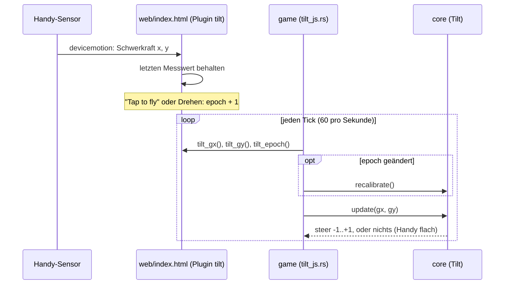
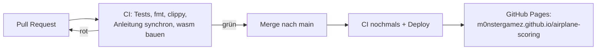

# Projektnotizen

English: [README.md](README.md). Beide Fassungen werden parallel geführt:
Ein Eintrag kommt immer in beide Dateien, im selben Pull Request.

Hier stehen Designentscheide, offene Fragen und alles, was Claude Code
wissen sollte und nicht im Code steht. Halte die Einträge kurz und datiert.

## 2026-10-28
- Gestartet mit der Vorlage airplane-scoring. macroquad fest auf 0.4.16.

## 2026-11-10
- Mobile first, nur **Querformat** (das Handy wird zum Kippen wie ein Lenkrad gehalten).
- Veröffentlicht über GitHub Actions auf GitHub Pages; die gebaute .wasm wird nicht committet.
- Geplant: Kippen über `deviceorientation` (iOS braucht eine Berechtigungsabfrage
  nach einem Tipp; HTTPS nötig), Finger und Tastatur als Ersatz, alles auf
  einen `steer`-Wert in core abgebildet.
- Eingabe: Jedes Gerät ergibt einen `steer` in [-1, 1] (core `input.rs`).
  Finger/Maus = das Flugzeug fliegt auf die Höhe des Fingers; Tasten = Up/W, Down/S.
  Der Finger gewinnt vor den Tasten. Kippen wird eine dritte Quelle.
- Eigenheit von macroquad 0.4.16: `touches()` liefert physische Pixel, Maus und
  Zeichnen logische. Das Spiel teilt Berührungen durch `dpi_scale()`.
- Kippen = das Handy ist das Flugzeug: Dreh es wie ein Lenkrad, rechte
  Seite (Nase) hoch = steigen. Verwendet den Winkel von `devicemotion`
  accelerationIncludingGravity in der x/y-Ebene des Geräts, relativ zu einer
  geraden Haltung, die bei "Tap to fly" und beim Drehen des Handys gemerkt wird. Der relative
  Winkel macht es unabhängig von Querformat links/rechts und vom umgekehrten
  Vorzeichen bei iOS. Totzone 2°, volle Geschwindigkeit ab 25°, unbrauchbar, wenn das Handy flach liegt.
- Brücke JS -> Rust: miniquad-Plugin "tilt" in web/index.html, die Imports
  sind mit #[link(wasm_import_module = "env")] in game/src/tilt_js.rs deklariert
  (wasm-ld braucht das, genau wie bei miniquads eigenen Imports).
- Vorrang: Finger > gedrückte Tasten > Kippen.

- Ton: macroquad-Feature `audio` (quad-snd 0.2.8). Die API in 0.4.16 kann nur
  laden / einmal abspielen / als Schleife / stoppen / Lautstärke setzen: keine Tonhöhe, kein Panorama, kein Ausblenden.
  Darum ist der Motor zwei Schleifen, die core überblendet (`Mix`), und
  Ausblenden heisst: core verschiebt die Lautstärken pro Tick ein wenig
  (`MIX_CHANGE_PER_SECOND`).
- core entscheidet über den Ton, game spielt ihn: `World.mix` (Lautstärken der Schleifen) und
  `World::events()` (Crash, Lightning, Thunder; gültig für einen Tick).
- Das Wetter hat einen Startwert (`World::with_seed`, SplitMix64 in core `rng.rs`); das
  Spiel nimmt ihn von der Uhr. Die ersten 10 s bleibt es trocken, dann Regenphasen von
  20–40 s; Regen >= 0.6 ist ein Gewitter. Den Donner plant core
  0.3–3 s nach seinem Blitz ein, je nach Entfernung.
- Zusammenstoss = das Flugzeug der Spielerin oder des Spielers berührt neu ein anderes Flugzeug:
  1.5 s Absturz ohne Steuerung. Flankengesteuert, also gibt es keinen zweiten
  Zusammenstoss, wenn man sich innerhalb des anderen Flugzeugs wieder fängt.
- Die Tondateien erzeugt `scripts/make-sounds.py` (nur Standardbibliothek,
  deterministisch), committet als Mono-WAV mit 16 Bit und 22050 Hz in `web/sounds/`
  (etwa 600 KB). WAV, weil quad-snd nativ nur WAV/OGG dekodiert und
  ältere iOS-Safari kein OGG können. Zur Laufzeit in einer Coroutine geladen, nicht mit
  `include_bytes!`, damit die wasm klein bleibt (+25 KB für den Ton-Code).
- quad-snd 0.2.8 fehlt `#[link(wasm_import_module = "env")]` bei seinen JS-Imports;
  `.cargo/config.toml` gibt wasm-ld `--import-undefined` mit.
- Browser starten den Ton angehalten. `mq_js_bundle.js` setzt ihn beim
  ersten touchstart/touchend/mousedown/keydown fort und hört dann auf zu horchen;
  Schleifen, die vorher gestartet wurden, beginnen dann zu spielen. Chrome meldet
  "AudioContext was not allowed to start", bis es so weit ist (in
  `scripts/shot.sh` ausgefiltert).
- Das iPhone war stumm (2026-11-10): Auf einem Handy ist das erste Ereignis
  touchstart, und Safari zählt nur touchend/click als Benutzergeste, also
  wurde das einzige resume() des Bundles endgültig abgelehnt. Chrome zählt
  touchstart, darum zeigten Tests auf dem Computer und auf Android das nie.
  Behoben in `web/index.html` (vor dem Bundle, das ungepatcht bleibt):
  jeden AudioContext merken und bei jedem touchend, click und keydown
  fortsetzen, immer (fängt auch Unterbrechungen durch iOS auf). Geprüft
  in Chrome mit nachgebildeter Safari-Regel (resume() während touchstart
  abgelehnt): Ohne den Fix bleibt der Kontext des Spiels "suspended",
  mit ihm "running". Hier nicht auf einem echten iPhone prüfbar.
- Stummschalten: Das gehört der Seite (Knopf `#mute`, localStorage
  `airplane-scoring.muted`, Plugin "sound"); die Taste M geht über Rust zum
  selben Schalter. Der Lautlos-Modus von iOS schaltet Web Audio stumm; dagegen können wir nichts tun.
- Nicht mit dem Ohr geprüft: Die Töne wurden als Spektrogramme und durch
  Aufzeichnen der Web-Audio-Aufrufe in Headless Chrome geprüft, nie angehört.

- Level-Hintergründe: Foto -> von Hand nachgezeichnetes SVG -> PNG. Die Fotos liegen in
  `art/levels/levelN/photo.*` und sind gitignored (öffentliches Repo, Handyfotos
  enthalten GPS und zeigen vielleicht Personen). Das SVG (eigene Arbeit, von unserem eigenen
  Foto nachgezeichnet) ist die Quelle; `scripts/make-backgrounds.sh` rendert es mit
  rsvg-convert in doppelter Grösse (3200x1480) nach `web/levels/levelN.png` und schlägt fehl, wenn
  linker und rechter Rand nicht zusammenpassen. Die PNGs werden wie die
  Tondateien committet; CI braucht kein rsvg.
- macroquad 0.4.16 kann kein SVG laden; resvg dazuzunehmen würde viel mehr wasm
  kosten als PNG. PNGs laden zieht den PNG-Decoder mit: wasm 489 KB -> 632 KB
  (roh, vor wasm-opt). level1.png ist etwa 530 KB und wird wie die Töne in einer
  Coroutine geladen; bis es da ist, zeigt das Spiel den alten einfarbigen Himmel.
- Scrollen: core `scroll_distance(ticks)` und `background_x(distance,
  tile_width)` (`scenery.rs`); aus der Zahl der Ticks abgeleitet, also kein neuer
  Zustand in `World`. Es gibt nur Level 1; ein Level wählen kommt später.
  Das SVG ist in Ebenen-Gruppen aufgeteilt, damit später Parallaxe möglich ist.

- Startanzeige am Computer: Auch Computer bekommen jetzt die Startanzeige
  ("Click to fly", Enter/Space) mit den Tasten und einem QR-Code zur Live-URL.
  Auch dort schaltet der Klick den Ton frei. Das QR-SVG erzeugt
  `scripts/make-qr.py`, ein kleiner Encoder nur mit der Standardbibliothek (Byte-Modus, Stufe M,
  v1-6), weil standardmässig kein QR-Werkzeug installiert ist; geprüft durch Dekodieren
  mit macOS CoreImage (CIDetector) für v1-v6 und aus dem echten Screenshot.
  Handys zeigen ihn auch, kleiner, mit der Beschriftung "Friends scan this to fly too"
  (teile das Spiel mit den Leuten um dich herum).
- Deutsch: Die Startanzeige des Spiels heisst «Startanzeige», weil
  «Startbildschirm» schon den Startbildschirm von Android bedeutet.

## 2026-11-11

- Hintergrund für Level 2: Sandstrand bei Sonnenuntergang, ruhige Bucht, dunkle Landzungen
  links und rechts, ferne Inseln dazwischen (`art/levels/level2/`, von
  unserem eigenen Foto nachgezeichnet, gerendert nach `web/levels/level2.png`). Gleiche Grösse und
  Ebenen-Regeln wie Level 1. Das Spiel verwendet ihn noch nicht: Es gibt noch keinen Weg,
  ein Level zu wählen oder zu erreichen, also wartet er nur in `web/levels/`. Im Spiel geprüft,
  indem er lokal anstelle von Level 1 gezeichnet wurde.
- Die Projektnotizen gibt es jetzt auch auf Deutsch (`docs/README.de.md`),
  parallel geführt wie die Anleitung; `scripts/check-docs.sh` vergleicht den Aufbau.

## 2026-11-12

- Levelwechsel: Alle `LEVEL_SECONDS` (60 s) beginnt das nächste Level,
  nach dem letzten wieder Level 1 (core `level.rs`, `level_view`). Die
  nächste Landschaft wird in den letzten `LEVEL_FADE_SECONDS` (3 s)
  eingeblendet, und «Level N» steht 2.5 s lang da. Gewählt statt Punkten
  (gibt es noch nicht) und statt eines Menüs (stört am Handy); kommen
  Punkte, ändert sich nur der Auslöser. Aus den Ticks und dem Start-Level
  abgeleitet, also kein neuer Zustand in `World`. Alle Level-Bilder laden
  beim Start. `?level=2` (Plugin "level", `LEVEL=2 scripts/shot.sh`)
  startet in Level 2. Headless Chrome lässt das Spiel kaum laufen, darum
  wurde die Überblendung lokal mit 1 s langen Levels geprüft.

## Konzepte

### Kippen: vom Sensor zur Steuerung

Die JS-Seite speichert nur Zahlen; die Rust-Hülle holt sie nur ab. Alle
Entscheide (gerade Haltung, Glättung, Totzone) stehen in `core/src/tilt.rs`
mit Tests.

### Bauen und veröffentlichen

