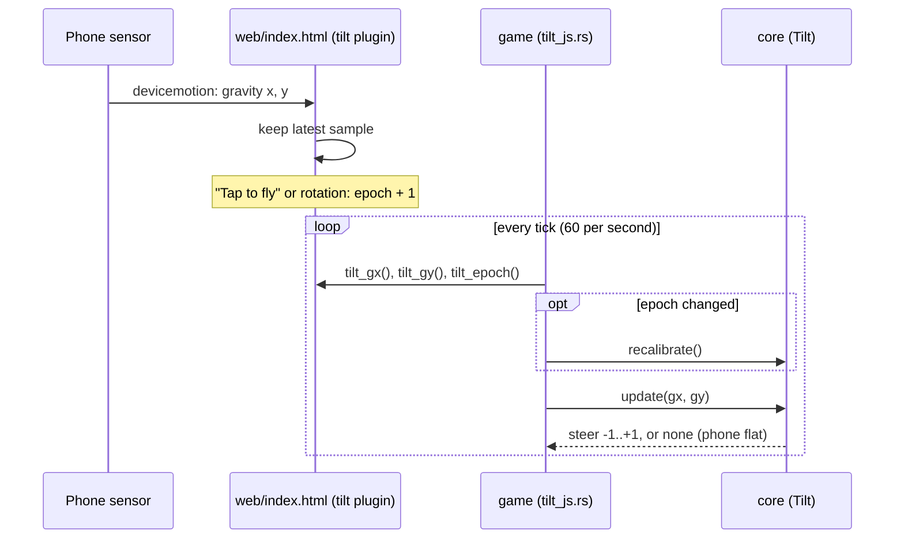
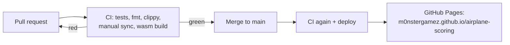

# Project notes

Put design decisions, open questions and anything Claude Code should know
that isn't code here. Keep entries short and dated.

## 2026-10-28
- Started from the airplane-scoring template. macroquad pinned at 0.4.16.

## 2026-11-10
- Mobile-first, **landscape** only (phone held like a steering wheel for tilt).
- Published via GitHub Actions to GitHub Pages; built .wasm is not committed.
- Planned: tilt steering via `deviceorientation` (iOS needs a tap-to-start
  permission prompt; HTTPS required), touch + keyboard fallbacks, all mapped
  to one `steer` value in core.
- Input: every device maps to one `steer` in [-1, 1] (core `input.rs`).
  Touch/mouse = plane flies to the finger's height; keys = Up/W, Down/S.
  Pointer wins over keys. Tilt will be a third source.
- macroquad 0.4.16 quirk: `touches()` is in physical pixels, mouse and
  drawing in logical ones. The game divides touch by `dpi_scale()`.
- Tilt = the phone is the plane: rotate it like a steering wheel, right
  side (nose) up = climb. Uses the angle of `devicemotion`
  accelerationIncludingGravity in the device x/y plane, relative to a
  neutral captured on "Tap to fly" and on orientation change. Relative
  angle makes it immune to landscape-left/right and iOS's negated sign
  convention. Dead zone 2°, full steer at 25°, unusable when lying flat.
- JS -> Rust bridge: miniquad plugin "tilt" in web/index.html, imports
  declared with #[link(wasm_import_module = "env")] in game/src/tilt_js.rs
  (wasm-ld needs that, same as miniquad's own imports).
- Priority: finger > pressed keys > tilt.

## Concepts

### Tilt: from sensor to steering

The JS side only stores numbers; the Rust shell only fetches them. All
decisions (neutral pose, smoothing, dead zone) are in `core/src/tilt.rs`
with tests.

### Build and publish

