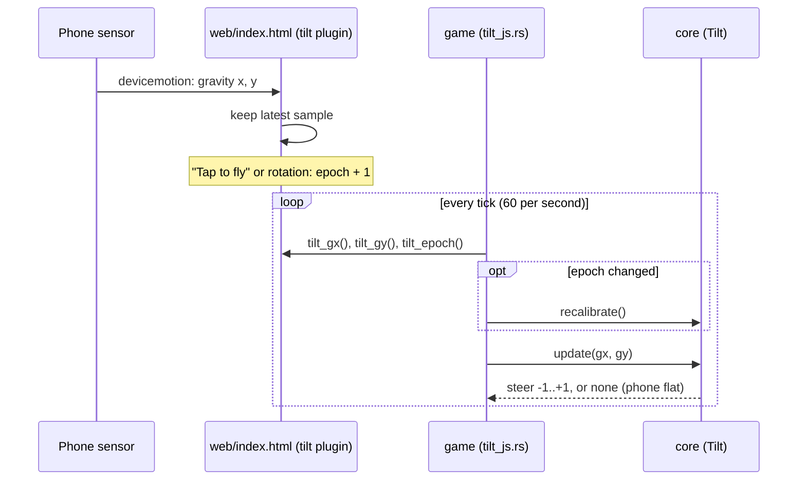
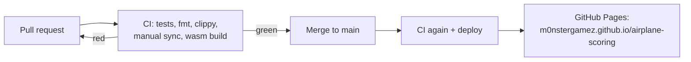

# Project notes

Deutsch: [README.de.md](README.de.md). Both versions are kept in sync:
every entry goes into both files, in the same pull request.

Put design decisions, open questions and anything Claude Code should know
that isn't code here. Keep entries short and dated.

## 2026-10-28
- Started from the airplane-scoring template. macroquad pinned at 0.4.16.

## 2026-11-10
- Mobile-first, **landscape** only (phone held like a steering wheel for tilt).
- Published via GitHub Actions to GitHub Pages; built .wasm is not committed.
- Planned: tilt steering via `deviceorientation` (iOS needs a tap-to-start
  permission prompt; HTTPS required), touch + keyboard fallbacks, all mapped
  to one `steer` value in core.
- Input: every device maps to one `steer` in [-1, 1] (core `input.rs`).
  Touch/mouse = plane flies to the finger's height; keys = Up/W, Down/S.
  Pointer wins over keys. Tilt will be a third source.
- macroquad 0.4.16 quirk: `touches()` is in physical pixels, mouse and
  drawing in logical ones. The game divides touch by `dpi_scale()`.
- Tilt = the phone is the plane: rotate it like a steering wheel, right
  side (nose) up = climb. Uses the angle of `devicemotion`
  accelerationIncludingGravity in the device x/y plane, relative to a
  neutral captured on "Tap to fly" and on orientation change. Relative
  angle makes it immune to landscape-left/right and iOS's negated sign
  convention. Dead zone 2°, full steer at 25°, unusable when lying flat.
- JS -> Rust bridge: miniquad plugin "tilt" in web/index.html, imports
  declared with #[link(wasm_import_module = "env")] in game/src/tilt_js.rs
  (wasm-ld needs that, same as miniquad's own imports).
- Priority: finger > pressed keys > tilt.

- Sound: macroquad feature `audio` (quad-snd 0.2.8). API in 0.4.16 is
  load / play once / loop / stop / set volume only: no pitch, pan or fade.
  So the engine is two loops cross-faded by core (`Mix`), and fades are
  core moving volumes a little per tick (`MIX_CHANGE_PER_SECOND`).
- Core decides sound, game plays it: `World.mix` (loop volumes) and
  `World::events()` (Crash, Lightning, Thunder; valid for one tick).
- Weather is seeded (`World::with_seed`, SplitMix64 in core `rng.rs`); the
  game seeds it from the clock. Starts dry for 10 s, then rain spells of
  20–40 s; rain >= 0.6 is a thunderstorm. Thunder is scheduled by core
  0.3–3 s after its lightning, by distance.
- Crash = player newly touches another plane: 1.5 s falling without
  controls. Edge-triggered, so recovering inside the other plane does not
  crash again.
- Sound files are synthesised by `scripts/make-sounds.py` (stdlib only,
  deterministic), committed as mono 16-bit 22050 Hz WAV in `web/sounds/`
  (about 600 KB). WAV because native quad-snd decodes only WAV/OGG and
  older iOS Safari cannot decode OGG. Loaded at runtime in a coroutine, not
  `include_bytes!`, so the wasm stays small (+25 KB for the audio code).
- quad-snd 0.2.8 lacks `#[link(wasm_import_module = "env")]` on its JS
  imports; `.cargo/config.toml` passes `--import-undefined` to wasm-ld.
- Browsers start audio suspended. `mq_js_bundle.js` resumes it on the
  first touchstart/touchend/mousedown/keydown and then stops listening;
  loops started before that begin playing then. Chrome logs
  "AudioContext was not allowed to start" until then (filtered in
  `scripts/shot.sh`).
- iPhone was silent (2026-11-10): on a phone that first event is
  touchstart, and Safari only counts touchend/click as a user gesture, so
  the bundle's single resume() was refused for good. Chrome counts
  touchstart, which is why desktop and Android tests never showed it.
  Fix in `web/index.html` (before the bundle, which stays unpatched):
  remember every AudioContext and resume it on each touchend, click and
  keydown, for good (also recovers after iOS interrupts audio). Verified
  in Chrome with Safari's rule emulated (resume() rejected during
  touchstart): without the fix the game's context stays "suspended",
  with it "running". Not verifiable here on a real iPhone.
- Mute: the page owns it (button `#mute`, localStorage
  `airplane-scoring.muted`, plugin "sound"); key M goes through Rust to
  the same toggle. iOS silent mode mutes Web Audio; nothing we can do.
- Not verified by ear: the sounds were checked as spectrograms and by
  recording Web Audio calls in headless Chrome, never listened to.

- Level backgrounds: photo -> hand-traced SVG -> PNG. Photos live in
  `art/levels/levelN/photo.*` and are gitignored (public repo, phone photos
  carry GPS, may show people). The SVG (own work, traced from our own
  photo) is the source; `scripts/make-backgrounds.sh` renders it with
  rsvg-convert at 2x (3200x1480) into `web/levels/levelN.png` and fails if
  the left and right edges do not match. PNGs are committed like the
  sounds; CI does not need rsvg.
- macroquad 0.4.16 cannot load SVG; adding resvg would cost far more wasm
  than PNG. Loading PNGs pulls in the png decoder: wasm 489 KB -> 632 KB
  (raw, before wasm-opt). level1.png is about 530 KB, loaded in a
  coroutine like the sounds; until it arrives the old plain sky shows.
- Scrolling: core `scroll_distance(ticks)` and `background_x(distance,
  tile_width)` (`scenery.rs`); derived from the tick count, so no new
  state in `World`. Only level 1 exists; picking a level comes later.
  The SVG is split into layer groups so parallax can come later.

- Desktop start screen: computers now also get the start overlay
  ("Click to fly", Enter/Space) with the keys and a QR code to the live
  URL. It is the click that unlocks audio there too. The QR SVG is made by
  `scripts/make-qr.py`, a small stdlib-only encoder (byte mode, level M,
  v1-6) because no QR tool is installed by default; checked by decoding
  with macOS CoreImage (CIDetector) for v1-v6 and from the real screenshot.
  Phones show it too, smaller, captioned "Friends scan this to fly too"
  (share the game with the people around you).
- German: the game's start screen is «Startanzeige», because
  «Startbildschirm» already means Android's home screen.

## 2026-11-11

- Level 2 background: sandy beach at sunset, calm bay, dark headlands
  left and right, far islands between (`art/levels/level2/`, traced from
  our own photo, rendered to `web/levels/level2.png`). Same size and
  layer rules as level 1. Not used by the game yet: there is still no way
  to pick or reach a level, so it only waits in `web/levels/`. Checked in
  the game by drawing it in place of level 1 locally.
- The project notes now exist in German too (`docs/README.de.md`),
  kept in sync like the manual; `scripts/check-docs.sh` compares the structure.

## 2026-11-12

- Level change: every `LEVEL_SECONDS` (60 s) the next level begins,
  after the last one level 1 again (core `level.rs`, `level_view`). The
  next landscape fades in over the last `LEVEL_FADE_SECONDS` (3 s) and
  "Level N" shows for 2.5 s. Picked over points (none yet) and a menu
  (in the way on a phone); when points come, only the trigger changes.
  Derived from ticks and the start level, so no new state in `World`.
  All level images load at the start. `?level=2` (plugin "page",
  `LEVEL=2 scripts/shot.sh`) starts in level 2. Headless Chrome barely
  advances the game, so the fade was checked with levels shortened
  locally to 1 s.
- The game stands still until "Tap to fly" / "Click to fly" / `?play`.
  Before, the clock ran from page load: a long wait on the start screen
  skipped the "Level 1" banner, the dry first 10 s, even whole levels.
  Core `Clock` (`clock.rs`) now turns frame time into ticks and gives none,
  and saves none up, before the start; the page reports the start through
  the "page" plugin (`page_js.rs`, replaces "level"). Checked with the
  start screen made see-through locally: behind it `ticks: 0`.
- Clean screen: the green ball (the template's "other plane", spawned in
  `main.rs`) and the "hello plane" text (`World::greeting`, removed) are
  gone. So nothing can crash the player for now; the crash rules stay in
  core with their tests for the obstacles to come.
- Level sounds: a short rising tune (C-E-G-C, `new-level.wav`) when a
  new level begins (`Event::NewLevel` from `World::tick`; `World` now
  keeps `start_level` and offers `levels()`), and a beach loop for
  level 2 (waves and gulls, `beach.wav`, 8 s, 344 KB) whose volume is
  `BEACH_VOLUME` times `LevelView::presence(BEACH_LEVEL)`, so it fades
  with the landscape. Both made by `make-sounds.py`; checked as numbers
  (seamless loop, two swells per loop) and listened to locally: good.
- Gulls at the beach (core `gulls.rs`): the first obstacles. While level 2
  is fully on screen a gull appears every 1.2–2.8 s (first after 2.5 s,
  while "Level 2" shows): 45 % from the right, 25 % from behind (slower,
  always calling, so you hear them coming), 30 % up from the sand. They
  bob while flapping; touching one is the usual crash. Seeded with their
  own stream, so they do not change the weather. The gull calls moved
  out of `beach.wav` into `gull-call.wav`, played on `Event::GullCall`,
  so every call belongs to a visible gull. Gulls were checked in
  screenshots with them spawning on screen (local change, not committed).
- No rain at the beach: `Weather::tick` takes `max_rain` = how much of
  level 1 is on screen; at 0 there is no storm and pending thunder is
  dropped. Spells keep their timing underneath, so level 1 gets its
  weather back. Reason: rain does not fit the sunset mood.
- Screenshots ran far too short (fix from 2026-11-11, merged today): `scripts/shot.sh out.png 5000` showed
  about 17 ticks whatever the time, because Chrome's
  `--virtual-time-budget` barely produces animation frames, so the game
  loop hardly ran. `scripts/cdp_shot.py` now drives headless Chrome over
  the DevTools protocol (stdlib only, tiny WebSocket client): load the
  page, wait real time, capture. 8000 ms now gives about 410 ticks. Plain
  `--timeout` instead gave a black canvas.
- `scripts/serve.sh` skips `socket.getfqdn()` in `HTTPServer.server_bind`:
  with Homebrew's Python 3.14 that reverse lookup of 127.0.0.1 took 35 s
  on a Mac, so every shot and `scripts/dev.sh` start waited for it.
- Lives (asked for now that obstacles exist): 3 per flight (`LIVES`),
  shown as small planes at the top right, left of the speaker button. A crash costs one; after
  recovering the plane blinks and is safe for 2 s (`SAFE_SECONDS`), so one
  flock of gulls costs one life. The last crash lets the plane fall, then
  `Event::GameOver`; the world stands still, the sound fades out, and
  "Game over" shows the score. After 1 s (`RESTART_WAIT_SECONDS`, so
  a finger still steering does not skip it) a tap, click or Enter starts a
  new world. All choices (3 lives, small planes, restart on tap, safe
  time) were asked for that way. Checked in screenshots; the game-over one with
  `LIVES` set to 1 locally (not committed).
- Score: 2 points per second flown (`SCORE_PER_SECOND`), computed from
  the ticks (`World::score`), so it stops at game over. Shown at the top
  centre all game long and as the result at game over (it replaced the
  flight time there). Ready for the highscore, which comes next.
- Lifeguard towers in level 1 were built and dropped unmerged (PR #17):
  towers every 2–4.5 s in a row felt illogical.
- Hot-air balloons (core `balloons.rs`): level 1's obstacles, chosen
  after the lifeguard towers were dropped. The user plans about 50 levels
  with level 1 the easiest, so balloons are big, slow and rare: one every
  5–8 s (first after 2.5 s), coming in from the right in the lower half of
  the sky, drifting left a little faster than the landscape and rising
  8–25 px/s. The hit test covers the envelope (radius 30 px) and the
  basket. A new burner sound (`balloon-burner.wav`, filtered noise with a
  flutter) plays as each one appears. Own random stream. Checked in a
  screenshot. Note for later: the gulls in level 2 (every 1.2–2.8 s) are
  strict for the second-easiest level.
- Balloons come three ways (`BalloonWay`), asked for after trying them:
  40 % rise from the lower sky, 30 % come level at the plane's height when
  they appear (head-on), 30 % sink from the upper sky to land. A balloon
  at the plane is kept whole on screen.
- No rain or thunderstorms in level 1 either: rain does not fit the
  balloons. `RAINY_LEVELS` (core `level.rs`) lists the levels where it may
  rain, empty for now; `LevelView::rain_room` caps the weather with it,
  replacing the beach-only cap. The weather keeps running, ready for a
  later level.
- Same proportions on every screen: the landscape was scaled to the
  screen height, but the plane, obstacles, hit boxes and speeds were fixed
  px. On a 900 px high computer window the plane looked tiny and the game
  was easier than on a phone. Now every px constant is for a phone in
  landscape (`DESIGN_HEIGHT` = 390) and core multiplies it by
  `Bounds::scale` (height / 390): moves, hit tests, spawns, the finger's
  easing (`World::steer_toward`) and the scroll distance. The game crate
  draws everything (plane, gulls, balloons, score, lives, texts) at the
  same scale. Checked with screenshots at 844×390 and 1440×900 side by
  side. A screen is never too small to fly in any more, except one of no
  height. The speaker button stays a fixed 44 px (HTML).
- More for level 1, after playing it: wooden huts in the foreground grass
  (core `huts.rs`, 3 looks, one every 4–7 s, low: only the bottom quarter
  of the screen; hit box down to the screen edge like the dropped
  towers). Rising balloons now stand on a launch pad (`Pad`), slide in
  with it and take off at 60–85 % of the screen width; the burner roars
  at take-off. Pads are flat and harmless; huts and pads wait for each
  other so they never overlap. The plane and obstacles are 20 % smaller
  (`OBJECT_SIZE` = 0.8 via `Bounds::size`; speeds unchanged) for more room
  to dodge. Checked in screenshots.
- Level 1 round three, after playing: flying into a launch pad costs a
  life (hit box down to the screen edge, like huts). Balloons also land
  on pads: a landing balloon comes in high right above its pad (no
  drift) and sinks so it touches down at 30–55 % of the screen width,
  then slides off with it. Four ways now (take off, land, at the plane,
  sink past), dealt as shuffled rounds of four and never the same way
  twice in a row: playing showed long runs of pad take-offs after the
  first balloons, which random picks allow. Plane and obstacles another
  20 % smaller (`OBJECT_SIZE` 0.8 → 0.64). Checked in screenshots.
- Plane and flying obstacles another 20 % smaller (`OBJECT_SIZE` 0.64 →
  0.512). Huts made really big and moved to the front so they read as
  foreground: 96–124 × 80–104 px standing at 98 % of the screen height,
  scaled with `Bounds::scale` only (they are landscape, not flying
  objects), and drawn in front of pads and balloons.
- Another 20 % smaller (`OBJECT_SIZE` 0.512 → 0.41). With big huts in
  front, tiny balloons on the pads looked wrong, so the game got depth
  (`Bounds::depth(y)`): plane, balloons and gulls are `OBJECT_SIZE` from
  `BALLOON_FAR_HEIGHT` (55 % of the height) up and grow linearly to full
  size at a balloon standing on a pad. Launch pads moved to the
  foreground with the huts (same ground line, `Bounds::scale`). The plane
  follows the same rule, as asked: hit box included, so low flying is
  riskier. Screenshots: small plane up high, big on the ground, a big
  balloon on its pad.
- Depth tuned after playing: no flat part any more. Sizes shrink
  steadily over the whole height, from full size at a balloon on its pad
  to `OBJECT_SIZE` at the very top (`BALLOON_FAR_HEIGHT` removed), so the
  plane keeps getting smaller all the way up. The plane grows more near
  the ground than the balloons: up to `PLANE_NEAR_SIZE` = 1.5
  (`Bounds::plane_depth`); balloons stay at 1 there, as liked.
- Crashes only on a real touch, after a life was lost a hair away from a
  hut. Before, the plane was a circle (reaching above and below its thin
  fuselage), huts and pads were boxes reaching down to the screen edge
  (including the empty corners beside the roof), balloons and gulls were
  circles. Now core has convex polygons (`shape.rs`, separating axis
  test) with the very points the game draws: plane fuselage, nose, wing,
  tail, cockpit; hut walls, roof triangle and eaves; pad deck and legs;
  balloon envelope (16-corner ellipse), taper, mouth, ropes, basket, rim;
  gull body, head, beak and the flapping wings. `PLAYER_HIT_RADIUS` and
  `GULL_RADIUS` are gone. Tests probe near misses with 2 px squares.
- Engine sound: a turbine instead of the propeller putter, as the plane
  is drawn as a jet. `scripts/make-sounds.py` `turbine()`: compressor
  whine (two tones 3 Hz apart for a shimmer, plus an overtone), a 140 Hz
  hum and filtered noise for the exhaust roar; full power has a higher
  whine (1800 vs 1400 Hz), a brighter roar and hiss. 2 s loops, whole
  cycles per loop, so they join seamlessly. The engine also fades with
  distance: `Mix::target` takes the plane's nearness
  (`Bounds::nearness`, the same 0..1 that drives its size), from 30 %
  (`ENGINE_FAR_VOLUME`) at the top to full near the ground. The sound
  files were checked by numbers (loop seam, loudness).
- Removed the help text at the bottom left ("drag or arrow keys to fly |
  ticks: …"): it was meant for testing and lay over the big huts. The
  start screen and the manual explain the controls.
- Highscore: the user did not answer the design questions, so the
  recommended defaults were built: stored on the device only (page
  plugin, localStorage key `airplane-scoring.highscores`, plugin version
  2), top 5 (`HIGHSCORE_COUNT`), "Best" under the score while flying, the
  list at game over with this flight marked, "New highscore!" and a
  generated fanfare (`new-highscore.wav`) for a record. Rules in core
  (`highscore.rs`): zeros do not count, a tie is no record. Native builds
  keep the list in memory only. Checked in a screenshot (game over with
  one life set locally, not committed).
- Lifeguard towers at the beach (core `towers.rs`), asked for as "not
  too many, not too tall": foreground like level 1's huts, one every
  6–10 s (first after 4 s), 92–112 px tall, 46–56 px wide, 2 looks.
  Unlike the dropped level 1 towers (tall, every 2–4.5 s), these are
  rare and low. Exact crash shapes via `Tower::parts` (also used for
  drawing): legs, ladder, platform, cabin, roof. Checked in screenshots.
- Lifeguard towers now stand at different depths, as asked: each gets
  `near` 0..1; its ground line goes from 80 % of the screen height (by the
  water) to 98 % (front), its size from 55 % to 100 %. Added parallax as
  a suggestion: far towers also slide slower, by the same factor. The
  list is kept in depth order so far ones are drawn first.
- Damage you can see, asked for: after the first lost life a thin light
  smoke trail, after the second a thick dark one with a flickering flame
  at the tail (`World::smoke` from `DAMAGE_SMOKE`), and the last life is
  an explosion instead of a crash (`Event::Explosion`, fireball, debris,
  smoke cloud, red flash, generated `explosion.wav`), then "Game over".
  Puff positions follow from the tick count, no particle state. The
  explosion was checked in a screenshot with a temporary local setup
  (one life, a plane parked in front; not committed). Lifeguard tower
  depth (previous entry) rides along in this PR, since #24 was merged
  before it was pushed.
- Screen shake at the explosion, as suggested: `World::shake` gives an
  offset of up to `SHAKE_PX` (10 px at phone size) that jumps around with
  the ticks and fades with `(1 - progress)²`. The game draws the
  landscape and everything in it through a `Camera2D` moved by it and
  zoomed 6 % so no edge shows; flashes, score and lives stay still.
  macroquad 0.4.16's `Camera2D::from_display_rect` turns y upwards (the
  first screenshot was upside down), so the game flips `zoom.y` back.
- The game speeds up a little with every point, asked for: `World::speed`
  = 1 + 0.1 % per point (`SPEED_PER_POINT`), at most `MAX_SPEED` 1.5.
  The landscape now moves by `World::distance`, which adds the speed each
  tick; huts, pads, balloons, gulls and towers (far ones less) get the
  extra shift from the world; new landings are planned for the current
  speed so they still touch down in view. Climbing stays the same.
- Smooth climbing with a tilting nose, asked for: the vertical speed
  (`Player::vel_y`) now follows the steering exponentially
  (`CLIMB_RESPONSE` 8/s, full speed after about a quarter second) instead
  of jumping; a crash still drops at once. The nose tilts with the
  vertical speed (`Player::pitch`, up to `MAX_PITCH_DEG` 20°, smoothed by
  `PITCH_RESPONSE`); the crash shape turns with it
  (`Poly::at_turned`), and the game draws the same turned points. The
  finger aims from where the plane will be (`y + vel_y / CLIMB_RESPONSE`),
  which damps the follow so it still never shoots past the finger (the
  existing no-overshoot test passes unchanged). Checked in a screenshot
  with a forced climb (temporary, not committed).
- Throttle, overspeed and pull up, asked for: →/D and ←/A, or tipping
  the phone forward/back (`Tilt::lean`, gravity's z, which the page makes
  the same sign on iOS and Android; tilt plugin version 2) set the
  airspeed (`Player::airspeed`, 0.5–2, drifting back to 1 without
  input). It multiplies the game's speed. Above 1.5 "OVERSPEED"
  (countdown, clacker loop, voice); 3 s there and the plane breaks
  apart: every life gone, the explosion. Below 0.75 "PULL UP" (warning
  light, whoop loop, voice) and the plane sags (chosen over a plain
  warning or a timed crash). Voices repeat every 1.5 s. The voices
  (`voice-overspeed.wav`, `voice-pull-up.wav`) are spoken by macOS's
  `say` (voice "Fred") in `scripts/make-sounds.py`. Licence note: Apple
  licenses its system voices for personal use; the user chose them
  knowingly over espeak-ng (open source, free to share), which could not
  be installed because Homebrew's folder was not writable. To replace
  them, change `voice()` in the script and run it again. So "Pull up"
  is heard over its whoop: the warning tone ducks to 20 % while a voice
  speaks (`VOICE_DUCK`, `VOICE_SECONDS`), the voices are softly
  compressed and play at full volume.
  A "SPEED" gauge at the bottom left shows the zones. Asked for after
  trying it: sagging into the ground while "Pull up" blows the plane up
  too, every life gone (`break_apart`, shared with overspeed); diving to
  the ground at normal speed stays harmless. The voice files are
  optional at runtime: without them every other sound still plays (a
  missing file had silenced the whole game).
- Takeoff from an airport, asked for: every new flight in level 1 starts
  on a runway in the foreground (`airport.rs`: runway with threshold
  stripes and centre line, control tower, windsock). The plane stands on
  it with its gear out; the landscape speeds up from standing over
  `ROLL_SECONDS` (2.5 s, `World::speed` times the roll), the plane lifts
  off, climbs out on its own for `CLIMB_OUT_SECONDS`, then the player
  steers. Opt-in (`World::with_takeoff`, which the game calls), so
  existing tests keep a plane in the air; a flight starting in level 2
  skips it. Nothing new spawns while the runway still reaches the right
  edge, so no hut or pad stands on it (a first try showed a pad on it).
  The SPEED gauge moved to the top left, off the runway. Also asked
  for: the plane grows a bit more near the ground (`PLANE_NEAR_SIZE` 1.5
  → 1.8).
- Pause menu, asked for "like a typical game menu": a menu button (three
  lines) top left, also Esc / P, pauses the game (`page_started` is false
  while paused; the clock stops) and shows a full-screen menu with the
  game blurred behind (`backdrop-filter`): Continue (3-2-1 countdown, the
  game goes on at 0), Calibrate (phones: recalibrates tilt and lean),
  Options (Music and Sounds switches, Back), Menu (back to the start
  page; `page_new_flight` makes the game set up a fresh flight). Leaving
  the tab pauses too. There is no background music yet, so "Music"
  switches the tunes (level tune, highscore fanfare) and "Sounds"
  everything else; the speaker button and M switch both. Sound is
  silent while paused. The warning lamp and SPEED gauge moved to make
  room for the button. `scripts/cdp_shot.py` can run JS before the
  capture (`SHOT_EVAL`), used to check the menu, options and countdown
  in screenshots. The start page itself is still the old one; the user
  will describe a new one.
- Gentler takeoff, asked for: the plane rolls longer (`ROLL_SECONDS` 2.5
  → 4 s) and climbs out less steeply (`CLIMB_OUT_STEER` -0.7 → -0.4, so
  the nose tilts about 8° instead of 14°) and a little longer
  (`CLIMB_OUT_SECONDS` 1.2 → 2 s) to gain height. A test checks the
  climb-out stays under half the full tilt.
- Takeoff sound, asked for. A first version only crossfaded the engine
  loops and added a deep rumble below 200 Hz; the user heard no
  difference (phone and laptop speakers barely play that low). Now the
  roll starts `Event::Takeoff`, a one-shot `takeoff.wav`: the turbine's
  whine rising in pitch from 450 to 1800 Hz (the power loop's pitch) over
  the 4 s roll, with the exhaust roar swelling and brightening; the
  engine loops step aside while it plays (`Mix::takeoff`) and take over
  at lift-off. The runway rumble (`runway-rumble.wav`) got a brighter
  tyre roar and clacks over the joints, louder (`RUMBLE_VOLUME` 0.8), and
  stops at lift-off. Both files listened to locally.
- Gear-up sound, asked for: 0.4 s after lift-off the gear folds up over
  1 s (`World::gear` 1 → 0, drawn as shortening struts and shrinking
  wheels) and `Event::GearUp` plays `gear-up.wav`: a hydraulic whir
  rising a little, then a clunk as the wheels lock. Listened to locally;
  the folding checked in screenshots.
- Asked for after trying it: a Restart button in the pause menu (a new
  flight from the airport after the 3-2-1 countdown; `page_new_flight`
  again), a longer roll (`ROLL_SECONDS` 4 → 6 s, the spool-up sound made
  6.8 s to match), and a bigger plane near the ground to fit the huts
  (`PLANE_NEAR_SIZE` 1.8 → 2.4). `World::with_takeoff` now parks the
  plane on the runway at once, so it does not hang mid-air during the
  countdown (seen in a screenshot).
- Levels end with a landing, asked for: no banner and no fade any more.
  After `LEVEL_SECONDS` of flying (`level_ticks`, counted per level) the
  world goes through `Landing`: `Approach` (a runway comes in from the
  right, `Event::GearDown`, the autopilot steers a gentle slope so the
  wheels meet the runway `TOUCHDOWN_INTO` down it, player input ignored),
  `Rollout` (braking to a stop over `BRAKE_SECONDS`, rumble dying down,
  `Event::LevelComplete` plays the tune), `Complete` ("Level N complete"
  with the score; a tap or `COMPLETE_SECONDS` goes on) and `Countdown`
  (the next landscape at once, its number and 3-2-1, the plane on its
  runway). The score and the world stand still at Complete and
  Countdown. `CLEAR_SECONDS` before the landing no new obstacles come.
  `World::levels` now follows `completed`, not the ticks. Checked with
  screenshots of approach, touchdown, complete and the beach countdown,
  with `LEVEL_SECONDS` set to 12 locally (not committed).
- Main menu and level map, asked for: the start page is now a game menu
  over the level 1 landscape with the plane (`web/plane.svg`, drawn from
  core's `PLANE_*` points) and the title "AIRPLANE SCORING": Tap/Click
  to fly, Levels, Options (the same Music/Sounds switches as the pause
  menu), QR code in a corner, keys on computers. Levels shows round
  pictures of each landscape on a dashed path; level 2 is locked until
  level 1 is landed (`page_level_complete`, stored as
  `airplane-scoring.unlocked`; locking was my suggestion, as in typical
  games). Picking a level starts there from its airport
  (`page_level`/`page_new_flight`; every level now takes off, also with
  `?level=2`). "Level complete" no longer goes on by itself: buttons Next
  level (or Enter) and Menu (`page_show_menu`). Page plugin version 4.
  Checked in screenshots (home, levels, options at 844×390 and
  1440×900; complete with `LEVEL_SECONDS` 12 locally, not committed); a
  first try was too crowded on a low screen, so low windows get a
  compact layout.

## Concepts

### Tilt: from sensor to steering

The JS side only stores numbers; the Rust shell only fetches them. All
decisions (neutral pose, smoothing, dead zone) are in `core/src/tilt.rs`
with tests.

### Build and publish

