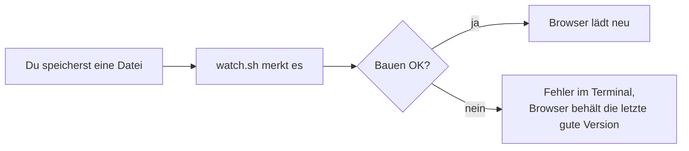
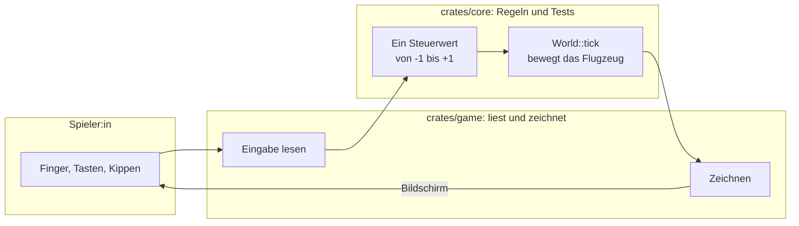
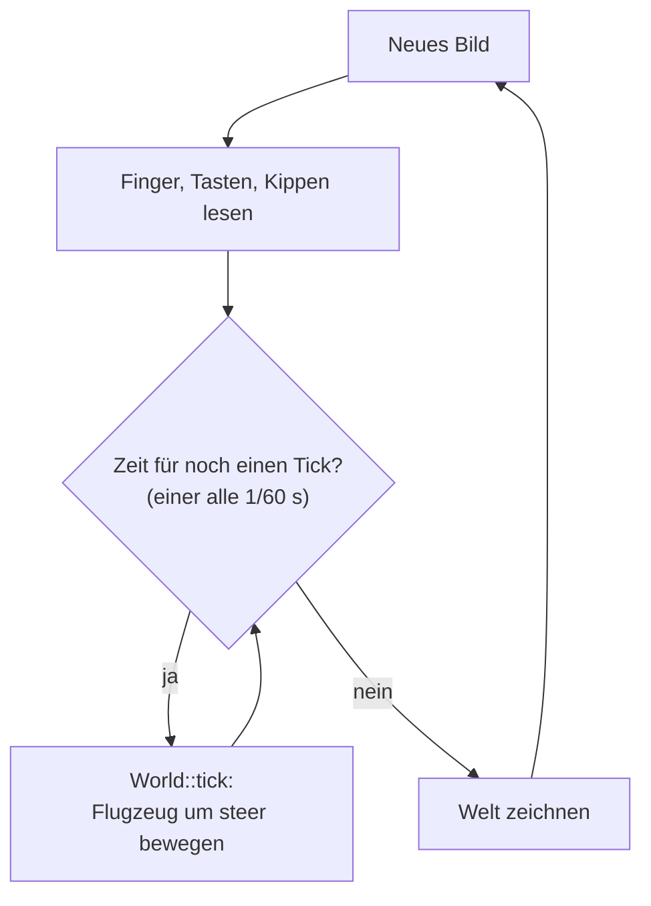
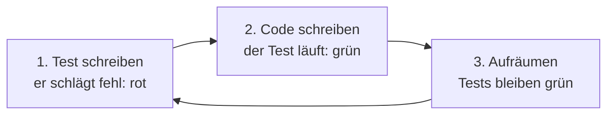
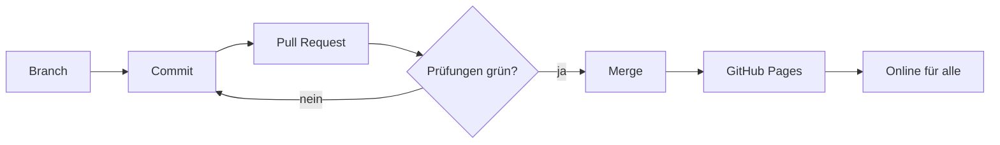

# Entwickeln

Das Spiel ist in [Rust](https://www.rust-lang.org/) geschrieben und läuft
im Browser als WebAssembly. Gezeichnet wird mit der Engine
[macroquad](https://macroquad.rs/).

## Was du brauchst

- Einen Computer mit macOS, Linux oder Windows
- [Rust](https://rustup.rs/) (Installation mit `rustup`)
- [Git](https://git-scm.com/)
- Python 3 (für den lokalen Webserver)
- Google Chrome (für automatische Screenshots; optional)

## Einrichten

```sh
git clone https://github.com/m0nstergamez/airplane-scoring.git
cd airplane-scoring
rustup target add wasm32-unknown-unknown
```

## Spiel starten

| Was | Befehl |
|---|---|
| In einem Fenster spielen | `cargo run` |
| Im Browser spielen | `scripts/dev.sh`, dann <http://localhost:8080> öffnen |
| Alle Prüfungen laufen lassen | `scripts/check.sh` |
| Schnelle Prüfungen | `scripts/check.sh --fast` |

`scripts/dev.sh` läuft weiter: Jedes Mal, wenn du eine Datei speicherst,
wird das Spiel neu gebaut und die Seite im Browser lädt sich von selbst neu:



## So ist das Projekt aufgebaut

| Ordner | Was drin ist |
|---|---|
| `crates/core` | Die **Regeln** des Spiels: Bewegung, Steuerung, Kippen. Keine Grafik. Alles hier hat Tests. |
| `crates/game` | Zeichnet das Spiel und liest Tasten, Finger und Sensoren. Keine Regeln. |
| `web` | Die Webseite, die das Spiel lädt. |
| `scripts` | Hilfsbefehle (bauen, starten, prüfen). |
| `docs` | Notizen und diese Anleitung. |

Die wichtigste Regel: **Spielregeln kommen in `core`, zuerst mit einem Test.**
`game` gibt nur weiter, was die Spielerin oder der Spieler tut, und zeichnet,
was `core` sagt:



Jede Art zu steuern endet als dieselbe einzelne Zahl, `steer`. Darum ist
es `core` egal, ob du kippst, ziehst oder Tasten drückst – und eine neue
Steuerung ist einfach ein weiterer Weg, diese Zahl zu erzeugen.

### Die Spielschleife

Das Spiel rechnet in festen Schritten von 1/60 Sekunde, den **Ticks**,
egal wie schnell ein Gerät zeichnen kann:



Ein langsames Handy macht mehrere Ticks pro Bild, ein schnelles manchmal
keinen. Weil jeder Tick gleich ist, verhält sich das Spiel überall gleich –
und ein Test kann es genau nachspielen.

### Zuerst der Test

Neue Regeln entstehen in drei Schritten:



Der fehlschlagende Test beweist, dass der Test die neue Regel wirklich
prüft. Wäre er sofort grün, würde er nichts Neues testen.

## Deine erste Änderung

Lass das Flugzeug schneller steigen und sinken:

1. Öffne `crates/core/src/lib.rs`.
2. Suche `PLAYER_CLIMB_SPEED` und ändere `300.0` auf `500.0`.
3. Speichern. Läuft `scripts/dev.sh`, lädt der Browser neu – probier es aus.
4. Starte `scripts/check.sh`. Schlägt ein Test fehl, lies seine Meldung:
   Tests beschreiben, wie sich das Spiel verhalten soll.

Weitere Zahlen zum Ausprobieren:

| Konstante | Datei | Bedeutung |
|---|---|---|
| `PLAYER_CLIMB_SPEED` | `crates/core/src/lib.rs` | Steig-/Sinkgeschwindigkeit (Pixel pro Sekunde) |
| `PLAYER_X_FRACTION` | `crates/core/src/lib.rs` | wo das Flugzeug steht (0.2 = 20 % von links) |
| `TILT_FULL_DEG` | `crates/core/src/tilt.rs` | wie weit du das Handy für volle Geschwindigkeit drehst |
| `TILT_DEAD_ZONE_DEG` | `crates/core/src/tilt.rs` | kleine Drehungen, die ignoriert werden |
| `TILT_SMOOTHING` | `crates/core/src/tilt.rs` | weicheres (kleiner) oder direkteres (grösser) Kippen |

## Änderung teilen

Änderungen kommen über einen **Pull Request** auf GitHub ins Spiel:



1. Neuen Branch anlegen: `git switch -c meine-aenderung`
2. Committen: `git commit -am "Schnelleres Flugzeug"`
3. Pushen und Pull Request öffnen: `git push -u origin meine-aenderung`,
   dann dem Link folgen, den GitHub anzeigt.
4. GitHub lässt alle Prüfungen automatisch laufen. Sind sie grün und ist
   der Pull Request gemergt, ist die neue Version eine Minute später online.

Ändert sich dadurch, was Spielerinnen und Spieler sehen oder tun, passe
auch diese Anleitung an – in **beiden** Sprachen.
