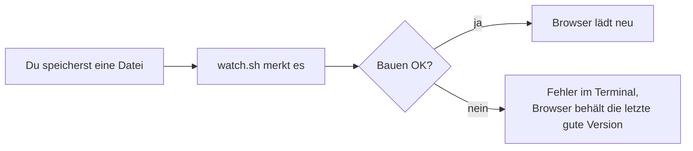
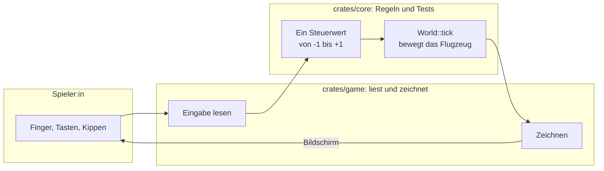
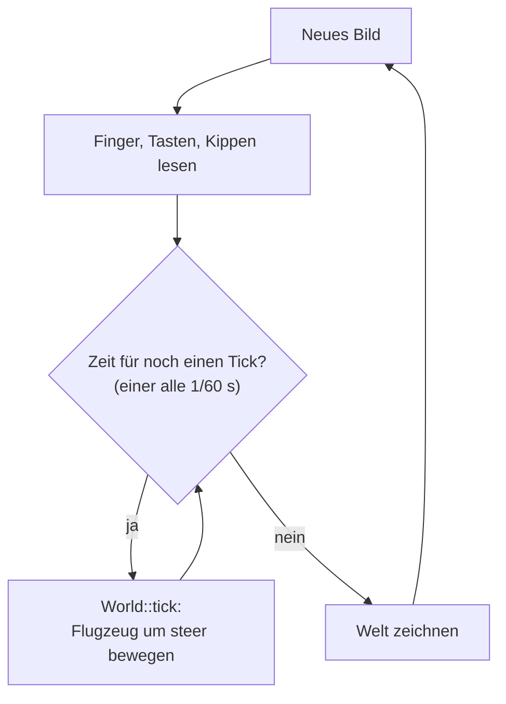
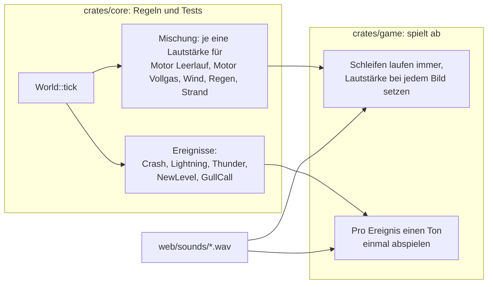
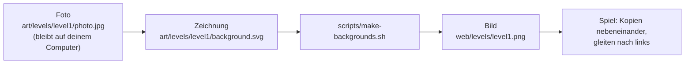
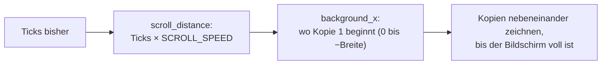
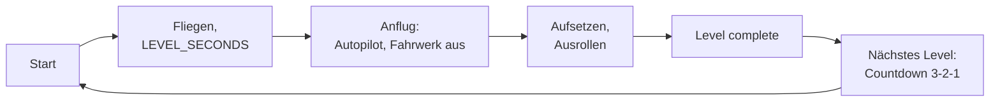
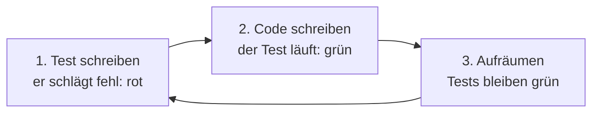
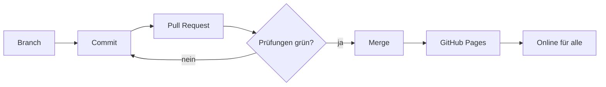

# Entwickeln

Das Spiel ist in [Rust](https://www.rust-lang.org/) geschrieben und läuft
im Browser als WebAssembly. Gezeichnet wird mit der Engine
[macroquad](https://macroquad.rs/).

## Was du brauchst

- Einen Computer mit macOS, Linux oder Windows
- [Rust](https://rustup.rs/) (Installation mit `rustup`)
- [Git](https://git-scm.com/)
- Python 3 (für den lokalen Webserver)
- Google Chrome (für automatische Screenshots; optional)
- Nur Linux: die ALSA-Ton-Header für `cargo run` (auf Ubuntu:
  `sudo apt install libasound2-dev`)
- Nur für Level-Hintergründe: `rsvg-convert` und ImageMagick (macOS:
  `brew install librsvg imagemagick`)

## Einrichten

```sh
git clone https://github.com/m0nstergamez/airplane-scoring.git
cd airplane-scoring
rustup target add wasm32-unknown-unknown
```

## Spiel starten

| Was | Befehl |
|---|---|
| In einem Fenster spielen | `cargo run` |
| Im Browser spielen | `scripts/dev.sh`, dann <http://localhost:8080> öffnen |
| Alle Prüfungen laufen lassen | `scripts/check.sh` |
| Schnelle Prüfungen | `scripts/check.sh --fast` |
| Tondateien neu erzeugen | `scripts/make-sounds.py` |
| Level-Hintergründe neu erzeugen | `scripts/make-backgrounds.sh` |

`scripts/dev.sh` läuft weiter: Jedes Mal, wenn du eine Datei speicherst,
wird das Spiel neu gebaut und die Seite im Browser lädt sich von selbst neu:



## So ist das Projekt aufgebaut

| Ordner | Was drin ist |
|---|---|
| `crates/core` | Die **Regeln** des Spiels: Bewegung, Steuerung, Kippen, Wetter, Zusammenstösse, Lautstärken, Scrollen. Keine Grafik, keine Tondateien. Alles hier hat Tests. |
| `crates/game` | Zeichnet das Spiel, spielt die Töne ab und liest Tasten, Finger und Sensoren. Keine Regeln. |
| `web` | Die Webseite, die das Spiel lädt, die Tondateien in `web/sounds` und die Level-Hintergründe in `web/levels`. |
| `art` | Zeichnungen, aus denen das Spiel gemacht ist: ein Ordner pro Level in `art/levels`. |
| `scripts` | Hilfsbefehle (bauen, starten, prüfen). |
| `docs` | Notizen und diese Anleitung. |

Die wichtigste Regel: **Spielregeln kommen in `core`, zuerst mit einem Test.**
`game` gibt nur weiter, was die Spielerin oder der Spieler tut, und zeichnet,
was `core` sagt:



Jede Art zu steuern endet als dieselbe einzelne Zahl, `steer`. Darum ist
es `core` egal, ob du kippst, ziehst oder Tasten drückst – und eine neue
Steuerung ist einfach ein weiterer Weg, diese Zahl zu erzeugen.

### Die Spielschleife

Das Spiel rechnet in festen Schritten von 1/60 Sekunde, den **Ticks**,
egal wie schnell ein Gerät zeichnen kann:



Ein langsames Handy macht mehrere Ticks pro Bild, ein schnelles manchmal
keinen. Weil jeder Tick gleich ist, verhält sich das Spiel überall gleich –
und ein Test kann es genau nachspielen.

Wie viele Ticks ein Bild bekommt, entscheidet `Clock` in
`crates/core/src/clock.rs`. Bis «Tap to fly» gibt es keine: Das Spiel
steht auf der Startanzeige still, und der Flug (Wetter, Levels)
beginnt mit dem Tipp.

### Ton

Beim Ton gilt dieselbe Aufteilung. `core` entscheidet, **was** du hörst
und **wie laut**; `game` spielt nur Dateien ab:



- **Schleifen** (Motor, Wind, Regen, Strand) hören nie auf. Bei jedem Tick
  berechnet `core` eine Mischung (`Mix`) mit ihren Lautstärken; diese
  ändern sich pro Tick nur wenig, damit nichts knackt.
- **Das Triebwerk** ist eine Turbine (Düse) und besteht aus zwei
  Schleifen. macroquad 0.4.16 kann die Tonhöhe nicht ändern, darum
  blendet Steigen vom Leerlauf (tieferes Pfeifen, leises Rauschen) zum
  Vollgas (höheres Pfeifen, lauteres Rauschen und Zischen) über. Die
  Lautstärke folgt der Entfernung des Flugzeugs (`Bounds::nearness`):
  voll nahe am Boden, `ENGINE_FAR_VOLUME` (30 %) ganz oben.
- **Einzelne Töne** (Donner, Zusammenstoss, die Melodie für ein neues
  Level, der Ruf einer Möwe) sind Ereignisse eines Ticks. Der Donner ist ein eigenes Ereignis,
  weil er später kommt als sein Blitz.
- **Töne eines Levels** folgen seiner Landschaft: Die Lautstärke der
  Strand-Schleife ist `BEACH_VOLUME` mal, wie viel von Level 2 zu sehen ist
  (`LevelView::presence`). So werden die Wellen mit dem Strand eingeblendet.
  Beim Wetter ist es gleich: Der Regen darf nur so stark sein, wie die
  Levels in `RAINY_LEVELS` zu sehen sind (`LevelView::rain_room`). Diese
  Liste ist im Moment leer, darum sind Level 1 und 2 trocken; das Wetter
  läuft für spätere Levels darunter weiter.
- **Heissluftballone** (`crates/core/src/balloons.rs`) sind die
  Hindernisse von Level 1: gross, langsam und selten, weil Level 1 das
  einfachste Level ist. Jeder hebt von einer Startrampe ab (`Pad`: er
  kommt darauf stehend herein und hebt bei `TAKEOFF_AT` ab), landet auf
  einer (Aufsetzen bei `TOUCHDOWN_AT`), kommt waagrecht auf der Höhe des
  Flugzeugs oder sinkt von dort vorbei (`BalloonWay`;
  `Balloon::at_plane_y`, bis ganz oben). Die Arten wechseln sich
  ab: eine gemischte Runde aus allen vier, nie zweimal dieselbe Art
  hintereinander. Auch Startrampen sind Hindernisse. core
  lässt sie auftauchen (mit Startwert), bewegt sie und prüft den
  Zusammenstoss mit Hülle und Korb; ein Ereignis `BalloonBurner` spielt
  seinen Ton, wenn er auftaucht oder abhebt.
- **Hütten** (`crates/core/src/huts.rs`) stehen gross im Vordergrund von
  Level 1, am unteren Bildschirmrand, selten, und ziehen mit der
  Landschaft vorbei. Sie gehören zur Landschaft, darum wachsen sie mit
  `Bounds::scale`, aber nicht mit `OBJECT_SIZE`; ebenso die Startrampen,
  die neben ihnen liegen. Hütten und Startrampen warten aufeinander, so
  liegt nie eine Rampe auf einer Hütte.
- **Tiefe** (`Bounds::depth(y)`): Was fliegt (Ballone, Möwen), ist ganz
  oben am kleinsten (`OBJECT_SIZE`) und wächst über die ganze Höhe
  gleichmässig bis zur vollen Grösse eines Ballons auf der Startrampe.
  Das Flugzeug folgt `Bounds::plane_depth(y)`: oben gleich klein, nahe am
  Boden bis `PLANE_NEAR_SIZE` (2.4) gross. Zeichnen und Zusammenstösse
  nutzen denselben Faktor, darum ist ein tief fliegendes Flugzeug
  grösser und leichter zu treffen.
- **Zusammenstösse nutzen die gezeichneten Formen**
  (`crates/core/src/shape.rs`): Das Flugzeug (`Player::shape`: Rumpf,
  Nase, Flügel, Heck, Cockpit) und jedes Hindernis (`Hut::shape`,
  `Pad::shape`, `Balloon::shape`, `Gull::shape`) sind ein paar konvexe
  Vielecke mit denselben Punkten, die das game-Crate zeichnet. Nur eine
  echte Überlappung ist ein Zusammenstoss; ein knappes Vorbeifliegen
  oder die leere Ecke neben einem Dach nicht.
- **Strandtürme** (`crates/core/src/towers.rs`) stehen im Sand des
  Strandes: selten (alle 6–10 s einer) und nicht hoch (92–112 px).
  Jeder hat seine eigene Tiefe (`Tower::near`): beim Wasser steht er
  höher (`TOWER_GROUND`), ist `TOWER_FAR_SIZE` (55 %) so gross und zieht
  entsprechend langsamer vorbei (Parallaxe); vorne ist er voll gross.
  Hintere werden zuerst gezeichnet. `Tower::parts` legt Beine, Leiter,
  Plattform, Kabine und Dach fest; Zusammenstösse (`Tower::shape`) und
  Zeichnen nutzen beide das.
- **Die Stadt** (`crates/core/src/city.rs`, Level 3, `CITY_LEVEL`)
  schickt Hochhäuser und Baukräne, alle 3–5 s eins
  (`CITY_GAP_SECONDS`), mit mindestens `CITY_ROOM` (140 px) freiem Boden
  dazwischen; `CRANE_SHARE` (40 %) sind Kräne, nie zwei hintereinander
  und spätestens nach `HIGH_RISES_IN_A_ROW` (2) Hochhäusern.
  Ein `HighRise` steht vorne (Mauern, Treppenhaus, Antenne): darüber
  fliegen. Ein `Crane` steht auch am Boden: Sein Mast geht vom Ausleger
  (`JIB_TOP`) bis zum Boden, eine Last hängt an einem Seil
  (`LOAD_DROP`), und alles wird getroffen: darüber fliegen. Alle 5–8 s
  kommt ein `FlyingHeli` dem Flugzeug auf seiner Höhe entgegen, nie
  tiefer als `FLYING_HELI_LOWEST` (über der Stadt), so ist auch oben
  nicht sicher. `parts` legt alles fest; Zusammenstösse (`shape`) und
  Zeichnen nutzen es. Ein Helikopter, den das Flugzeug trifft (fliegend
  oder parkiert, `heli_shape`), wird zu einem fallenden, brennenden
  `Wreck` (`WRECK_SECONDS`) und schickt `Event::HeliCrash` (den
  Explosionston).
  `HELI_SHARE` (35 %) der Hochhäuser haben einen `Heli`: Er hebt ab,
  sobald sein Hochhaus bei `HELI_TAKEOFF_AT` ist, und steigt nach hinten
  oben weg, oder er landet bis `HELI_TOUCHDOWN_AT` (seine Sinkrate
  rechnet mit dem Tempo des Spiels). Sein Platz zählt ab dem Dach, so
  zieht er mit ihm vorbei.
- **Der Sonnenaufgang** (`crates/core/src/sunrise.rs`, Level 4,
  `SUNRISE_LEVEL`): Alle 3–5 s (`GOOSE_GAP_SECONDS`) kommt dem Flugzeug
  ein V Gänse entgegen, seine Spitze oder ein Flügel auf der Höhe des
  Flugzeugs (`Goose::shape`, abgeschossen wie Möwen, `Event::GooseHonk`).
  `Steam`-Säulen steigen vom Boden auf; in einer wird das Flugzeug nach
  oben gedrückt (`STEAM_LIFT`, `Event::SteamHiss`), ohne Leben zu
  verlieren. `Sunrise::glare` (0..1, alle 10–16 s für `GLARE_SECONDS`)
  sagt dem Spiel, wie stark es den Bildschirm ins Licht der Sonne
  taucht, die es bei `SUN_AT` zeichnet.
- **Möwen** (`crates/core/src/gulls.rs`) sind die Hindernisse am Strand.
  core entscheidet, wann und wo sie auftauchen (mit Startwert, wie das
  Wetter), bewegt sie und prüft den Zusammenstoss; eine Möwe, die ruft,
  schickt ein Ereignis `GullCall`. So gehört jeder Ruf, den du hörst, zu
  einer Möwe, die du siehst.
- **Getroffene Möwen** (`Gull::knock_down`): Eine Möwe, in die das
  Flugzeug fliegt, wird ein wenig hochgeworfen, fällt dann (`GULL_FALL`)
  und trudelt (`Gull::tumble`); sie ist kein Hindernis mehr und
  verschwindet unten aus dem Bild. Das Spiel dreht nur die Zeichnung um
  `tumble`.
- **Leben** zählt auch core: Ein Zusammenstoss kostet eines
  (`World.lives`), ein Flugzeug, das sich erholt, ist `SAFE_SECONDS` lang
  geschützt (`Player::is_safe`), jedes verlorene Leben gibt mehr Rauch
  (`World::smoke`, `DAMAGE_SMOKE`), und ist das letzte weg, explodiert
  das Flugzeug (`Event::Explosion`, `World::explosion`,
  `World::explosion_progress` über die Absturzzeit), dann kommt `Event::GameOver`, und `World::tick` steht still
  (`World::is_over`). Das game-Crate zeichnet das nur und startet, sobald
  `World::can_restart` es erlaubt, bei einem Tipp eine neue `World`.
  Die Zeit auf dem Bildschirm (`World::seconds_in_level`, von
  `clock_text` als «m:ss» angezeigt) ergibt sich aus den in diesem Level
  geflogenen Ticks, darum bleibt sie bei «Game over» mit ihnen stehen und
  beginnt in jedem Level bei 0:00; `World::seconds_flown` zählt den
  ganzen Flug, für das Schnellerwerden.
  Nur «Level complete» speichert eine Bestzeit: `World::millis_in_level`
  (von `best_time_text` als «m:ss.mmm» angezeigt) kommt in `BestTimes`,
  die schnellste zuerst; «Game over» oder Verlassen speichert nichts.
- **Das Wetter ist zufällig, aber wiederholbar:** `World::with_seed`
  bekommt einen Startwert; derselbe Startwert ergibt denselben Regen und
  dieselben Blitze, darum können Tests es nachspielen.
- **Die Tondateien erzeugt ein Skript**, sie sind nicht aufgenommen:
  `scripts/make-sounds.py` berechnet sie aus Rauschen und Impulsen. Skript
  ändern, laufen lassen, die neuen `.wav`-Dateien committen.

### Level-Hintergründe

Jedes Level hat eine Landschaft hinter dem Flugzeug. Sie beginnt als Foto
und endet als Bild, das das Spiel beim Scrollen immer wieder nebeneinander
zeichnet:



Jedes Level hat einen eigenen Ordner mit denselben Dateinamen:

```text
art/levels/
  level1/
    photo.jpg         das Foto (wird nicht committet)
    background.svg    die Zeichnung (wird committet)
  level2/
  level3/
```

Ein neues Level in sechs Schritten:

1. Lege den Ordner an, zum Beispiel `art/levels/level2/`.
2. Leg dein Foto als `photo.jpg` hinein. Fotografiere quer und ohne
   Personen. Das Foto wird nie committet: Das Repository ist öffentlich,
   und Handyfotos enthalten den Ort, an dem sie gemacht wurden.
3. Zeichne `background.svg` nach dem Foto, oder bitte Claude Code: «Mach
   `art/levels/level2/background.svg` aus `photo.jpg`, wie bei Level 1.»
   Nimm eine Kopie von `art/levels/level1/background.svg` als Start: Ihre
   Kommentare erklären die Regeln unten.
4. Starte `scripts/make-backgrounds.sh level2`. Es erzeugt
   `web/levels/level2.png` und prüft die Naht.
5. Erhöhe `LEVEL_COUNT` in `crates/core/src/level.rs` um eins, damit das
   Spiel das neue Level zeigt.
6. Schau dir das Bild an, dann committe das SVG und das PNG.

Das SVG muss ein paar Regeln einhalten, weil der rechte Rand einer Kopie
den linken Rand der nächsten berührt:

- **Grösse:** `viewBox="0 0 1600 740"`, ungefähr die Form eines quer
  gehaltenen Handys. Das Spiel skaliert es auf die Bildschirmhöhe.
- **Flache Farben, ruhig und etwas blass**, damit das Flugzeug und die
  weisse Schrift gut sichtbar sind.
- **Was über die ganze Breite geht** (Himmel, Wasser, Strasse, Wiese),
  ändert sich nur von oben nach unten, nie von links nach rechts.
- **Alles andere wird dreimal gezeichnet** (bei x = −1600, 0 und +1600).
  Eine Wolke, die rechts hinausragt, kommt links wieder herein.
- **Eine Gruppe pro Ebene** (Himmel, Hügel, Wasser, Ufer, Strasse, Wiese,
  Zaun). Später können die Ebenen verschieden schnell scrollen.

Passen die Ränder nicht zusammen, bricht `make-backgrounds.sh` mit «seam
too visible» ab. Das Spiel selbst weiss nur, wie weit sich die Landschaft
bewegt hat, `background_x` in `crates/core/src/scenery.rs`, und zeichnet so
viele Kopien, wie der Bildschirm braucht:



Ein Level endet mit einer Landung (`World::landing`, `Landing` in
`crates/core/src/lib.rs`): Nach `LEVEL_DISTANCE` Landschaft (`LEVEL_SECONDS` bei Reisetempo, mit mehr Gas früher) kommt die
Landebahn, der Autopilot fliegt den Anflug und setzt auf, das Flugzeug
bremst bis zum Stillstand, «Level N complete» erscheint (ein Tipp führt
weiter), die Landschaft des nächsten Levels übernimmt sofort und zählt
herunter, und das Flugzeug startet von seiner Startbahn.
`CLEAR_SECONDS` vor der Landung kommen keine neuen Hindernisse. Um
direkt in einem Level zu starten, häng `?level=2` an die Adresse
(`LEVEL=2 scripts/shot.sh` für einen Screenshot).



### Zuerst der Test

Neue Regeln entstehen in drei Schritten:



Der fehlschlagende Test beweist, dass der Test die neue Regel wirklich
prüft. Wäre er sofort grün, würde er nichts Neues testen.

## Deine erste Änderung

Lass das Flugzeug schneller steigen und sinken:

1. Öffne `crates/core/src/lib.rs`.
2. Suche `PLAYER_CLIMB_SPEED` und ändere `300.0` auf `500.0`.
3. Speichern. Läuft `scripts/dev.sh`, lädt der Browser neu – probier es aus.
4. Starte `scripts/check.sh`. Schlägt ein Test fehl, lies seine Meldung:
   Tests beschreiben, wie sich das Spiel verhalten soll.

Weitere Zahlen zum Ausprobieren. Grössen und Geschwindigkeiten in Pixeln
gelten für ein Handy quer (`DESIGN_HEIGHT`, 390 Pixel hoch); auf einem
grösseren Bildschirm multipliziert das Spiel sie mit `Bounds::scale`
(Bildschirmhöhe / 390), so behält alles seine Grösse im Verhältnis zur
Landschaft:

| Konstante | Datei | Bedeutung |
|---|---|---|
| `DESIGN_HEIGHT` | `crates/core/src/lib.rs` | die Bildschirmhöhe, für die alle Grössen und Geschwindigkeiten in Pixeln gemacht sind |
| `PLANE_NEAR_SIZE` | `crates/core/src/lib.rs` | wie gross das Flugzeug nahe am Boden wird (1 = erster Entwurf) |
| `OBJECT_SIZE` | `crates/core/src/lib.rs` | wie gross Flugzeug und Hindernisse gezeichnet und getroffen werden (1 = erster Entwurf, jetzt 0.41): die Grösse oben am Himmel; kleiner gibt mehr Platz |
| `PLAYER_CLIMB_SPEED` | `crates/core/src/lib.rs` | Steig-/Sinkgeschwindigkeit (Pixel pro Sekunde) |
| `CLIMB_RESPONSE` | `crates/core/src/lib.rs` | wie schnell das Flugzeug Steigen oder Sinken aufnimmt (kleiner = weicher) |
| `MAX_PITCH_DEG` | `crates/core/src/lib.rs` | wie weit sich die Nase bei vollem Steigen oder Sinken neigt (Grad) |
| `PLAYER_X_FRACTION` | `crates/core/src/lib.rs` | wo das Flugzeug steht (0.2 = 20 % von links) |
| `TILT_FULL_DEG` | `crates/core/src/tilt.rs` | wie weit du das Handy für volle Geschwindigkeit drehst |
| `TILT_DEAD_ZONE_DEG` | `crates/core/src/tilt.rs` | kleine Drehungen, die ignoriert werden |
| `TILT_SMOOTHING` | `crates/core/src/tilt.rs` | weicheres (kleiner) oder direkteres (grösser) Kippen |
| `CRASH_SECONDS` | `crates/core/src/lib.rs` | wie lange sich ein Flugzeug nach einem Zusammenstoss nicht steuern lässt |
| `LIVES` | `crates/core/src/lib.rs` | Leben am Anfang eines Flugs |
| `SPEED_PER_SECOND` | `crates/core/src/lib.rs` | wie viel schneller das Spiel pro geflogene Sekunde wird (`World::speed`, höchstens `MAX_SPEED`) |
| `AIRSPEED_RANGE` | `crates/core/src/lib.rs` | langsamste und schnellste einstellbare Geschwindigkeit (1 = normal) |
| `OVERSPEED_AT` | `crates/core/src/lib.rs` | Geschwindigkeit, ab der «Overspeed» warnt; nach `OVERSPEED_SECONDS` bricht es auseinander |
| `STALL_AT` | `crates/core/src/lib.rs` | Geschwindigkeit, unter der «Pull up» warnt und das Flugzeug absackt (bis `STALL_SINK`) |
| `ROLL_SECONDS` | `crates/core/src/airport.rs` | wie lange das Flugzeug auf der Startbahn rollt, bevor es abhebt |
| `SHAKE_PX` | `crates/core/src/lib.rs` | wie weit der Bildschirm bei der Explosion wackelt (`World::shake`) |
| `SAFE_SECONDS` | `crates/core/src/lib.rs` | wie lange das Flugzeug nach einem Zusammenstoss blinkt und geschützt ist |
| `RAIN_SECONDS` | `crates/core/src/weather.rs` | kürzester und längster Regen |
| `STORM_RAIN` | `crates/core/src/weather.rs` | wie stark der Regen für Blitze sein muss (0 bis 1) |
| `STRIKE_GAP_SECONDS` | `crates/core/src/weather.rs` | Zeit zwischen zwei Blitzen |
| `ENGINE_VOLUME` | `crates/core/src/sound.rs` | wie laut der Motor ist (0 bis 1) |
| `BEACH_VOLUME` | `crates/core/src/sound.rs` | wie laut Wellen und Möwen sind (0 bis 1) |
| `GULL_GAP_SECONDS` | `crates/core/src/gulls.rs` | kürzeste und längste Zeit zwischen zwei Möwen |
| `GULL_SPEED` | `crates/core/src/gulls.rs` | wie schnell Möwen fliegen (Pixel pro Sekunde) |
| `TOWER_GAP_SECONDS` | `crates/core/src/towers.rs` | kürzeste und längste Zeit zwischen zwei Strandtürmen |
| `TOWER_HEIGHT` | `crates/core/src/towers.rs` | niedrigster und höchster Strandturm (Pixel) |
| `BALLOON_GAP_SECONDS` | `crates/core/src/balloons.rs` | kürzeste und längste Zeit zwischen zwei Ballonen |
| `CITY_GAP_SECONDS` | `crates/core/src/city.rs` | kürzeste und längste Zeit zwischen zwei Hochhäusern oder Kränen |
| `CRANE_SHARE` | `crates/core/src/city.rs` | wie wahrscheinlich das Nächste ein Kran ist (0 bis 1) |
| `BALLOON_RISE` | `crates/core/src/balloons.rs` | wie schnell Ballone steigen (Pixel pro Sekunde) |
| `HUT_GAP_SECONDS` | `crates/core/src/huts.rs` | kürzeste und längste Zeit zwischen zwei Hütten |
| `HUT_HEIGHT` | `crates/core/src/huts.rs` | niedrigste und höchste Hütte (Pixel) |
| `SCROLL_SPEED` | `crates/core/src/scenery.rs` | wie schnell die Landschaft vorbeizieht (Pixel pro Sekunde) |
| `LEVEL_SECONDS` | `crates/core/src/level.rs` | wie lange ein Level bei Reisetempo dauert (Sekunden); legt `LEVEL_DISTANCE` fest |
| `CLEAR_SECONDS` | `crates/core/src/airport.rs` | wie lange vor einer Landung keine neuen Hindernisse kommen |
| `BRAKE_SECONDS` | `crates/core/src/airport.rs` | wie lange das Flugzeug nach dem Aufsetzen bis zum Stillstand bremst |

## Änderung teilen

Änderungen kommen über einen **Pull Request** auf GitHub ins Spiel:



1. Neuen Branch anlegen: `git switch -c meine-aenderung`
2. Committen: `git commit -am "Schnelleres Flugzeug"`
3. Pushen und Pull Request öffnen: `git push -u origin meine-aenderung`,
   dann dem Link folgen, den GitHub anzeigt.
4. GitHub lässt alle Prüfungen automatisch laufen. Sind sie grün und ist
   der Pull Request gemergt, ist die neue Version eine Minute später online.

Ändert sich dadurch, was Spielerinnen und Spieler sehen oder tun, passe
auch diese Anleitung an – in **beiden** Sprachen.
