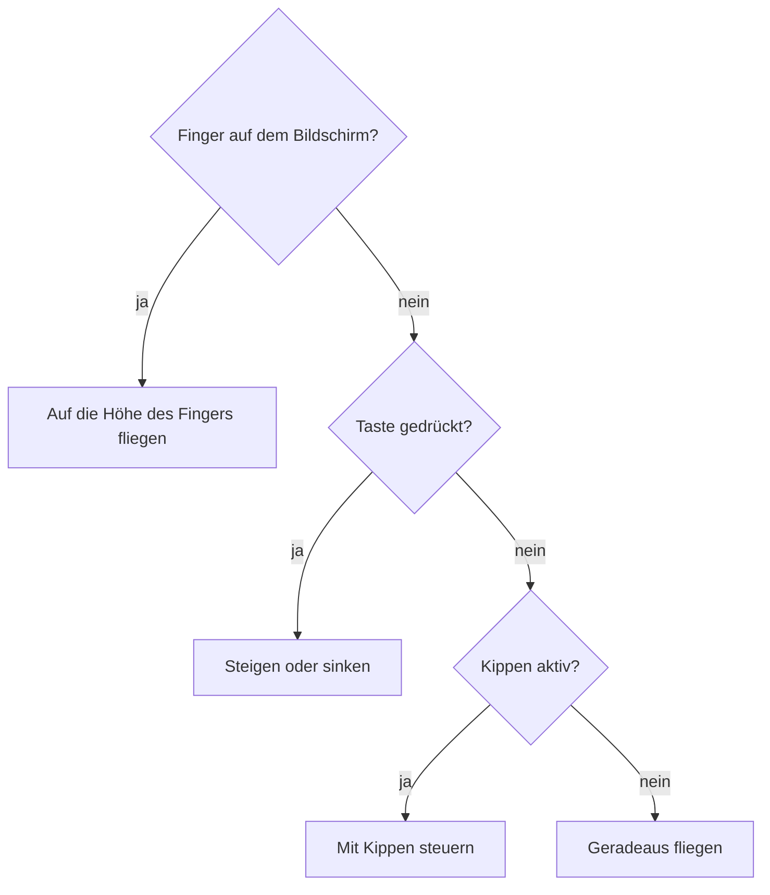
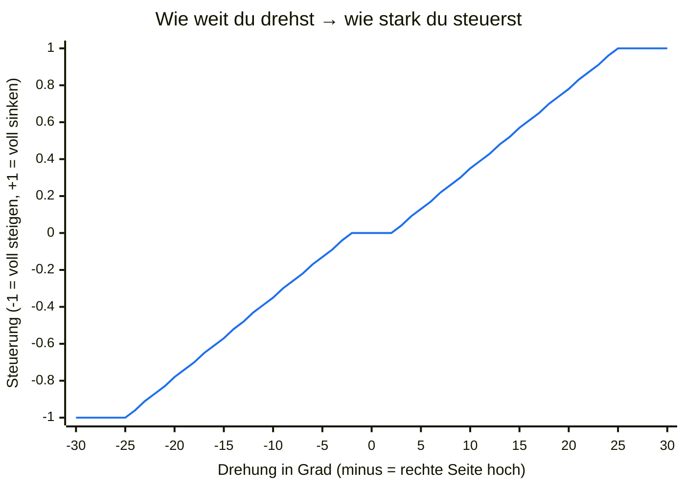

# Spielen

## Start

1. Öffne <https://m0nstergamez.github.io/airplane-scoring/> auf deinem Handy.
2. Dreh dein Handy **quer**. Hältst du es aufrecht, bittet dich das Spiel,
   es zu drehen.
3. Im **Hauptmenü** («AIRPLANE SCORING», mit dem Flugzeug vor der Küste)
   tippst du auf **«Tap to fly»** und **wählst dann ein Level**. Auf dem
   iPhone erlaubst du den Zugriff auf «Bewegung & Ausrichtung», wenn
   danach gefragt wird. Unten rechts ist ein **QR-Code**: Deine Freunde
   scannen ihn mit der Kamera und fliegen auch.

«Tap to fly» öffnet die **Level-Karte** («Choose a level»): ein rundes
Bild jeder Landschaft, verbunden mit einer gestrichelten Linie. Tippe
auf ein Level, um dort zu starten. Level 2 und 3 sind zuerst gesperrt
(grau mit Schloss); jedes wird frei, sobald du das Level davor geschafft
hast (ein neues Level trägt ein goldenes **«NEW»**, bis du es geflogen
bist); das Spiel
merkt es sich, und ein geschafftes Level bekommt ein grünes Häkchen.
Tippst du auf ein gesperrtes Level, steht da, welches du zuerst schaffen
musst. Der Knopf **Levels** im Hauptmenü öffnet dieselbe Karte nur zum
Anschauen: Ein Tipp auf ein Level startet dort nichts, sondern sagt dir,
ob du es schon geschafft hast, noch nicht, oder zuerst das davor
schaffen musst. Unter **How to play** steht eine kurze Anleitung auf
Englisch (Ziel, Steuerung, Tempo, Pause), unter **Options** schaltest du
Musik und Geräusche.

Am Computer zeigt das Hauptmenü auch die Tasten und einen grösseren
**QR-Code**. Scanne ihn mit der Kamera deines Handys, um das Spiel dort
zu öffnen. Um am Computer zu fliegen, klicke auf **«Click to fly»** oder
drücke Enter und wähle dann ein Level (Enter fliegt Level 1).

Der Flug beginnt erst, wenn du ein Level wählst. Bis dahin wartet das
Spiel, egal wie lange das Hauptmenü offen ist.

Jeder Flug beginnt auf einem **Flughafen**: Dein Flugzeug steht vorne
auf der Startbahn, beim Kontrollturm und dem Windsack. Es rollt los,
die Landschaft zieht immer schneller vorbei, es hebt ab und steigt von
selbst weg. Dann übernimmst du die Steuerung. Solange der Autopilot
fliegt (beim Start und bei der Landung am Ende eines Levels), kommen
keine Hindernisse, und nichts kann das Flugzeug treffen: Du könntest ja
nicht ausweichen. Während du fliegst, bleibt der Bildschirm des Handys
an, auch wenn du nur durch Kippen steuerst.

## Steuerung

Das Flugzeug reagiert weich: Es nimmt Fahrt nach oben oder unten
allmählich auf und neigt dabei die Nase, beim Steigen nach oben, beim
Sinken nach unten, je stärker du steuerst, desto mehr.

Du kannst auf drei Arten steuern. Benutzt du mehrere gleichzeitig,
gewinnt der Finger, dann die Tasten, dann das Kippen:

### Kippen (Handy)

Halte dein Handy wie ein Lenkrad. **Das Handy ist das Flugzeug:**

- Rechte Seite **nach oben** drehen → das Flugzeug steigt.
- Rechte Seite **nach unten** drehen → das Flugzeug sinkt.
- Ruhig halten → das Flugzeug fliegt geradeaus.

Wie du das Handy hältst, wenn du auf «Tap to fly» tippst, gilt als
«gerade». Kleines Wackeln wird ignoriert; etwa eine Vierteldrehung bis
zur Senkrechten (25°) ist volle Geschwindigkeit:

Zwischen −2° und +2° passiert nichts (so fliegt eine ruhige Hand
geradeaus), danach wird die Steuerung gleichmässig stärker, und ab 25° ist sie voll.

**Tempo:** Kippst du das Handy nach vorne (obere Kante von dir weg),
gibst du Gas; kippst du es zu dir, bremst du. Auch hier gilt die
Haltung beim Start als «gerade»; bis 5° passiert nichts, ab 25° ist es
voll.

### Finger (Handy und Computer)

Berühre den Bildschirm und halte den Finger drauf: Das Flugzeug fliegt
auf die Höhe deines Fingers. Am Computer hältst du stattdessen die
Maustaste gedrückt.

### Tasten (Computer)

| Taste | Aktion |
|---|---|
| ↑ oder W | steigen |
| ↓ oder S | sinken |
| → oder D | schneller (Gas) |
| ← oder A | langsamer (bremsen) |
| M | Ton ein oder aus |
| Esc oder P | Pause (Menü) |

## Menü (Pause)

Oben links ist der **Menü-Knopf** mit drei Strichen (am Computer auch
**Esc** oder **P**). Er hält das Spiel an und zeigt das Menü über dem
Spiel, das unscharf dahinter zu sehen ist:

- **Continue:** zurück ins Spiel. Ein Countdown zählt 3, 2, 1; erst bei 0
  geht es weiter, damit du bereit bist.
- **Restart:** ein neuer Flug vom Flughafen, nach demselben Countdown.
- **Calibrate** (nur auf dem Handy): Wie du das Handy jetzt hältst, gilt
  ab sofort als «gerade», fürs Steuern und fürs Gas.
- **Options:** Musik (die Melodien) und Geräusche (alles andere)
  einzeln ein- oder ausschalten. **Back** führt zurück.
- **Menu:** zurück ins Hauptmenü; mit «Tap to fly» und einem Level
  beginnt ein neuer Flug.

Wechselst du die App oder den Tab, hält das Spiel von selbst an, und
ebenso, wenn du das Handy hochkant drehst oder am Computer in ein anderes
Fenster klickst.

## Wetter und Zusammenstösse

Du fliegst einer Küste entlang: Hinter deinem Flugzeug zieht die
Landschaft vorbei. Bei Regen wird sie dunkler.

Im Moment ist es in allen Levels trocken: Regen passt weder zu den
Heissluftballonen an der Küste noch zum Sonnenuntergang am Strand. Das
Spiel kann aber Wetter: In späteren Levels setzt Regen ein, wird stärker
und lässt wieder nach. Starker Regen ist ein **Gewitter**: Blitze
erhellen den Himmel, und der Donner folgt. Je weiter weg der Blitz,
desto später und leiser der Donner.

Berührst du einen Heissluftballon, eine Startrampe oder eine Hütte
(Level 1), eine Möwe oder einen Strandturm (Level 2) oder ein Hochhaus,
einen Kran oder einen Helikopter (Level 3), gibt es einen
**Zusammenstoss**.
Nur eine echte Berührung zählt: Ganz knapp vorbeifliegen oder durch die
Lücke neben einem Dach ist erlaubt. Beim Zusammenstoss
raucht dein Flugzeug, fällt und lässt sich einen Moment lang (1,5 Sekunden)
nicht steuern. Danach fliegst du wieder.

## Tempo, Overspeed und Pull up

Neben dem Tempo, das mit deiner Flugzeit langsam steigt, stellst du selbst
ein, wie schnell du fliegst. Oben links zeigt die Anzeige «SPEED» dein
Tempo: gelb ist zu langsam, grün ist gut, rot ist zu schnell. Gibst du
kein Gas und bremst nicht, kommst du langsam zurück aufs normale Tempo.

- **Zu schnell:** «OVERSPEED» blinkt rot mit einem Countdown, ein
  Warnton klappert, und eine Stimme sagt «Overspeed». Bremst du nicht
  innerhalb von 3 Sekunden, bricht das Flugzeug auseinander: Es
  explodiert, und alle Leben sind auf einmal weg.
- **Zu langsam:** «PULL UP» blinkt gelb, ein Warnlicht leuchtet, ein
  Heulton ertönt, und eine Stimme sagt «Pull up». Die Flügel tragen
  nicht mehr richtig: Das Flugzeug sackt ab, je langsamer, desto mehr.
  Gib Gas! Schlägst du so am Boden auf, explodiert das Flugzeug, und
  alle Leben sind auf einmal weg.

## Zeit und Leben

Oben in der Mitte steht deine **Zeit**: wie lange du schon in diesem
Level fliegst, in Minuten und Sekunden («Time 1:05»). Jedes neue Level
beginnt wieder bei 0:00. Jedes Level ist eine feste **Strecke**: Mit
mehr Gas bist du früher am Ziel, aber alles kommt dir auch schneller
entgegen. Je schneller du ein Level schaffst, desto besser. Unter der
Zeit zeigt ein dünner Balken, wie weit du schon bist: Ein kleines
Flugzeug fliegt auf ihm zur Zielflagge, wo die Landung beginnt. Mit jeder Sekunde wird das Spiel ein ganz kleines bisschen
**schneller**: Die Landschaft und alles darin kommen schneller daher
(nach einer Minute etwa 12 %, höchstens 50 % schneller).

Du hast **3 Leben**, und jedes neue Level beginnt wieder mit allen 3. Oben rechts, neben dem Lautsprecher-Knopf, zeigt pro
Leben ein kleines Flugzeug, wie viele du noch hast. Jeder Zusammenstoss kostet ein Leben: Sein Flugzeug
wird grau und blinkt kurz.

Fliegst du nach einem Zusammenstoss wieder, **blinkt** dein Flugzeug
2 Sekunden lang. Solange es blinkt, bist du geschützt: Was du
dann berührst, kostet kein Leben. So verlierst du nicht zwei Leben an derselben
Möwengruppe.

Man sieht den Schaden: Nach dem ersten verlorenen Leben zieht dein
Flugzeug eine lange graue **Rauchfahne** hinter sich her; nach dem
zweiten kommt viel mehr Rauch, dick und dunkel, und am Heck flackert eine
kleine Flamme.

Beim letzten Leben **explodiert** dein Flugzeug: ein Feuerball,
herumfliegende Trümmer und eine Rauchwolke, mit einem lauten Knall, und
der Bildschirm **wackelt**.
Dann steht **«Game over»** auf dem Bildschirm, mit den Bestzeiten des Levels (ein «Game over» bekommt keine Zeit). Nach einem
kurzen Moment erscheint «Tap or click to fly again»: Tippe, klicke oder
drücke Enter, und ein neuer Flug beginnt im selben Level mit 3 Leben.

Nur ein **geschafftes** Level bekommt eine Zeit. «Level complete» zeigt
sie mit Millisekunden («Time 1:02.483»), und darunter stehen die
**«Best times»**: die 5 schnellsten Zeiten in diesem Level; diese Zeit
ist mit «<» markiert, wenn sie in die Liste kam, und «New best time!»
blinkt, wenn sie alle geschlagen hat. Jedes Level hat seine eigene
Liste. Ein «Game over» oder ein Flug, den du mit **Menu** oder
**Restart** verlässt, zählt keine Zeit. Die Zeiten bleiben nur in diesem
Browser: Nichts geht ins Internet, und deine Freunde haben auf ihren
Handys ihre eigenen Listen.

## Levels

Jedes **Level** hat seine eigene Landschaft: zuerst die Küste (Level 1),
dann einen Strand bei Sonnenuntergang (Level 2), dann eine Stadt bei
Nacht (Level 3). Nach seiner Strecke (bei Reisetempo etwa eine Minute)
endet ein Level mit einer **Landung**: Es kommen keine neuen
Hindernisse mehr, eine Landebahn erscheint, und der Autopilot übernimmt.
Solange er fliegt, schweigen die Tempo-Warnungen, und das Tempo geht von
selbst zurück.
Das Fahrwerk fährt aus, das Flugzeug setzt mit noch erhobener Nase auf
den Hinterrädern auf und senkt dann die Nase auf ihr Rad; jedes Aufsetzen
gibt eine Wolke **Reifenrauch**. Es bremst und steht: «Level
1 complete» erscheint mit deiner Zeit, den Bestzeiten des Levels und
zwei Knöpfen. **Next level**
(oder Enter) startet das nächste Level: Seine Landschaft erscheint, es
zählt 3, 2, 1, und du startest von seiner Startbahn. **Menu** führt ins
Hauptmenü. Das letzte Level (zurzeit Level 3) hat kein **Next level**:
Dort steht an seiner Stelle «No more levels yet, new ones are coming!»,
neben **Menu** (auch mit Enter).

An der Küste fahren ab und zu **Heissluftballone**. Sie kommen langsam
von rechts und wechseln sich auf vier Arten ab: Einer steht auf einer
**Startrampe** in der Wiese und hebt ab, sobald er ins Bild kommt, einer
kommt vom Himmel herab und landet auf einer Startrampe, einer kommt dir
genau auf deiner Höhe entgegen, und einer sinkt langsam von deiner Höhe
aus an dir vorbei. Auch ganz oben bist du also nicht vor ihnen sicher.
Unter je vier Ballonen kommt jede Art einmal, du weisst
also nie, welche als Nächstes kommt. Flieg über oder unter ihnen durch,
und pass auch auf den Korb auf. Wenn ein Ballon auftaucht oder abhebt,
hörst du seinen Brenner fauchen. Ein Ballon, in den du fliegst,
**explodiert** mit einem Knall und stürzt zu Boden (ein Leben kostet es
dich trotzdem). Auch in eine Startrampe zu fliegen kostet ein Leben.

Ganz vorne, am unteren Bildschirmrand, stehen ab und zu grosse
**Hütten** aus Holz, zusammen mit den Startrampen. Nur wenn du nahe am
Boden fliegst, musst du über sie steigen.
Unten durch kommst du nicht.

Das Spiel hat **Tiefe**: Je höher etwas fliegt, desto weiter weg ist es
und desto kleiner sieht es aus. Oben am Himmel sind dein Flugzeug und
die Ballone klein, unten bei den Hütten gross. Ein Ballon auf seiner
Startrampe ist gross und wird beim Aufsteigen bis ganz oben immer
kleiner. Dein Flugzeug wird sogar noch grösser, wenn du tief fliegst,
und braucht dann mehr Platz. Tief fliegen ist darum riskanter.

Am Strand fliegen **Möwen** herum: von vorne, von hinten und vom Sand
aus nach oben. Flieg nicht in sie hinein. Viele rufen, wenn sie
auftauchen; Möwen von hinten rufen immer, also hör gut hin. Eine Möwe,
die du triffst, kreischt und stürzt trudelnd zu Boden; ein Leben kostet
es dich trotzdem.

Ab und zu steht im Sand ein **Strandturm** der Bademeister: auf
Holzbeinen, mit Leiter und kleiner Kabine. Manche stehen weit hinten
beim Wasser (höher im Bild, kleiner, und sie ziehen langsamer vorbei),
andere vorne (grösser). Die Türme sind nicht hoch; nur wenn du tief
fliegst, musst du über sie steigen. Zwischen den
Beinen ist Luft, aber es ist sehr eng.

In der **Stadt bei Nacht** (Level 3) wechseln sich zwei Dinge ab, eins
nach dem anderen und mit Platz dazwischen:

Am Strand und in der Stadt (Level 2 und 3) sind die Bahnen
**beleuchtet**: Lichter an beiden Rändern und auf der Mittellinie, grün
am Anfang und rot am Ende, damit du sie in der Dämmerung und im Dunkeln
siehst.

- **Hochhäuser** stehen vorne, mit hellen Fenstern und einem roten
  Licht auf der Antenne. Flieg über sie; auch die Antenne zählt. Auf
  manchen steht ein **Helikopter**: Er wirft den Rotor an und fliegt
  weg, oder er kommt vom Himmel herab und landet, immer solange das
  Hochhaus noch weit vorne ist. Wenn es bei dir ist, steht der Helikopter
  auf dem Dach (flieg auch über ihn) oder ist weg.
- **Baukräne** stehen am Boden. Ein gelber Gittermast trägt den langen
  Ausleger, und an einem Seil hängt ein roter Stahlträger. Flieg
  **über** den Kran: Alles zählt, bis hinunter zum Fuss des Masts.
  Spätestens nach zwei Hochhäusern kommt ein Kran, nie zwei
  hintereinander.
- **Helikopter** fliegen dir alle paar Sekunden von rechts entgegen, auf
  deiner Höhe, bis ganz oben am Bildschirm (aber immer über den
  Häusern). Ganz oben fliegen ist hier also kein Ausweg. Weich ihnen
  aus: Fliegst du in einen Helikopter, ob er steht oder fliegt,
  explodiert er mit einem Knall und stürzt ab, und du verlierst ein
  Leben.

## Ton

| Du hörst | Wann |
|---|---|
| Triebwerk | Immer, wie bei einem Düsenflugzeug: eine hohe Turbine und ein Rauschen. Steigen klingt nach Vollgas, Sinken nach Leerlauf. Je höher (weiter weg) du fliegst, desto leiser. |
| Wind | Immer. Lauter bei Regen, in Böen und wenn du sinkst. |
| Regen | Solange es regnet (erst in späteren Levels). Je stärker der Regen, desto lauter. |
| Donner | Einen Moment nach jedem Blitz (erst in späteren Levels). |
| Zusammenstoss | Wenn du einen Ballon, eine Startrampe, eine Hütte, eine Möwe, einen Strandturm, ein Hochhaus oder einen Kran berührst. |
| Brenner | Wenn ein Heissluftballon auftaucht oder abhebt (Level 1). |
| Wellen | Am Strand (Level 2). Sie werden mit der Landschaft ein- und ausgeblendet. |
| Möwe | Wenn eine Möwe auftaucht. Möwen von hinten rufen immer. |
| Melodie | Wenn du gelandet bist und ein Level geschafft ist. |
| Start | Beim Rollen auf der Startbahn: Das Triebwerk dreht hoch, die Räder rumpeln, bis das Flugzeug abhebt. |
| Fahrwerk | Kurz nach dem Abheben: Surren, während die Räder einfahren, dann ein «Klonk». |
| Explosion | Wenn dein Flugzeug sein letztes Leben verliert. |
| Overspeed | Solange du zu schnell fliegst: Klappern und die Stimme «Overspeed». |
| Pull up | Solange du zu langsam fliegst: Heulton und die Stimme «Pull up». |

Browser erlauben Ton erst, nachdem du die Seite berührt hast. Auf dem
Handy ist das der Tipp auf «Tap to fly», am Computer der erste Klick
oder Tastendruck.

Um den Ton aus- oder einzuschalten, tippe oben rechts auf den
**Lautsprecher-Knopf** oder drücke **M**. Musik und Geräusche einzeln
schaltest du im Menü unter **Options**. Das Spiel merkt sich deine Wahl.

## Aufs Handy installieren

Leg das Spiel auf deinen Home-Bildschirm. Dann öffnet es sich wie eine
App im Vollbild.
Im Browser des Handys erinnert dich das Hauptmenü rechts daran («Play it
like an app!»); sobald das Spiel vom Home-Bildschirm läuft, ist der
Hinweis weg.

Die App hält sich selbst aktuell: Immer wenn sie aufgeht oder
zurückkommt, fragt sie, ob eine neuere Version da ist, und lädt sie im
Hauptmenü von selbst (nie mitten in einem Flug). Auf dem
iPhone hat die App eigene Bestzeiten und freigeschaltete Levels, getrennt
von Safari, darum beginnt sie bei Level 1.

### iPhone (Safari)

1. Tippe auf den Teilen-Knopf (Quadrat mit Pfeil).
2. Wähle **«Zum Home-Bildschirm»**.

### Android (Chrome)

1. Tippe oben rechts auf das Menü **⋮**.
2. Wähle **«Zum Startbildschirm hinzufügen»** oder **«App installieren»**.

## Hilfe

### Kippen funktioniert nicht

- Hast du auf **«Tap to fly»** getippt? Kippen geht erst danach.
- iPhone: Hast du «Bewegung & Ausrichtung» erlaubt? Wenn du Nein gesagt
  hast, lade die Seite neu und tippe nochmals auf «Tap to fly». Kommt die
  Frage nicht wieder, schliesse Safari ganz und öffne das Spiel erneut.
- Liegt das Handy flach auf dem Tisch? Zum Kippen musst du es hochhalten.
- Mit dem Finger kannst du immer steuern.

### Ich höre nichts

- Ist der Lautsprecher-Knopf oben rechts durchgestrichen? Tippe darauf.
- iPhone: Steht der Schalter an der Seite auf lautlos? Der Lautlos-Modus
  schaltet auch das Spiel stumm. Stell ihn auf Klingeln.
- Mach den Ton mit den Tasten an der Seite des Handys lauter.
- Computer: Klicke einmal ins Spiel. Der Ton startet erst danach.
- Zurück aus einer anderen App oder vom Sperrbildschirm: Tippe einmal auf
  den Bildschirm. Das iPhone lässt den Ton erst nach einem Tipp wieder
  starten.

### Das Flugzeug fliegt von selbst nach oben oder unten

Du hast das Handy beim Start anders gehalten. Öffne das Menü (oben
links) und tippe auf **Calibrate**, oder dreh das Handy einmal
andersherum (quer) und zurück: Deine jetzige Haltung gilt dann wieder
als «gerade».

### Das Spiel zeigt «Turn your phone sideways»

Das Spiel ist für Querformat gemacht. Dreh dein Handy. Dreht sich das
Bild nicht mit, schalte die Ausrichtungssperre (Android: «Automatisch
drehen») aus.
