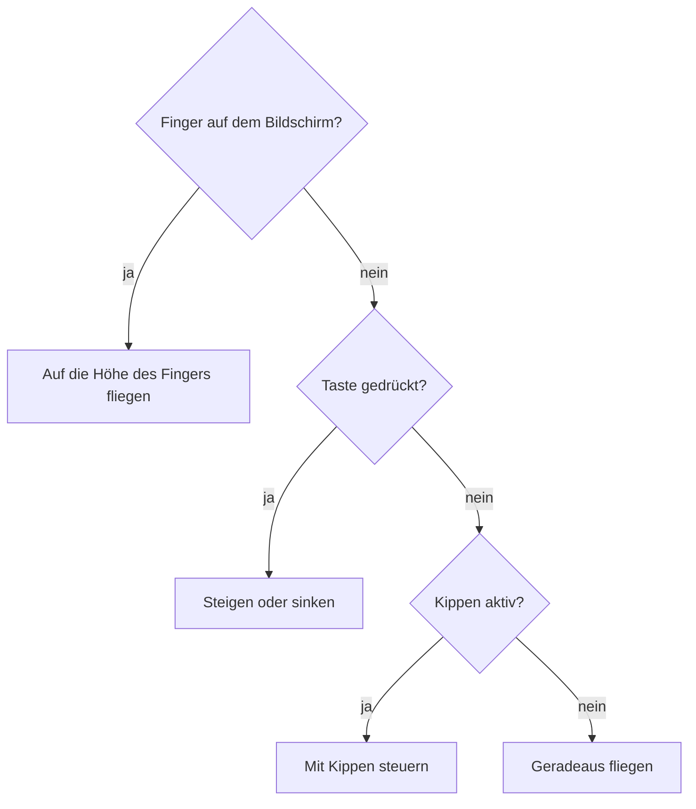
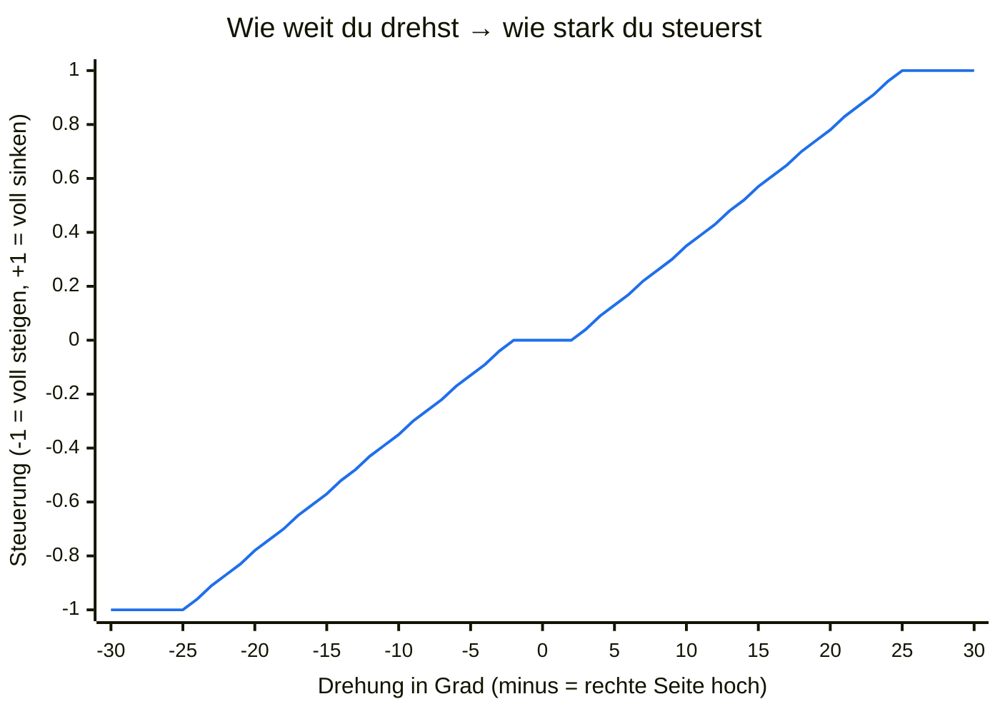

# Spielen

## Start

1. Öffne <https://m0nstergamez.github.io/airplane-scoring/> auf deinem Handy.
2. Dreh dein Handy **quer**. Hältst du es aufrecht, bittet dich das Spiel,
   es zu drehen.
3. Tippe auf **«Tap to fly»**. Auf dem iPhone erlaubst du den Zugriff auf
   «Bewegung & Ausrichtung», wenn danach gefragt wird. Neben dem Knopf ist
   ein **QR-Code**: Deine Freunde scannen ihn mit der Kamera und fliegen
   auch.

Am Computer zeigt die Startanzeige die Tasten und einen **QR-Code**.
Scanne ihn mit der Kamera deines Handys, um das Spiel dort zu öffnen. Um
am Computer zu fliegen, klicke auf **«Click to fly»** oder drücke Enter.

Der Flug beginnt erst mit diesem Tipp oder Klick. Bis dahin wartet das
Spiel, egal wie lange die Startanzeige offen ist. So startest du immer am
Anfang von Level 1.

## Steuerung

Das Flugzeug reagiert weich: Es nimmt Fahrt nach oben oder unten
allmählich auf und neigt dabei die Nase, beim Steigen nach oben, beim
Sinken nach unten, je stärker du steuerst, desto mehr.

Du kannst auf drei Arten steuern. Benutzt du mehrere gleichzeitig,
gewinnt der Finger, dann die Tasten, dann das Kippen:

### Kippen (Handy)

Halte dein Handy wie ein Lenkrad. **Das Handy ist das Flugzeug:**

- Rechte Seite **nach oben** drehen → das Flugzeug steigt.
- Rechte Seite **nach unten** drehen → das Flugzeug sinkt.
- Ruhig halten → das Flugzeug fliegt geradeaus.

Wie du das Handy hältst, wenn du auf «Tap to fly» tippst, gilt als
«gerade». Kleines Wackeln wird ignoriert; etwa eine Vierteldrehung bis
zur Senkrechten (25°) ist volle Geschwindigkeit:

Zwischen −2° und +2° passiert nichts (so fliegt eine ruhige Hand
geradeaus), danach wird die Steuerung gleichmässig stärker, und ab 25° ist sie voll.

**Tempo:** Kippst du das Handy nach vorne (obere Kante von dir weg),
gibst du Gas; kippst du es zu dir, bremst du. Auch hier gilt die
Haltung beim Start als «gerade»; bis 5° passiert nichts, ab 25° ist es
voll.

### Finger (Handy und Computer)

Berühre den Bildschirm und halte den Finger drauf: Das Flugzeug fliegt
auf die Höhe deines Fingers. Am Computer hältst du stattdessen die
Maustaste gedrückt.

### Tasten (Computer)

| Taste | Aktion |
|---|---|
| ↑ oder W | steigen |
| ↓ oder S | sinken |
| → oder D | schneller (Gas) |
| ← oder A | langsamer (bremsen) |
| M | Ton ein oder aus |

## Wetter und Zusammenstösse

Du fliegst einer Küste entlang: Hinter deinem Flugzeug zieht die
Landschaft vorbei. Bei Regen wird sie dunkler.

Im Moment ist es in allen Levels trocken: Regen passt weder zu den
Heissluftballonen an der Küste noch zum Sonnenuntergang am Strand. Das
Spiel kann aber Wetter: In späteren Levels setzt Regen ein, wird stärker
und lässt wieder nach. Starker Regen ist ein **Gewitter**: Blitze
erhellen den Himmel, und der Donner folgt. Je weiter weg der Blitz,
desto später und leiser der Donner.

Berührst du einen Heissluftballon, eine Startrampe oder eine Hütte
(Level 1) oder eine Möwe oder einen Strandturm (Level 2), gibt es einen
**Zusammenstoss**.
Nur eine echte Berührung zählt: Ganz knapp vorbeifliegen oder durch die
Lücke neben einem Dach ist erlaubt. Beim Zusammenstoss
raucht dein Flugzeug, fällt und lässt sich einen Moment lang (1,5 Sekunden)
nicht steuern. Danach fliegst du wieder.

## Tempo, Overspeed und Pull up

Neben dem Tempo, das mit deinem Score langsam steigt, stellst du selbst
ein, wie schnell du fliegst. Unten links zeigt die Anzeige «SPEED» dein
Tempo: gelb ist zu langsam, grün ist gut, rot ist zu schnell. Gibst du
kein Gas und bremst nicht, kommst du langsam zurück aufs normale Tempo.

- **Zu schnell:** «OVERSPEED» blinkt rot mit einem Countdown, ein
  Warnton klappert, und eine Stimme sagt «Overspeed». Bremst du nicht
  innerhalb von 3 Sekunden, bricht das Flugzeug auseinander: Es
  explodiert, und alle Leben sind auf einmal weg.
- **Zu langsam:** «PULL UP» blinkt gelb, ein Warnlicht leuchtet, ein
  Heulton ertönt, und eine Stimme sagt «Pull up». Die Flügel tragen
  nicht mehr richtig: Das Flugzeug sackt ab, je langsamer, desto mehr.
  Gib Gas! Schlägst du so am Boden auf, explodiert das Flugzeug, und
  alle Leben sind auf einmal weg.

## Punkte und Leben

Oben in der Mitte steht dein **Score** (deine Punkte). Er steigt jede
Sekunde um 2, solange du fliegst: Je länger du durchhältst, desto mehr
Punkte hast du. Mit jedem Punkt wird das Spiel ein ganz kleines bisschen
**schneller**: Die Landschaft und alles darin kommen schneller daher
(nach einer Minute etwa 12 %, höchstens 50 % schneller).

Du hast **3 Leben**. Oben rechts, neben dem Lautsprecher-Knopf, zeigt pro
Leben ein kleines Flugzeug, wie viele du noch hast. Jeder Zusammenstoss kostet ein Leben: Sein Flugzeug
wird grau und blinkt kurz.

Fliegst du nach einem Zusammenstoss wieder, **blinkt** dein Flugzeug
2 Sekunden lang. Solange es blinkt, bist du geschützt: Was du
dann berührst, kostet kein Leben. So verlierst du nicht zwei Leben an derselben
Möwengruppe.

Man sieht den Schaden: Nach dem ersten verlorenen Leben zieht dein
Flugzeug eine dünne, helle **Rauchfahne** hinter sich her; nach dem
zweiten wird der Rauch dick und dunkel, und am Heck flackert eine kleine
Flamme.

Beim letzten Leben **explodiert** dein Flugzeug: ein Feuerball,
herumfliegende Trümmer und eine Rauchwolke, mit einem lauten Knall, und
der Bildschirm **wackelt**.
Dann steht **«Game over»** auf dem Bildschirm, zusammen mit deinem Score. Nach einem
kurzen Moment erscheint «Tap or click to fly again»: Tippe, klicke oder
drücke Enter, und ein neuer Flug beginnt bei Level 1 mit 3 Leben.

## Highscore

Das Spiel merkt sich deine **5 besten Scores** auf diesem Handy oder
Computer. Der beste steht klein unter dem Score, während du fliegst
(«Best»).

Bei «Game over» siehst du deinen Score und die Liste der besten Scores
(«Highscores»); dieser Flug ist mit «<» markiert, wenn er in die Liste
kam. Schlägst du alle bisherigen Scores, blinkt «New highscore!», und
eine kurze Fanfare spielt.

Die Scores bleiben nur in diesem Browser: Nichts geht ins Internet, und
deine Freunde haben auf ihren Handys ihre eigene Liste. Löschst du die
Websitedaten des Browsers, ist sie weg.

## Levels

Jede Minute erreichst du ein neues **Level** mit einer neuen Landschaft:
zuerst die Küste (Level 1), dann einen Strand bei Sonnenuntergang
(Level 2). Gegen Ende eines Levels erscheint die nächste Landschaft
langsam über der alten, und in der Mitte des Bildschirms steht «Level 2».
Nach dem letzten Level beginnt wieder Level 1.

An der Küste fahren ab und zu **Heissluftballone**. Sie kommen langsam
von rechts und wechseln sich auf vier Arten ab: Einer steht auf einer
**Startrampe** in der Wiese und hebt ab, sobald er ins Bild kommt, einer
kommt vom Himmel herab und landet auf einer Startrampe, einer kommt dir
genau auf deiner Höhe entgegen, und einer sinkt langsam von oben herab
an dir vorbei. Unter je vier Ballonen kommt jede Art einmal, du weisst
also nie, welche als Nächstes kommt. Flieg über oder unter ihnen durch,
und pass auch auf den Korb auf. Wenn ein Ballon auftaucht oder abhebt,
hörst du seinen Brenner fauchen. Auch in eine Startrampe zu fliegen
kostet ein Leben.

Ganz vorne, am unteren Bildschirmrand, stehen ab und zu grosse
**Hütten** aus Holz, zusammen mit den Startrampen. Nur wenn du nahe am
Boden fliegst, musst du über sie steigen.
Unten durch kommst du nicht.

Das Spiel hat **Tiefe**: Je höher etwas fliegt, desto weiter weg ist es
und desto kleiner sieht es aus. Oben am Himmel sind dein Flugzeug und
die Ballone klein, unten bei den Hütten gross. Ein Ballon auf seiner
Startrampe ist gross und wird beim Aufsteigen bis ganz oben immer
kleiner. Dein Flugzeug wird sogar noch grösser, wenn du tief fliegst,
und braucht dann mehr Platz. Tief fliegen ist darum riskanter.

Am Strand fliegen **Möwen** herum: von vorne, von hinten und vom Sand
aus nach oben. Flieg nicht in sie hinein. Viele rufen, wenn sie
auftauchen; Möwen von hinten rufen immer, also hör gut hin.

Ab und zu steht im Sand ein **Strandturm** der Bademeister: auf
Holzbeinen, mit Leiter und kleiner Kabine. Manche stehen weit hinten
beim Wasser (höher im Bild, kleiner, und sie ziehen langsamer vorbei),
andere vorne (grösser). Die Türme sind nicht hoch; nur wenn du tief
fliegst, musst du über sie steigen. Zwischen den
Beinen ist Luft, aber es ist sehr eng.

## Ton

| Du hörst | Wann |
|---|---|
| Triebwerk | Immer, wie bei einem Düsenflugzeug: eine hohe Turbine und ein Rauschen. Steigen klingt nach Vollgas, Sinken nach Leerlauf. Je höher (weiter weg) du fliegst, desto leiser. |
| Wind | Immer. Lauter bei Regen, in Böen und wenn du sinkst. |
| Regen | Solange es regnet (erst in späteren Levels). Je stärker der Regen, desto lauter. |
| Donner | Einen Moment nach jedem Blitz (erst in späteren Levels). |
| Zusammenstoss | Wenn du einen Ballon, eine Startrampe, eine Hütte, eine Möwe oder einen Strandturm berührst. |
| Brenner | Wenn ein Heissluftballon auftaucht oder abhebt (Level 1). |
| Wellen | Am Strand (Level 2). Sie werden mit der Landschaft ein- und ausgeblendet. |
| Möwe | Wenn eine Möwe auftaucht. Möwen von hinten rufen immer. |
| Melodie | Wenn ein neues Level beginnt. |
| Fanfare | Wenn du einen neuen Highscore erreichst. |
| Explosion | Wenn dein Flugzeug sein letztes Leben verliert. |
| Overspeed | Solange du zu schnell fliegst: Klappern und die Stimme «Overspeed». |
| Pull up | Solange du zu langsam fliegst: Heulton und die Stimme «Pull up». |

Browser erlauben Ton erst, nachdem du die Seite berührt hast. Auf dem
Handy ist das der Tipp auf «Tap to fly», am Computer der erste Klick
oder Tastendruck.

Um den Ton aus- oder einzuschalten, tippe oben rechts auf den
**Lautsprecher-Knopf** oder drücke **M**. Das Spiel merkt sich deine Wahl.

## Aufs Handy installieren

Leg das Spiel auf deinen Home-Bildschirm. Dann öffnet es sich wie eine
App im Vollbild.

### iPhone (Safari)

1. Tippe auf den Teilen-Knopf (Quadrat mit Pfeil).
2. Wähle **«Zum Home-Bildschirm»**.

### Android (Chrome)

1. Tippe oben rechts auf das Menü **⋮**.
2. Wähle **«Zum Startbildschirm hinzufügen»** oder **«App installieren»**.

## Hilfe

### Kippen funktioniert nicht

- Hast du auf **«Tap to fly»** getippt? Kippen geht erst danach.
- iPhone: Hast du «Bewegung & Ausrichtung» erlaubt? Wenn du Nein gesagt
  hast, lade die Seite neu und tippe nochmals auf «Tap to fly». Kommt die
  Frage nicht wieder, schliesse Safari ganz und öffne das Spiel erneut.
- Liegt das Handy flach auf dem Tisch? Zum Kippen musst du es hochhalten.
- Mit dem Finger kannst du immer steuern.

### Ich höre nichts

- Ist der Lautsprecher-Knopf oben rechts durchgestrichen? Tippe darauf.
- iPhone: Steht der Schalter an der Seite auf lautlos? Der Lautlos-Modus
  schaltet auch das Spiel stumm. Stell ihn auf Klingeln.
- Mach den Ton mit den Tasten an der Seite des Handys lauter.
- Computer: Klicke einmal ins Spiel. Der Ton startet erst danach.

### Das Flugzeug fliegt von selbst nach oben oder unten

Du hast das Handy beim Start anders gehalten. Dreh das Handy einmal
andersherum (quer) und zurück oder lade die Seite neu: Deine jetzige
Haltung gilt dann wieder als «gerade».

### Das Spiel zeigt «Turn your phone sideways»

Das Spiel ist für Querformat gemacht. Dreh dein Handy. Dreht sich das
Bild nicht mit, schalte die Ausrichtungssperre (Android: «Automatisch
drehen») aus.
