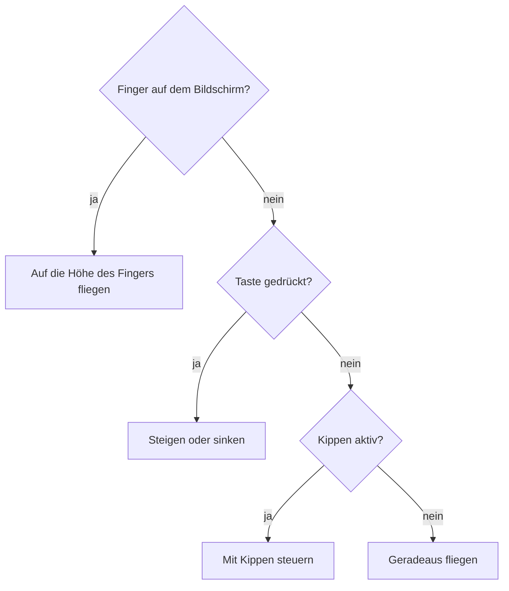
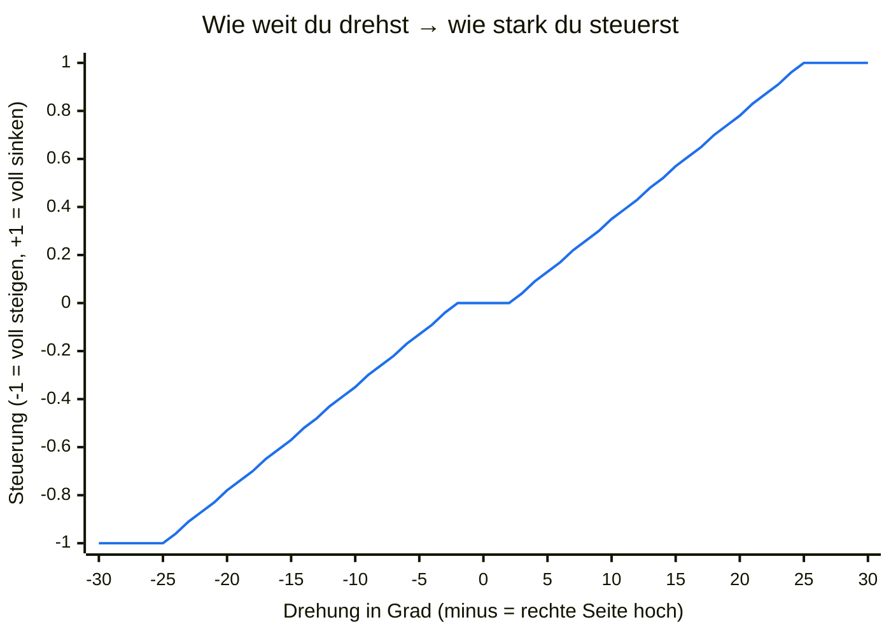

# Spielen

## Start

1. Öffne <https://m0nstergamez.github.io/airplane-scoring/> auf deinem Handy.
2. Dreh dein Handy **quer**. Hältst du es aufrecht, bittet dich das Spiel,
   es zu drehen.
3. Tippe auf **„Tap to fly“**. Auf dem iPhone erlaubst du den Zugriff auf
   „Bewegung & Ausrichtung“, wenn danach gefragt wird.

Am Computer startet das Spiel sofort.

## Steuerung

Du kannst auf drei Arten steuern. Benutzt du mehrere gleichzeitig,
gewinnt der Finger, dann die Tasten, dann das Kippen:

### Kippen (Handy)

Halte dein Handy wie ein Lenkrad. **Das Handy ist das Flugzeug:**

- Rechte Seite **nach oben** drehen → das Flugzeug steigt.
- Rechte Seite **nach unten** drehen → das Flugzeug sinkt.
- Ruhig halten → das Flugzeug fliegt geradeaus.

Wie du das Handy hältst, wenn du auf „Tap to fly“ tippst, gilt als
„gerade“. Kleines Wackeln wird ignoriert; etwa eine Vierteldrehung bis
zur Senkrechten (25°) ist volle Geschwindigkeit:

Zwischen −2° und +2° passiert nichts (so fliegt eine ruhige Hand
geradeaus), danach wird die Steuerung gleichmässig stärker, und ab 25° ist sie voll.

### Finger (Handy und Computer)

Berühre den Bildschirm und halte den Finger drauf: Das Flugzeug fliegt
auf die Höhe deines Fingers. Am Computer hältst du stattdessen die
Maustaste gedrückt.

### Tasten (Computer)

| Taste | Aktion |
|---|---|
| ↑ oder W | steigen |
| ↓ oder S | sinken |

## Aufs Handy installieren

Leg das Spiel auf deinen Home-Bildschirm. Dann öffnet es sich wie eine
App im Vollbild.

### iPhone (Safari)

1. Tippe auf den Teilen-Knopf (Quadrat mit Pfeil).
2. Wähle **„Zum Home-Bildschirm“**.

### Android (Chrome)

1. Tippe oben rechts auf das Menü **⋮**.
2. Wähle **„Zum Startbildschirm hinzufügen“** oder **„App installieren“**.

## Hilfe

### Kippen funktioniert nicht

- Hast du auf **„Tap to fly“** getippt? Kippen geht erst danach.
- iPhone: Hast du „Bewegung & Ausrichtung“ erlaubt? Wenn du Nein gesagt
  hast, lade die Seite neu und tippe nochmals auf „Tap to fly“. Kommt die
  Frage nicht wieder, schliesse Safari ganz und öffne das Spiel erneut.
- Liegt das Handy flach auf dem Tisch? Zum Kippen musst du es hochhalten.
- Mit dem Finger kannst du immer steuern.

### Das Flugzeug fliegt von selbst nach oben oder unten

Du hast das Handy beim Start anders gehalten. Dreh das Handy einmal
andersherum (quer) und zurück oder lade die Seite neu: Deine jetzige
Haltung gilt dann wieder als „gerade“.

### Das Spiel zeigt „Turn your phone sideways“

Das Spiel ist für Querformat gemacht. Dreh dein Handy. Dreht sich das
Bild nicht mit, schalte die Ausrichtungssperre (Android: „Automatisch
drehen“) aus.
