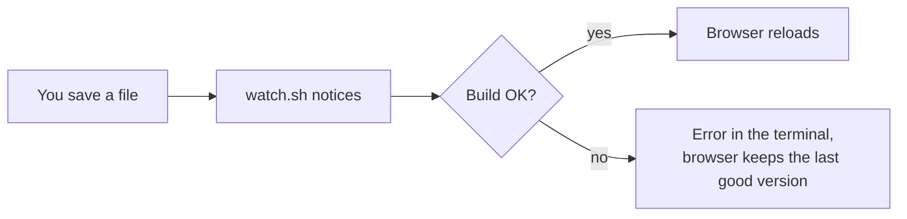
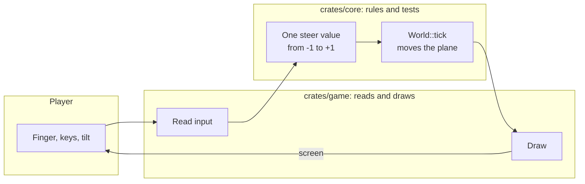
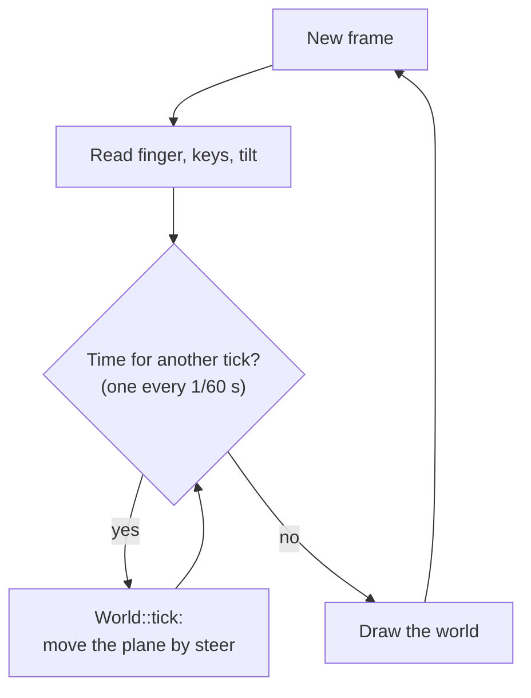
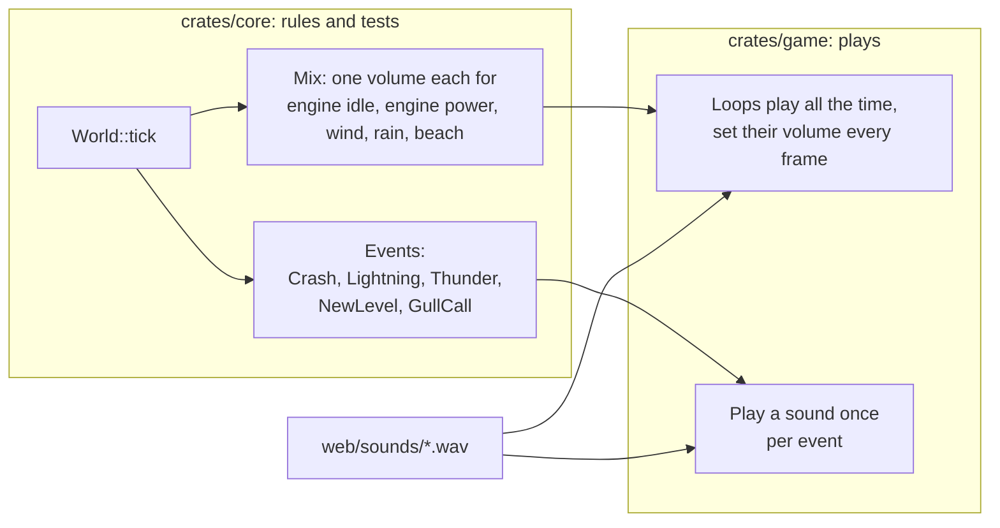
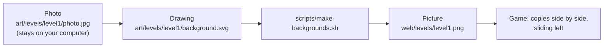
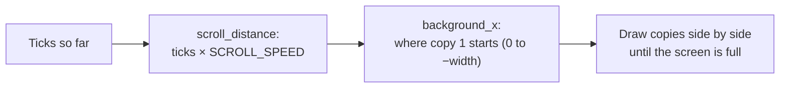
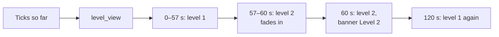
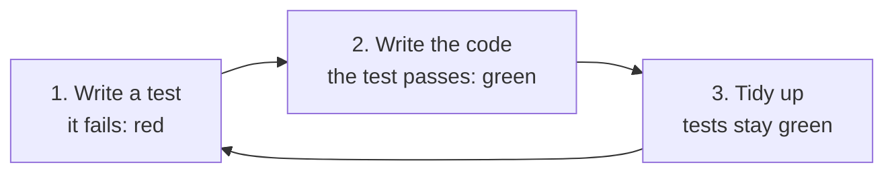
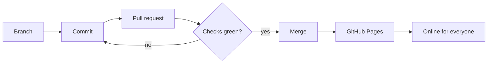

# Developing

The game is written in [Rust](https://www.rust-lang.org/) and runs in
the browser as WebAssembly. Drawing is done by the
[macroquad](https://macroquad.rs/) engine.

## What you need

- A computer with macOS, Linux or Windows
- [Rust](https://rustup.rs/) (install with `rustup`)
- [Git](https://git-scm.com/)
- Python 3 (for the local web server)
- Google Chrome (for automatic screenshots; optional)
- Linux only: the ALSA sound headers for `cargo run` (on Ubuntu:
  `sudo apt install libasound2-dev`)
- Only for level backgrounds: `rsvg-convert` and ImageMagick (macOS:
  `brew install librsvg imagemagick`)

## Set up

```sh
git clone https://github.com/m0nstergamez/airplane-scoring.git
cd airplane-scoring
rustup target add wasm32-unknown-unknown
```

## Run the game

| What | Command |
|---|---|
| Play in a window | `cargo run` |
| Play in the browser | `scripts/dev.sh`, then open <http://localhost:8080> |
| Run all checks | `scripts/check.sh` |
| Quick checks | `scripts/check.sh --fast` |
| Make the sound files again | `scripts/make-sounds.py` |
| Make the level backgrounds again | `scripts/make-backgrounds.sh` |

`scripts/dev.sh` keeps running: every time you save a file, the game is
rebuilt and the browser page reloads by itself:



## How the project is built

| Folder | What is in it |
|---|---|
| `crates/core` | The **rules** of the game: movement, steering, tilting, weather, crashes, sound volumes, scrolling. No graphics, no sound files. Everything here has tests. |
| `crates/game` | Draws the game, plays the sounds and reads keys, finger and sensors. No rules. |
| `web` | The web page that loads the game, the sound files in `web/sounds` and the level backgrounds in `web/levels`. |
| `art` | Drawings the game is made from: one folder per level in `art/levels`. |
| `scripts` | Helper commands (build, start, check). |
| `docs` | Notes and this manual. |

The most important rule: **game rules go into `core`, with a test first.**
`game` only passes on what the player does and draws what `core` says:



Every way of steering ends up as the same single number, `steer`. So
`core` does not care whether you tilt, drag or press keys – and adding a
new control means adding one more way to make that number.

### The game loop

The game calculates in fixed steps of 1/60 second, called **ticks**,
no matter how fast a device can draw:



A slow phone does several ticks per frame, a fast one sometimes none.
Because each tick is the same, the game behaves the same everywhere –
and a test can replay it exactly.

How many ticks a frame gets is decided by `Clock` in
`crates/core/src/clock.rs`. Until "Tap to fly" it gives none: the game
stands still on the start screen, and the flight (weather, levels)
begins with the tap.

### Sound

Sound follows the same split. `core` decides **what** you hear and
**how loud**; `game` only plays files:



- **Loops** (engine, wind, rain, beach) never stop. Each tick `core` computes a
  `Mix` with their volumes; the volumes move a little per tick, so
  nothing clicks.
- **The engine** is a turbine (jet) and two loops. macroquad 0.4.16
  cannot change the pitch of a sound, so climbing fades from the idle
  loop (lower whine, soft roar) to the power loop (higher whine, louder
  roar and hiss). Its volume follows the plane's distance
  (`Bounds::nearness`): full near the ground, `ENGINE_FAR_VOLUME` (30 %)
  at the top of the screen.
- **One-shot sounds** (thunder, crash, the tune for a new level, a gull's
  call) are events of one tick. Thunder is its own event because it arrives later
  than its lightning.
- **Sounds of a level** follow its landscape: the beach loop's volume is
  `BEACH_VOLUME` times how much of level 2 is on screen
  (`LevelView::presence`), so the waves fade in with the beach. The
  weather works the same way: rain may only be as heavy as the levels in
  `RAINY_LEVELS` are on screen (`LevelView::rain_room`). That list is
  empty for now, so levels 1 and 2 are dry; the weather keeps running
  underneath for later levels.
- **Hot-air balloons** (`crates/core/src/balloons.rs`) are level 1's
  obstacles: big, slow and rare, since level 1 is the easiest level.
  Each one takes off from a launch pad (`Pad`: it slides in standing on
  it and lifts off at `TAKEOFF_AT`), lands on one (touching down at
  `TOUCHDOWN_AT`), comes level at the plane's height, or sinks past
  (`BalloonWay`). The ways take turns: a shuffled round of all four,
  never the same way twice in a row. Launch pads are obstacles too. Core spawns them (seeded), moves them and checks
  the crash against the envelope and the basket; a `BalloonBurner` event
  plays its sound as it appears or takes off.
- **Huts** (`crates/core/src/huts.rs`) stand big in level 1's foreground
  grass at the bottom of the screen, rare, sliding with the landscape.
  They belong to the landscape, so they grow with `Bounds::scale` but not
  with `OBJECT_SIZE`; so do the launch pads, which lie next to them.
  Huts and launch pads wait for each other, so a pad never lies on a hut.
- **Depth** (`Bounds::depth(y)`): what flies (balloons, gulls) is
  smallest (`OBJECT_SIZE`) at the top of the screen and grows steadily
  all the way down to full size at a balloon standing on a pad. The
  plane follows `Bounds::plane_depth(y)`: as small at the top, growing to
  `PLANE_NEAR_SIZE` (1.5) near the ground. Drawing and crashes use the
  same factor, so a plane flying low is bigger and easier to hit.
- **Crashes use the drawn shapes** (`crates/core/src/shape.rs`): the
  plane (`Player::shape`: fuselage, nose, wing, tail, cockpit) and each
  obstacle (`Hut::shape`, `Pad::shape`, `Balloon::shape`,
  `Gull::shape`) are a few convex polygons with the same points the
  game crate draws. Only a real overlap is a crash; a near miss, or the
  empty corner beside a roof, is not.
- **Lifeguard towers** (`crates/core/src/towers.rs`) stand in the
  beach's sand: rare (one every 6–10 s) and not tall (92–112 px). Each
  has its own depth (`Tower::near`): by the water it stands higher
  (`TOWER_GROUND`), is `TOWER_FAR_SIZE` (55 %) as big and slides that much
  slower (parallax); at the front it is full size. Far ones are drawn
  first. `Tower::parts` places legs, ladder,
  platform, cabin and roof; crashes (`Tower::shape`) and drawing both use
  it.
- **Gulls** (`crates/core/src/gulls.rs`) are the beach's obstacles. Core
  decides when and where they appear (seeded, like the weather), moves
  them and checks the crash; a gull that calls sends a `GullCall` event,
  so every call you hear belongs to a gull you see.
- **Highscores** (`crates/core/src/highscore.rs`): core keeps the rules
  (`Highscores::add`: best first, top `HIGHSCORE_COUNT`, a tie is no
  record, a record sends `Event::NewHighscore`). The page plugin stores
  the numbers in the browser's local storage
  (`airplane-scoring.highscores`); `page_js.rs` only loads and saves
  them. Nothing leaves the device.
- **Lives** are counted in core too: a crash costs one (`World.lives`),
  a recovering plane is safe for `SAFE_SECONDS` (`Player::is_safe`), and
  when the last one is gone the plane falls, `Event::GameOver` fires and
  `World::tick` stands still (`World::is_over`). The game crate only draws
  it and, once `World::can_restart` says so, starts a new `World` on a tap.
  The score (`World::score`) follows from the ticks flown, so it stops
  with them at game over.
- **Weather is random but repeatable:** `World::with_seed` takes a seed;
  the same seed gives the same rain and the same lightning, so tests can
  replay it.
- **The sound files are made by a script**, not recorded:
  `scripts/make-sounds.py` computes them from noise and pulses. Change
  the script, run it, commit the new `.wav` files.

### Level backgrounds

Each level has a landscape behind the plane. It starts as a photo and
ends as a picture the game repeats side by side while it scrolls:



Every level has its own folder with the same file names:

```text
art/levels/
  level1/
    photo.jpg         the photo (not committed)
    background.svg    the drawing (committed)
  level2/
  level3/
```

A new level in six steps:

1. Make the folder, for example `art/levels/level2/`.
2. Put your photo in it as `photo.jpg`. Take a photo held sideways,
   without people. It is never committed: the repository is public and
   phone photos contain the place where they were taken.
3. Draw `background.svg` from the photo, or ask Claude Code: "Make
   `art/levels/level2/background.svg` from `photo.jpg`, like level 1."
   Copy `art/levels/level1/background.svg` as a start: its comments
   explain the rules below.
4. Run `scripts/make-backgrounds.sh level2`. It makes
   `web/levels/level2.png` and checks the seam.
5. Raise `LEVEL_COUNT` in `crates/core/src/level.rs` by one, so the game
   shows the new level.
6. Look at the picture, then commit the SVG and the PNG.

The SVG has to follow a few rules, because the right edge of one copy
touches the left edge of the next:

- **Size:** `viewBox="0 0 1600 740"`, about the shape of a phone held
  sideways. The game scales it to the screen height.
- **Flat colours, calm and a bit pale**, so the plane and the white text
  stand out.
- **Things that span the whole width** (sky, water, road, grass) only
  change from top to bottom, never from left to right.
- **Everything else is drawn three times** (at x = −1600, 0 and +1600).
  A cloud that sticks out on the right comes back in on the left.
- **One group per layer** (sky, hills, water, shore, road, grass,
  fence). Later the layers can scroll at different speeds.

If the edges do not match, `make-backgrounds.sh` stops with "seam too
visible". The game itself only knows how far the landscape has moved,
`background_x` in `crates/core/src/scenery.rs`, and draws as many copies
as the screen needs:



Which level shows is decided by `level_view` in
`crates/core/src/level.rs`, again only from the ticks: every
`LEVEL_SECONDS` the next level begins. During the last
`LEVEL_FADE_SECONDS` of a level, the next picture is drawn over the old
one, a little more opaque every tick, so there is no jump. To start
directly in a level, add `?level=2` to the address
(`LEVEL=2 scripts/shot.sh` for a screenshot).



### Test first

New rules are written in three steps:



The failing test proves that the test really checks the new rule. If it
passed right away, it would test nothing new.

## Your first change

Make the plane climb and dive faster:

1. Open `crates/core/src/lib.rs`.
2. Find `PLAYER_CLIMB_SPEED` and change `300.0` to `500.0`.
3. Save. If `scripts/dev.sh` is running, the browser reloads – try it.
4. Run `scripts/check.sh`. If a test fails, read its message: tests
   describe how the game should behave.

More numbers you can try. Sizes and speeds in pixels are for a phone
in landscape (`DESIGN_HEIGHT`, 390 px high); on a bigger screen the game
multiplies them by `Bounds::scale` (screen height / 390), so everything
keeps its size relative to the landscape:

| Constant | File | Meaning |
|---|---|---|
| `DESIGN_HEIGHT` | `crates/core/src/lib.rs` | the screen height all pixel sizes and speeds are made for |
| `PLANE_NEAR_SIZE` | `crates/core/src/lib.rs` | how big the plane gets near the ground (1 = first design) |
| `OBJECT_SIZE` | `crates/core/src/lib.rs` | how big the plane and obstacles are drawn and hit (1 = first design, now 0.41): the size up high; smaller leaves more room |
| `PLAYER_CLIMB_SPEED` | `crates/core/src/lib.rs` | climb/dive speed (pixels per second) |
| `PLAYER_X_FRACTION` | `crates/core/src/lib.rs` | where the plane sits (0.2 = 20 % from the left) |
| `TILT_FULL_DEG` | `crates/core/src/tilt.rs` | how far to turn the phone for full speed |
| `TILT_DEAD_ZONE_DEG` | `crates/core/src/tilt.rs` | small turns that are ignored |
| `TILT_SMOOTHING` | `crates/core/src/tilt.rs` | smoother (lower) or more direct (higher) tilting |
| `CRASH_SECONDS` | `crates/core/src/lib.rs` | how long a crashed plane is out of control |
| `LIVES` | `crates/core/src/lib.rs` | lives at the start of a flight |
| `SCORE_PER_SECOND` | `crates/core/src/lib.rs` | how many points each second of flight is worth |
| `HIGHSCORE_COUNT` | `crates/core/src/highscore.rs` | how many best scores are kept |
| `SAFE_SECONDS` | `crates/core/src/lib.rs` | how long the plane blinks and cannot crash after a crash |
| `RAIN_SECONDS` | `crates/core/src/weather.rs` | shortest and longest rain |
| `STORM_RAIN` | `crates/core/src/weather.rs` | how heavy rain must be for lightning (0 to 1) |
| `STRIKE_GAP_SECONDS` | `crates/core/src/weather.rs` | time between two lightning strikes |
| `ENGINE_VOLUME` | `crates/core/src/sound.rs` | how loud the engine is (0 to 1) |
| `BEACH_VOLUME` | `crates/core/src/sound.rs` | how loud the waves and gulls are (0 to 1) |
| `GULL_GAP_SECONDS` | `crates/core/src/gulls.rs` | shortest and longest time between two gulls |
| `GULL_SPEED` | `crates/core/src/gulls.rs` | how fast gulls fly (pixels per second) |
| `TOWER_GAP_SECONDS` | `crates/core/src/towers.rs` | shortest and longest time between two lifeguard towers |
| `TOWER_HEIGHT` | `crates/core/src/towers.rs` | lowest and highest lifeguard tower (pixels) |
| `BALLOON_GAP_SECONDS` | `crates/core/src/balloons.rs` | shortest and longest time between two balloons |
| `BALLOON_RISE` | `crates/core/src/balloons.rs` | how fast balloons rise (pixels per second) |
| `HUT_GAP_SECONDS` | `crates/core/src/huts.rs` | shortest and longest time between two huts |
| `HUT_HEIGHT` | `crates/core/src/huts.rs` | lowest and highest hut (pixels) |
| `SCROLL_SPEED` | `crates/core/src/scenery.rs` | how fast the landscape slides past (pixels per second) |
| `LEVEL_SECONDS` | `crates/core/src/level.rs` | how long one level lasts (seconds) |
| `LEVEL_FADE_SECONDS` | `crates/core/src/level.rs` | how long the next landscape takes to fade in |

## Share your change

Changes go into the game through a **pull request** on GitHub:



1. Make a new branch: `git switch -c my-change`
2. Commit: `git commit -am "Faster plane"`
3. Push and open a pull request: `git push -u origin my-change`, then
   follow the link GitHub shows.
4. GitHub runs all checks automatically. When they are green and the
   pull request is merged, the new version is online a minute later.

If your change affects what players see or do, update this manual too –
in **both** languages.
