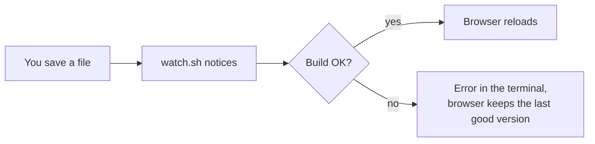
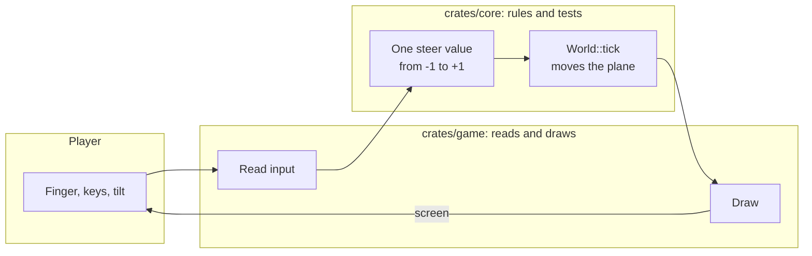
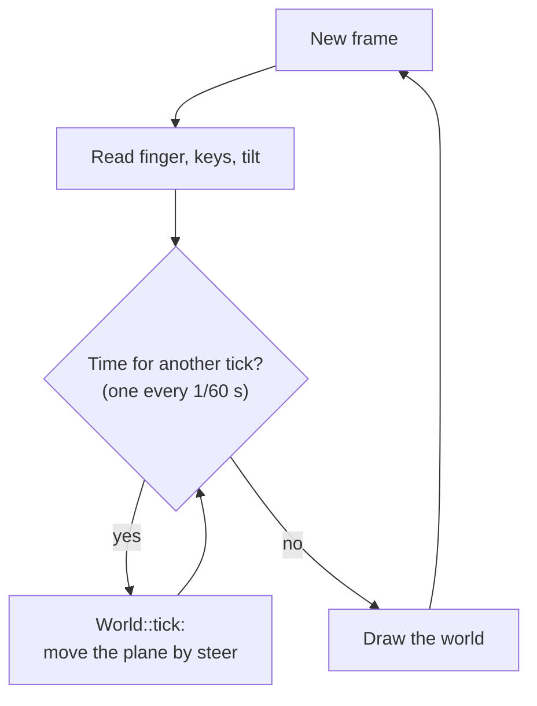
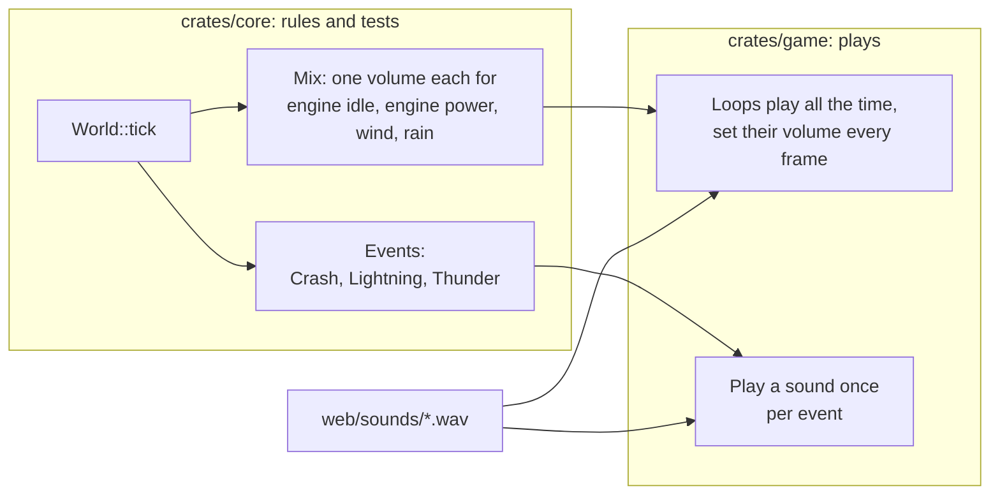
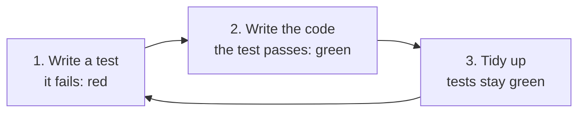
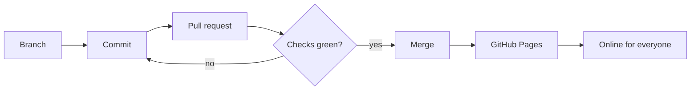

# Developing

The game is written in [Rust](https://www.rust-lang.org/) and runs in
the browser as WebAssembly. Drawing is done by the
[macroquad](https://macroquad.rs/) engine.

## What you need

- A computer with macOS, Linux or Windows
- [Rust](https://rustup.rs/) (install with `rustup`)
- [Git](https://git-scm.com/)
- Python 3 (for the local web server)
- Google Chrome (for automatic screenshots; optional)
- Linux only: the ALSA sound headers for `cargo run` (on Ubuntu:
  `sudo apt install libasound2-dev`)

## Set up

```sh
git clone https://github.com/m0nstergamez/airplane-scoring.git
cd airplane-scoring
rustup target add wasm32-unknown-unknown
```

## Run the game

| What | Command |
|---|---|
| Play in a window | `cargo run` |
| Play in the browser | `scripts/dev.sh`, then open <http://localhost:8080> |
| Run all checks | `scripts/check.sh` |
| Quick checks | `scripts/check.sh --fast` |
| Make the sound files again | `scripts/make-sounds.py` |

`scripts/dev.sh` keeps running: every time you save a file, the game is
rebuilt and the browser page reloads by itself:



## How the project is built

| Folder | What is in it |
|---|---|
| `crates/core` | The **rules** of the game: movement, steering, tilting, weather, crashes, sound volumes. No graphics, no sound files. Everything here has tests. |
| `crates/game` | Draws the game, plays the sounds and reads keys, finger and sensors. No rules. |
| `web` | The web page that loads the game, and the sound files in `web/sounds`. |
| `scripts` | Helper commands (build, start, check). |
| `docs` | Notes and this manual. |

The most important rule: **game rules go into `core`, with a test first.**
`game` only passes on what the player does and draws what `core` says:



Every way of steering ends up as the same single number, `steer`. So
`core` does not care whether you tilt, drag or press keys – and adding a
new control means adding one more way to make that number.

### The game loop

The game calculates in fixed steps of 1/60 second, called **ticks**,
no matter how fast a device can draw:



A slow phone does several ticks per frame, a fast one sometimes none.
Because each tick is the same, the game behaves the same everywhere –
and a test can replay it exactly.

### Sound

Sound follows the same split. `core` decides **what** you hear and
**how loud**; `game` only plays files:



- **Loops** (engine, wind, rain) never stop. Each tick `core` computes a
  `Mix` with their volumes; the volumes move a little per tick, so
  nothing clicks.
- **The engine** is two loops. macroquad 0.4.16 cannot change the pitch
  of a sound, so climbing fades from the idle loop to the power loop.
- **One-shot sounds** (thunder, crash) are events of one tick. Thunder is
  its own event because it arrives later than its lightning.
- **Weather is random but repeatable:** `World::with_seed` takes a seed;
  the same seed gives the same rain and the same lightning, so tests can
  replay it.
- **The sound files are made by a script**, not recorded:
  `scripts/make-sounds.py` computes them from noise and pulses. Change
  the script, run it, commit the new `.wav` files.

### Test first

New rules are written in three steps:



The failing test proves that the test really checks the new rule. If it
passed right away, it would test nothing new.

## Your first change

Make the plane climb and dive faster:

1. Open `crates/core/src/lib.rs`.
2. Find `PLAYER_CLIMB_SPEED` and change `300.0` to `500.0`.
3. Save. If `scripts/dev.sh` is running, the browser reloads – try it.
4. Run `scripts/check.sh`. If a test fails, read its message: tests
   describe how the game should behave.

More numbers you can try:

| Constant | File | Meaning |
|---|---|---|
| `PLAYER_CLIMB_SPEED` | `crates/core/src/lib.rs` | climb/dive speed (pixels per second) |
| `PLAYER_X_FRACTION` | `crates/core/src/lib.rs` | where the plane sits (0.2 = 20 % from the left) |
| `TILT_FULL_DEG` | `crates/core/src/tilt.rs` | how far to turn the phone for full speed |
| `TILT_DEAD_ZONE_DEG` | `crates/core/src/tilt.rs` | small turns that are ignored |
| `TILT_SMOOTHING` | `crates/core/src/tilt.rs` | smoother (lower) or more direct (higher) tilting |
| `CRASH_SECONDS` | `crates/core/src/lib.rs` | how long a crashed plane is out of control |
| `RAIN_SECONDS` | `crates/core/src/weather.rs` | shortest and longest rain |
| `STORM_RAIN` | `crates/core/src/weather.rs` | how heavy rain must be for lightning (0 to 1) |
| `STRIKE_GAP_SECONDS` | `crates/core/src/weather.rs` | time between two lightning strikes |
| `ENGINE_VOLUME` | `crates/core/src/sound.rs` | how loud the engine is (0 to 1) |

## Share your change

Changes go into the game through a **pull request** on GitHub:



1. Make a new branch: `git switch -c my-change`
2. Commit: `git commit -am "Faster plane"`
3. Push and open a pull request: `git push -u origin my-change`, then
   follow the link GitHub shows.
4. GitHub runs all checks automatically. When they are green and the
   pull request is merged, the new version is online a minute later.

If your change affects what players see or do, update this manual too –
in **both** languages.
