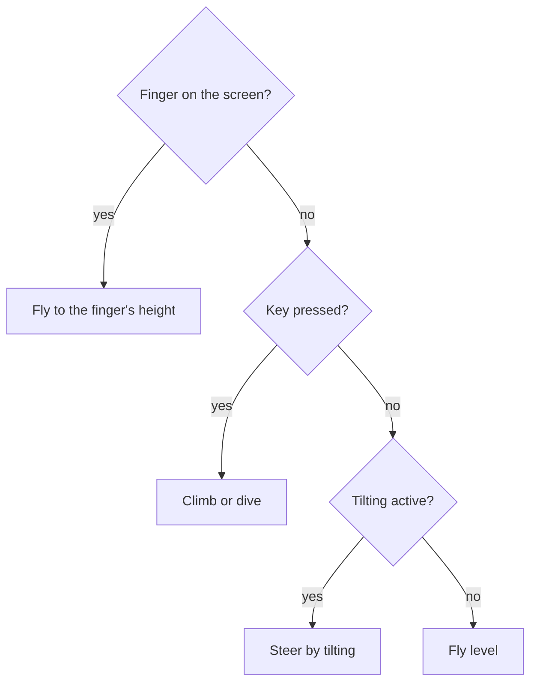
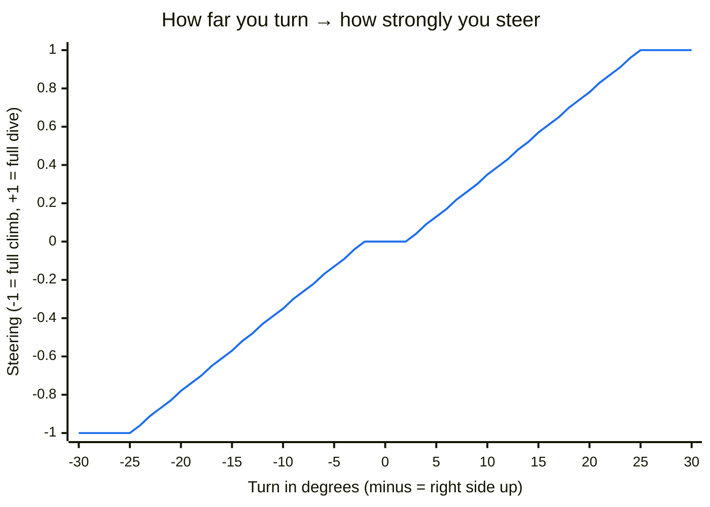

# Playing

## Start

1. Open <https://m0nstergamez.github.io/airplane-scoring/> on your phone.
2. Turn your phone **sideways** (landscape). Held upright, the game asks
   you to turn it.
3. In the **main menu** ("AIRPLANE SCORING", with the plane over the
   coast), tap **"Tap to fly"**, then **choose a level**. On an iPhone,
   allow access to "Motion & Orientation" when asked. At the bottom right
   is a **QR code**: friends scan it with their camera to fly too.

"Tap to fly" opens the **level map** ("Choose a level"): a round picture
of each landscape, joined by a dashed line. Tap a level to start there.
Level 2 is locked at first (grey with a padlock) and opens once you have
completed level 1; the game remembers, and a completed level gets a
green tick. Tapping a locked level tells you which level to complete
first. The **Levels** button in the main menu opens the same map just to
look: tapping a level there starts nothing but tells you whether you
have completed it, have not yet, or must complete the one before.
**How to play** gives a short
guide (goal, steering, speed, pause); under **Options** you switch music
and sounds.

On a computer the main menu also shows the keys and a larger **QR
code**. Scan it with your phone's camera to open the game there. To fly
on the computer, click **"Click to fly"** or press Enter, then pick a
level (Enter flies level 1).

The flight only begins when you pick a level. Until then the game waits,
however long the main menu is open.

Every flight starts at an **airport**: your plane stands on the runway
in the foreground, by the control tower and the windsock. It rolls, the
landscape starts moving faster and faster, it lifts off and climbs away
on its own. Then you have the controls. While the autopilot flies (the
takeoff, and the landing at the end of a level) no obstacles come, and
nothing can hit the plane: you could not dodge. While you fly, the
phone's screen stays on, even if you only steer by tilting.

## Controls

The plane responds smoothly: it picks up a climb or dive gradually and
tilts its nose, up to climb and down to dive, the more the harder you
steer.

You have three ways to steer. If you use several at once, the finger
wins, then the keys, then tilting:

### Tilt (phone)

Hold your phone like a steering wheel. **The phone is the plane:**

- Turn the right side **up** → the plane climbs.
- Turn the right side **down** → the plane dives.
- Hold it still → the plane flies level.

The position you hold the phone in when you tap "Tap to fly" counts as
"level". Small wobbles are ignored; turning about a quarter of the way
to vertical (25°) is full speed:

Between −2° and +2° nothing happens (so a calm hand flies level), from
there steering grows evenly, and from 25° on it is at full strength.

**Speed:** tip the phone forward (top edge away from you) for gas, back
toward you to brake. Again, how you held it at the start counts as
"level"; up to 5° nothing happens, from 25° on it is full.

### Finger (phone and computer)

Touch the screen and hold: the plane flies to the height of your finger.
On a computer, hold down the mouse button instead.

### Keys (computer)

| Key | Action |
|---|---|
| ↑ or W | climb |
| ↓ or S | dive |
| → or D | faster (gas) |
| ← or A | slower (brake) |
| M | sound on or off |
| Esc or P | pause (menu) |

## Menu (pause)

At the top left is the **menu button** with three lines (on a computer
also **Esc** or **P**). It pauses the game and shows the menu over it,
with the game blurred behind:

- **Continue:** back to the game. A countdown counts 3, 2, 1; the game
  goes on only at 0, so you are ready.
- **Restart:** a new flight from the airport, after the same countdown.
- **Calibrate** (phone only): the way you hold the phone now counts as
  "level" from now on, for steering and for gas.
- **Options:** switch music (the tunes) and sounds (everything else) on
  or off separately. **Back** goes back.
- **Menu:** back to the main menu; "Tap to fly" and a level start a
  new flight.

Switching to another app or tab pauses the game by itself, and so does
turning the phone upright or, on a computer, clicking into another
window.

## Weather and crashes

You fly along a coast: the landscape slides past behind your plane. In
rain it gets darker.

For now it is dry in every level: rain fits neither the hot-air
balloons on the coast nor the sunset at the beach. The game can do
weather, though: in later levels rain sets in, gets heavier and fades
again. Heavy rain is a **thunderstorm**: lightning lights up the sky,
and the thunder follows. The further away the lightning, the later and
quieter the thunder.

If you touch a hot-air balloon, a launch pad or a hut (level 1) or a
gull or a lifeguard tower (level 2), you **crash**. Only a real touch counts: flying past very
closely, or through the gap beside a roof, is fine. In a crash your plane smokes, falls
and ignores the controls for a moment (1.5 seconds). Then you fly again.

## Speed, overspeed and pull up

Besides the speed that slowly rises with your flight time, you set how fast
you fly yourself. At the top left, the "SPEED" gauge shows it: amber
is too slow, green is fine, red is too fast. With no gas and no brake
you slowly return to normal speed.

- **Too fast:** "OVERSPEED" blinks red with a countdown, a warning
  clacks, and a voice says "Overspeed". If you do not brake within 3
  seconds, the plane breaks apart: it explodes, and every life is gone
  at once.
- **Too slow:** "PULL UP" blinks amber, a warning light glows, a whooping
  tone sounds, and a voice says "Pull up". The wings stop carrying you
  properly: the plane sags, more the slower it is. Give gas! If you hit
  the ground like this, the plane explodes and every life is gone at
  once.

## Time and lives

At the top centre is your **time**: how long you have been flying in
this level, in minutes and seconds ("Time 1:05"). Every new level starts
again at 0:00. The longer you last, the better.
With every second the game gets a tiny bit **faster**: the landscape
and everything in it come by quicker (after a minute about 12 %, at
most 50 % faster).

You have **3 lives**, and every new level starts with all 3 again. At the top right, next to the speaker button, one
small plane per life shows how many you have left. Each crash costs a life: its plane turns grey and
blinks for a moment.

When you fly again after a crash, your plane **blinks** for 2 seconds.
While it blinks you are safe: nothing you touch costs a life then. So you do not
lose two lives to the same flock of gulls.

You can see the damage: after the first lost life your plane trails a
long grey trail of **smoke**; after the second there is much more smoke,
thick and dark, and a small flame flickers at the tail.

With the last life your plane **explodes**: a fireball, flying debris
and a cloud of smoke, with a big bang, and the screen **shakes**. Then **"Game over"** shows on the
screen, together with your time. After a short
moment "Tap or click to fly again" appears: tap, click or press Enter,
and a new flight starts in the same level with 3 lives.

Under the time, **"Best times"** lists the 5 longest times in this
level, in minutes and seconds; this time is marked with a
"<" when it made the list, and "New best time!" blinks when it beat
them all. Each level has its own list, and "Level complete" shows it
too. A flight you leave with **Menu**
or **Restart** counts too. The times stay only in this browser: nothing
goes online, and friends on their phones have their own lists.

## Levels

Each **level** has its own landscape: first the coast (level 1), then a
beach at sunset (level 2). After about a minute of flying, a level ends
with a **landing**: no new obstacles come, a runway appears, and the
autopilot takes over. Speed warnings stay off while it flies, and the
speed settles back by itself. The gear comes down, the plane touches down,
brakes and stops: "Level 1 complete" shows with your time, the
level's best times and two
buttons. **Next level** (or Enter) starts the next level: its landscape
appears, it counts 3, 2, 1, and you take off from its runway. **Menu**
goes to the main menu. After the last level,
level 1 starts again.

On the coast, **hot-air balloons** float by now and then. They come
slowly from the right and take turns in four ways: one stands on a
**launch pad** in the grass and takes off as it comes into view, one
comes down from the sky and lands on a launch pad, one comes straight at
you at your height, and one sinks slowly past from your height. So
flying right at the top does not keep you out of their way. Within every
four balloons each way comes once, so you never know which is next. Fly
over or under them, and mind the basket too. When a balloon appears or
takes off, you hear its burner roar. A balloon you fly into
**explodes** with a bang and crashes to the ground (it costs you a life
all the same). Flying into a launch pad costs a life too.

Big wooden **huts** stand now and then right at the front, at the
bottom of the screen, together with the launch pads. Only if you fly
close to the ground do you have to climb over them. You
cannot slip underneath.

The game has **depth**: the higher something flies, the further away it
is and the smaller it looks. Up in the sky your plane and the balloons
are small; down near the huts they are big. A balloon on its launch pad
is big and shrinks all the way as it rises. Your plane grows even more
when you fly low, and so does the room it takes, so low flying is
riskier.

At the beach, **gulls** fly around: from the front, from behind and up
from the sand. Do not fly into them. You hear many of them call when
they appear; gulls from behind always call, so listen out. A gull you
hit squawks and tumbles to the ground; it costs you a life all the same.

Now and then a **lifeguard tower** stands in the sand: on wooden legs,
with a ladder and a small cabin. Some stand far back by the water (higher
up the screen, smaller, and they pass more slowly), others near the
front (bigger). They are not tall; only if you fly low do you have to
climb over them. Between the
legs is open air, but it is very tight.

## Sound

| You hear | When |
|---|---|
| Engine | Always, like a jet: a high turbine whine and a roar. Climbing sounds like full power, diving like idling. The higher (further away) you fly, the quieter. |
| Wind | Always. Louder in rain, in gusts and when you dive. |
| Rain | While it rains (only in later levels). Louder the harder it rains. |
| Thunder | A moment after each lightning (only in later levels). |
| Crash | When you touch a balloon, a launch pad, a hut, a gull or a lifeguard tower. |
| Burner | When a hot-air balloon appears or takes off (level 1). |
| Waves | At the beach (level 2). They fade in and out with the landscape. |
| Gull | When a gull appears. Gulls from behind always call. |
| Tune | When you have landed and a level is complete. |
| Takeoff | Rolling down the runway: the engine spools up and the wheels rumble until the plane lifts off. |
| Gear | Just after lift-off: a whir while the wheels fold up, then a clunk. |
| Explosion | When your plane loses its last life. |
| Overspeed | While you fly too fast: clacking and the voice "Overspeed". |
| Pull up | While you fly too slow: a whooping tone and the voice "Pull up". |

Browsers only allow sound after you have touched the page. On a phone
that is the tap on "Tap to fly"; on a computer the first click or key
press.

To switch the sound off or on, tap the **speaker button** at the top
right or press **M**. Switch music and sounds separately in the menu
under **Options**. The game remembers your choice.

## Install on your phone

Add the game to your home screen. It then opens full screen like an app.

### iPhone (Safari)

1. Tap the share button (square with an arrow).
2. Choose **"Add to Home Screen"**.

### Android (Chrome)

1. Tap the menu **⋮** at the top right.
2. Choose **"Add to Home screen"** or **"Install app"**.

## Help

### Tilting does nothing

- Did you tap **"Tap to fly"**? Tilting only starts after that.
- iPhone: did you allow "Motion & Orientation"? If you said no, reload
  the page and tap "Tap to fly" again. If the question does not come
  back, close Safari completely and open the game again.
- Is the phone lying flat on the table? Tilting needs the phone held up.
- You can always steer with your finger instead.

### I hear nothing

- Is the speaker button at the top right crossed out? Tap it.
- iPhone: is the switch on the side set to silent? Silent mode also
  mutes the game. Switch it to ring.
- Turn up the volume with the buttons on the side of the phone.
- Computer: click into the game once. Sound only starts after that.
- Back from another app or the lock screen: tap the screen once. The
  iPhone only lets the sound start again after a tap.

### The plane drifts by itself

You held the phone at a different angle when you started. Open the menu
(top left) and tap **Calibrate**, or turn the phone the other way round
(landscape) and back: your current position then becomes "level"
again.

### The game shows "Turn your phone sideways"

The game is made for landscape. Turn your phone. If it does not rotate,
switch off the rotation lock.
