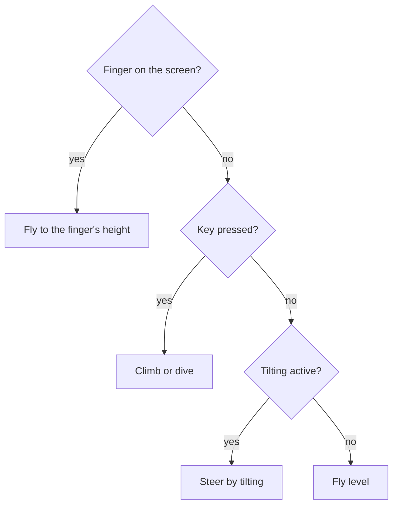
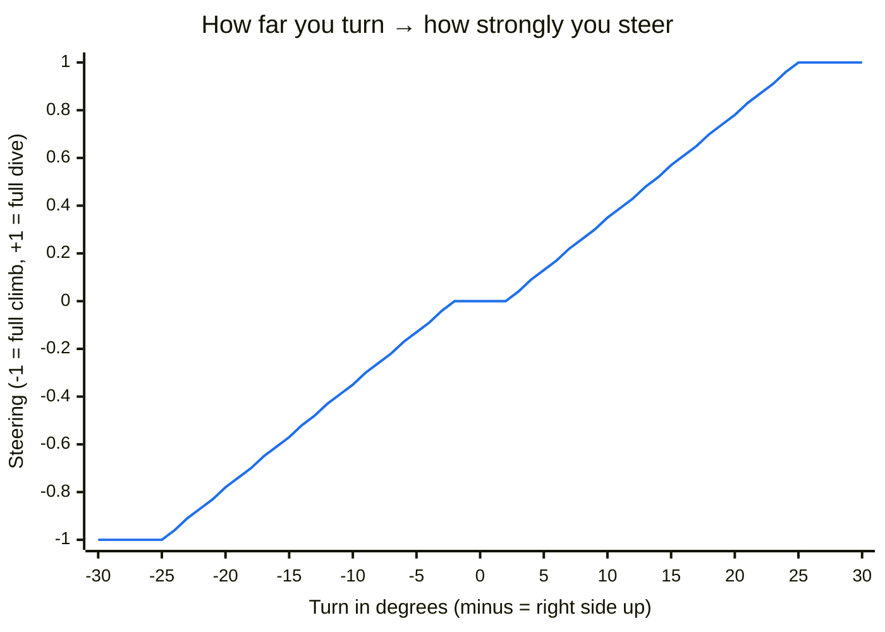

# Playing

## Start

1. Open <https://m0nstergamez.github.io/airplane-scoring/> on your phone.
2. Turn your phone **sideways** (landscape). Held upright, the game asks
   you to turn it.
3. Tap **"Tap to fly"**. On an iPhone, allow access to "Motion & Orientation"
   when asked. Next to the button is a **QR code**: friends scan it with
   their camera to fly too.

On a computer the start screen shows the keys and a **QR code**. Scan
it with your phone's camera to open the game there. To fly on the
computer, click **"Click to fly"** or press Enter.

## Controls

You have three ways to steer. If you use several at once, the finger
wins, then the keys, then tilting:

### Tilt (phone)

Hold your phone like a steering wheel. **The phone is the plane:**

- Turn the right side **up** → the plane climbs.
- Turn the right side **down** → the plane dives.
- Hold it still → the plane flies level.

The position you hold the phone in when you tap "Tap to fly" counts as
"level". Small wobbles are ignored; turning about a quarter of the way
to vertical (25°) is full speed:

Between −2° and +2° nothing happens (so a calm hand flies level), from
there steering grows evenly, and from 25° on it is at full strength.

### Finger (phone and computer)

Touch the screen and hold: the plane flies to the height of your finger.
On a computer, hold down the mouse button instead.

### Keys (computer)

| Key | Action |
|---|---|
| ↑ or W | climb |
| ↓ or S | dive |
| M | sound on or off |

## Weather and crashes

You fly along a coast: the landscape slides past behind your plane. In
rain it gets darker.

The weather changes while you fly. It starts dry. After a while rain
sets in, gets heavier and fades again. Heavy rain is a **thunderstorm**:
lightning lights up the sky, and the thunder follows. The further away
the lightning, the later and quieter the thunder.

If you touch the other plane, you **crash**: your plane smokes, falls
and ignores the controls for a moment (1.5 seconds). Then you fly again.

## Sound

| You hear | When |
|---|---|
| Engine | Always. Climbing sounds like full power, diving like idling. |
| Wind | Always. Louder in rain, in gusts and when you dive. |
| Rain | While it rains. Louder the harder it rains. |
| Thunder | A moment after each lightning. |
| Crash | When you touch the other plane. |

Browsers only allow sound after you have touched the page. On a phone
that is the tap on "Tap to fly"; on a computer the first click or key
press.

To switch the sound off or on, tap the **speaker button** at the top
right or press **M**. The game remembers your choice.

## Install on your phone

Add the game to your home screen. It then opens full screen like an app.

### iPhone (Safari)

1. Tap the share button (square with an arrow).
2. Choose **"Add to Home Screen"**.

### Android (Chrome)

1. Tap the menu **⋮** at the top right.
2. Choose **"Add to Home screen"** or **"Install app"**.

## Help

### Tilting does nothing

- Did you tap **"Tap to fly"**? Tilting only starts after that.
- iPhone: did you allow "Motion & Orientation"? If you said no, reload
  the page and tap "Tap to fly" again. If the question does not come
  back, close Safari completely and open the game again.
- Is the phone lying flat on the table? Tilting needs the phone held up.
- You can always steer with your finger instead.

### I hear nothing

- Is the speaker button at the top right crossed out? Tap it.
- iPhone: is the switch on the side set to silent? Silent mode also
  mutes the game. Switch it to ring.
- Turn up the volume with the buttons on the side of the phone.
- Computer: click into the game once. Sound only starts after that.

### The plane drifts by itself

You held the phone at a different angle when you started. Turn the
phone the other way round (landscape) and back, or reload the page:
your current position then becomes "level" again.

### The game shows "Turn your phone sideways"

The game is made for landscape. Turn your phone. If it does not rotate,
switch off the rotation lock.
